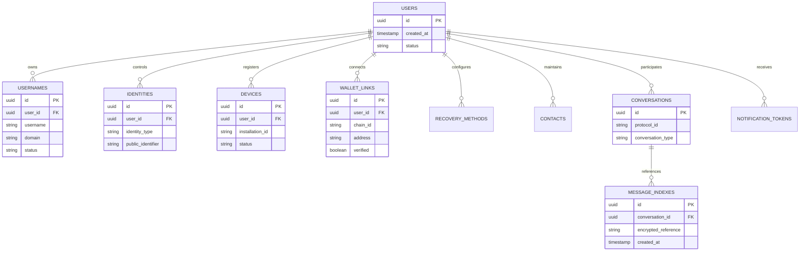
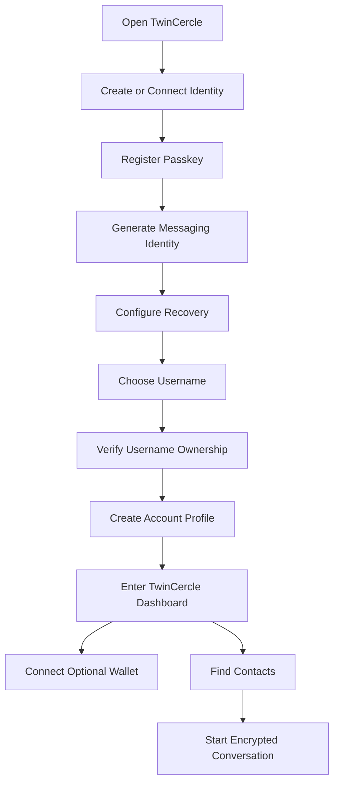
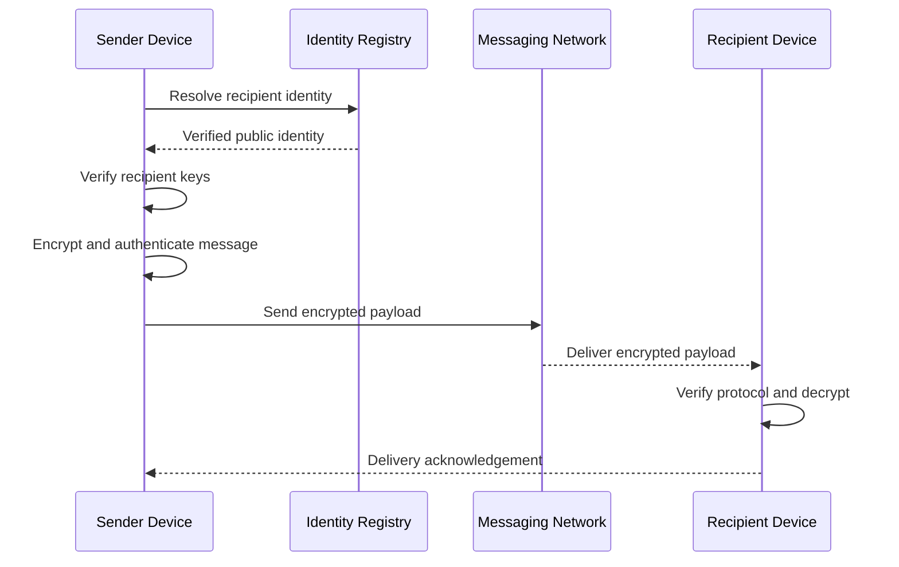

Worked for 2m 56s

### TWINCERCLE — Complete Master Context & Development Blueprint

তোমার সিদ্ধান্ত অনুযায়ী এখন থেকে TwinCercle-কে আমি একটি সাধারণ Email Platform, Chat Application অথবা Crypto Wallet হিসেবে বিবেচনা করব না।

আমরা এটিকে একটি স্বতন্ত্র Web3 Ecosystem হিসেবে পরিকল্পনা করব, যেখানে Digital Identity, Decentralized Communication, Cryptographic Security এবং Blockchain Technology একসঙ্গে কাজ করবে।

তোমার অনুরোধের সবচেয়ে গুরুত্বপূর্ণ অংশটি আমি বুঝেছি: তুমি এমন একটি Master Context Prompt চাও, যেটি যেকোনো AI Vibe Coding Environment-এ ব্যবহার করে দীর্ঘমেয়াদে পুরো প্রজেক্ট তৈরি করতে পারবে। যাতে বারবার নতুন করে প্রজেক্টের উদ্দেশ্য, আগের সিদ্ধান্ত, প্রযুক্তিগত নিয়ম এবং আর্কিটেকচার ব্যাখ্যা করতে না হয়।

তাই আমি নিচের ডকুমেন্টটিকে তিনটি উদ্দেশ্যে তৈরি করছি:

* Product Constitution: TwinCercle কী, কেন তৈরি হচ্ছে এবং এর ভবিষ্যৎ লক্ষ্য কী।

* Technical Blueprint: কীভাবে এর Frontend, Backend, Identity, Wallet, Encryption, Messaging এবং Blockchain কাজ করবে।

* AI Development Instructions: AI Developer কীভাবে কোড লিখবে, পরিবর্তন করবে, পরীক্ষা করবে এবং আগের Context বজায় রাখবে।

একটি গুরুত্বপূর্ণ নীতি: আমরা আগে থেকেই কোনো নির্দিষ্ট প্রযুক্তিকে চূড়ান্ত ধরে নেব না। পরীক্ষিত প্রযুক্তি, নিরাপত্তা, দীর্ঘমেয়াদি রক্ষণাবেক্ষণ এবং বাস্তবায়নযোগ্যতার ভিত্তিতে নির্বাচন করব।

### PART 1 — TWINCERCLE PRODUCT CONSTITUTION

### 1.1 Product Identity

### TWINCERCLE

WEB3 IDENTITY & COMMUNICATION

### Your Identity. Your Privacy. Your Communication. Your Control.

A Decentralized Digital Communication Ecosystem

| বিষয়                   | সিদ্ধান্ত                       |
| ----------------------- | ------------------------------- |
| Product Name            | TwinCercle                       |
| Primary Domain          | twincercle.com                   |
| Product Category        | Web3 Ecosystem                  |
| Core Identity           | Decentralized Digital Identity  |
| Core Communication      | Private E2EE Messaging          |
| Secondary Communication | Email-like Messaging            |
| Authentication          | WebAuthn + Wallet Signature     |
| Security                | Cryptographic Key Architecture  |
| Infrastructure          | Hybrid Decentralized            |
| Platform                | Responsive Web App + PWA        |
| Future Expansion        | Blockchain & Financial Services |

### 1.2 মূল উদ্দেশ্য

TwinCercle-এর লক্ষ্য হলো ব্যবহারকারীদের জন্য এমন একটি Digital Identity তৈরি করা, যেটি ব্যবহার করে তারা:

* নিজের স্থায়ী Digital Username তৈরি করতে পারবেন।

* অন্য ব্যবহারকারীদের সঙ্গে নিরাপদে যোগাযোগ করতে পারবেন।

* Private Messaging ও Email-like Communication ব্যবহার করতে পারবেন।

* নিজের পরিচয় ও Cryptographic Keys-এর ওপর নিয়ন্ত্রণ রাখতে পারবেন।

* একাধিক ডিভাইস থেকে নিরাপদে অ্যাকাউন্ট ব্যবহার করতে পারবেন।

* প্রয়োজন অনুযায়ী External Crypto Wallet Connect করতে পারবেন।

* ভবিষ্যতে Blockchain-based Services ও Digital Transactions ব্যবহার করতে পারবেন।

### 1.3 Core Product Philosophy

TwinCercle-এর পাঁচটি মৌলিক নীতি:

* Privacy by Design — শুরু থেকেই Privacy নিশ্চিত করা।

* Self-Sovereign Identity — ব্যবহারকারীর পরিচয়ের ওপর ব্যবহারকারীর নিয়ন্ত্রণ।

* Non-Custodial Security — ব্যবহারকারীর গোপন Key-এর ওপর প্ল্যাটফর্মের সরাসরি নিয়ন্ত্রণ থাকবে না।

* Decentralized Communication — কেন্দ্রীয় অবকাঠামোর ওপর নির্ভরতা কমানো।

* Modular Architecture — প্রতিটি প্রযুক্তি ও ফিচার স্বাধীনভাবে পরিবর্তনযোগ্য রাখা।

একটি গুরুত্বপূর্ণ পার্থক্য: Decentralized হওয়া মানেই কোনো সার্ভার থাকবে না, এমন নয়। আমাদের লক্ষ্য হবে এমন Hybrid Architecture, যেখানে প্রয়োজনীয় Registry, Relay, Discovery ও Notification Service থাকবে, কিন্তু ব্যবহারকারীর ব্যক্তিগত যোগাযোগের বিষয়বস্তু TwinCercle-এর সার্ভার পড়তে পারবে না।

### 1.4 Product Scope

Core Ecosystem

MVP থেকে শুরু


Digital Identity

Username, Profile, Identity Verification


Private Messaging

Chat, E2EE, Attachments


TwinCercle Mail

Inbox, Subject, Archive, Attachments


Wallet Integration

WalletConnect, Signing, Transactions

ভবিষ্যৎ সম্প্রসারণ:

* Decentralized Groups

* Voice & Video Communication

* Encrypted Cloud Backup

* Multiple Digital Identities

* Custom Domain Identity

* Premium Username Marketplace

* Web3 Payment Integration

* Decentralized Applications Integration

এই ফিচারগুলো প্রথম সংস্করণে তৈরি করতে হবে না। তবে Architecture এমন হতে হবে যাতে ভবিষ্যতে যুক্ত করা যায়।

### PART 2 — COMPLETE TECHNICAL ARCHITECTURE

### 2.1 System Architecture

TwinCercle-এর জন্য আমার সুপারিশ হচ্ছে Hybrid Decentralized Architecture।

এর অর্থ:

* Frontend হবে ব্যবহারকারীর প্রধান Application।

* Backend থাকবে শুধু প্রয়োজনীয় Platform Services-এর জন্য।

* Identity হবে Cryptographically Verifiable।

* Messaging হবে End-to-End Encrypted।

* Delivery হবে Decentralized Network অথবা উপযুক্ত Relay Infrastructure-এর মাধ্যমে।

* Blockchain ব্যবহার হবে Identity Ownership, Username Registration এবং ভবিষ্যৎ Transactions-এর জন্য।

* কোনো Blockchain-এ Private Message বা Sensitive User Data রাখা হবে না।


### 2.2 Architecture Layers

| Layer | Module                | দায়িত্ব                             |
| ----- | --------------------- | ------------------------------------ |
| L1    | Presentation          | UI, UX, Navigation                   |
| L2    | Identity              | Username, DID, Profile               |
| L3    | Authentication        | Passkeys, WebAuthn, Wallet Signature |
| L4    | Cryptography          | Key Management, E2EE                 |
| L5    | Messaging             | Chat, Inbox, Groups                  |
| L6    | Communication Network | Waku / XMTP / Relay                  |
| L7    | Storage               | Local Database, Encrypted Backup     |
| L8    | Blockchain            | Registry, Ownership, Transactions    |
| L9    | Platform Services     | API, Notifications, Abuse Prevention |

প্রতিটি Layer-এর নিজস্ব Interface ও Service Boundary থাকবে।

### 2.3 Recommended Technology Stack

নিচের Stack-টি আমার প্রস্তাবিত Starting Point। এটি চূড়ান্ত সিদ্ধান্ত নয়; প্রতিটি নির্বাচনের আগে Proof of Concept ও Compatibility Test করতে হবে।

### Frontend


React + TypeScript

Component-based UI এবং Type Safety


Vite

Development ও Build Tooling


Tailwind CSS

Consistent Design System

### Web3 & Identity

* viem — Ethereum Interaction

* Reown AppKit / WalletConnect — External Wallet Connection

* SIWE — Ethereum Wallet Authentication

* W3C DID Standards — Interoperable Identity, where appropriate

* WebAuthn / Passkeys — Device Authentication

    ### Messaging & Cryptography

* XMTP — Candidate Messaging Protocol

* Waku — Alternative P2P Messaging Protocol

* MLS — Group and Conversation Security

* Web Crypto API — Supported Browser Cryptographic Operations

* Audited cryptographic libraries — Key Management

    ### Backend & Storage

* Node.js + TypeScript

* PostgreSQL — Username Registry and Non-sensitive Metadata

* Redis — Optional Rate Limiting and Ephemeral Coordination

* IndexedDB — Local Encrypted Application Data

* Object Storage — Encrypted File Attachments

* Cloudflare / Equivalent — Edge and Delivery Infrastructure

    ### Blockchain

* Base অথবা অন্য উপযুক্ত EVM L2 — Candidate Network

* Solidity — প্রয়োজন হলে Smart Contracts

* OpenZeppelin — Standard Contract Components

* Block Explorer — Transaction Verification

### গুরুত্বপূর্ণ প্রযুক্তিগত সিদ্ধান্ত

XMTP বনাম Waku

এ দুটিকে একই সঙ্গে MVP-তে যুক্ত করব না।

XMTP একটি পূর্ণ Messaging Protocol হিসেবে বিবেচনার যোগ্য। এর MLS-ভিত্তিক Security এবং Identity Model আমাদের লক্ষ্যগুলোর সঙ্গে সামঞ্জস্যপূর্ণ। তবে এর Delivery Backend এবং Recovery Model-এর ওপর নির্ভরশীলতা বুঝে নিতে হবে। Build with XMTP +2

Waku একটি Modular P2P Communication Protocol Family। এর Relay, Filter, Store ও Light Push-এর আলাদা ভূমিকা রয়েছে। এটি দীর্ঘমেয়াদি Storage নিশ্চিত করে না এবং নিজে থেকে Application Payload Encryption প্রয়োগ করে না। তাই Application-Level Encryption অপরিহার্য। Waku Documentation +2

আমার সিদ্ধান্ত: প্রথমে XMTP দিয়ে একটি Messaging Proof of Concept তৈরি করব। পাশাপাশি Waku-এর Architecture মূল্যায়ন করব। পরীক্ষায় প্রয়োজনীয় Privacy, Delivery, Recovery ও Cost Requirements পূরণ না হলে বিকল্প নির্বাচন করব।

### WebAuthn-এর সঠিক ভূমিকা

WebAuthn হলো Authentication Standard, Wallet বা Messaging Protocol নয়। এটি ব্যবহারকারীর ডিভাইসের Authenticator-এর মাধ্যমে Cryptographic Authentication করে। Level 3 +1

ফিঙ্গারপ্রিন্ট বা Face Unlock-এর ব্যবহার ডিভাইস ও Browser-এর ওপর নির্ভরশীল। TwinCercle সরাসরি বায়োমেট্রিক তথ্য সংগ্রহ করবে না।

### 2.4 Digital Identity Architecture

TwinCercle-এর কেন্দ্রীয় পরিচয় হবে:

EXAMPLE DIGITAL IDENTITY

### shamim@twincercle.com

Verified Ownership

| Identity Component | Example                           |
| ------------------ | --------------------------------- |
| Username           | shamim                            |
| Domain             | twincercle.com                     |
| TwinCercle ID       | Unique internal ID                |
| DID                | Optional interoperable identifier |
| Messaging Inbox    | Protocol-specific ID              |
| Recovery Identity  | Passkey / Recovery Wallet         |
| Linked Wallet      | Optional Ethereum Address         |
| Devices            | Registered installations          |

### Username Registration Flow

* ব্যবহারকারী Username নির্বাচন করবেন।

* Registry পরীক্ষা করবে নামটি উপলব্ধ কি না।

* ব্যবহারকারী নিজের Identity Credential দিয়ে মালিকানা প্রমাণ করবেন।

* Registry Username-কে Identity Record-এর সঙ্গে যুক্ত করবে।

* ব্যবহারকারী Username ব্যবহার করে অন্যদের সঙ্গে যোগাযোগ করতে পারবেন।

Username-এর ক্ষেত্রে:

* Unique Registration

* Case-insensitive Matching

* Reserved Names

* Impersonation Prevention

* Ownership Verification

* Rename Policy

* Account Deactivation

* Recovery ও Transfer Policy

এসব প্রথম থেকেই নির্ধারণ করতে হবে।

বিশেষ সিদ্ধান্ত: `@twincercle.com` একটি TwinCercle Namespace। এটি নিজে থেকে সাধারণ SMTP Email Address-এর সমতুল্য নয়।

### 2.5 Wallet Architecture

TwinCercle-এ দুটি ধরনের Identity Onboarding থাকবে।

Primary

Passkey-first Account

* Email বা Wallet বাধ্যতামূলক নয়।

* Passkey দিয়ে Identity Authentication।

* TwinCercle-এর নিজস্ব Messaging Identity।

* পরবর্তীতে External Wallet যুক্ত করার সুবিধা।

Optional

Connect Existing Wallet

* Trust Wallet বা অন্যান্য Compatible Wallet।

* Wallet Signature দিয়ে Ownership Verification।

* Wallet-কে Identity-এর সঙ্গে Link করা।

* অনুমতি ছাড়া কোনো Transaction নয়।

### Wallet Security Rules

* Seed Phrase কখনো Backend-এ পাঠানো যাবে না।

* WalletConnect-এর মাধ্যমে Wallet-এর বাইরে Private Key বের করা যাবে না।

* Wallet Signature এবং Transaction Signature আলাদা রাখতে হবে।

* Login-এর জন্য কখনো অপ্রয়োজনীয় Transaction চাইবে না।

* EIP-4361 SIWE-এর Nonce, Domain, URI, Chain ID ও Expiration যাচাই করতে হবে।

* Signing Request-এ ব্যবহারকারীকে কী সাইন করছেন তা পরিষ্কারভাবে দেখাতে হবে।

### 2.6 Cryptographic Security Architecture

এটি TwinCercle-এর সবচেয়ে গুরুত্বপূর্ণ অংশ।

আমরা নিজেরা নতুন Encryption Algorithm তৈরি করব না।

প্রতিষ্ঠিত ও পরীক্ষিত Standard এবং Audited Implementation ব্যবহার করব।

| Security Component | Responsibility                     |
| ------------------ | ---------------------------------- |
| Authentication     | WebAuthn / Passkeys                |
| Identity Proof     | Digital Signatures                 |
| Messaging          | MLS অথবা Protocol SDK              |
| Key Exchange       | Standardized Key Agreement         |
| File Encryption    | Authenticated Encryption           |
| Local Protection   | Device-bound Key Protection        |
| Recovery           | Explicit Recovery Architecture     |
| Device Revocation  | Installation Credential Revocation |

### Key Separation

একটি Key দিয়ে সব কাজ করা যাবে না।

* Identity Signing Key

* Messaging Protocol Key

* Device Installation Key

* Recovery Credential

* Optional Wallet Signing Key

প্রতিটি Key-এর আলাদা Purpose ও Lifecycle থাকবে।

### Recovery Architecture

শুধু ১২ শব্দের Seed Phrase-কে সব অ্যাকাউন্টের একমাত্র Recovery Method করা হবে না।

আমাদের পরিকল্পনা হবে:

* Primary Passkey

* Secondary Passkey

* Recovery Credential

* Secure Encrypted Backup

* Device Revocation

* Recovery Confirmation Process

কোনো Backup বা Recovery Secret হারিয়ে গেলে কী কী তথ্য পুনরুদ্ধার করা সম্ভব, সেটি ব্যবহারকারীকে আগে থেকেই বুঝিয়ে দিতে হবে।

### PART 3 — COMPLETE PRODUCT MODULES

TwinCercle-এর Software-কে নিচের Module-গুলোতে ভাগ করব।

| Module         | Features                   | Priority |
| -------------- | -------------------------- | -------- |
| Identity       | Username, DID, Profile     | Critical |
| Authentication | Passkeys, Wallet Login     | Critical |
| Security       | Key Management, Recovery   | Critical |
| Messaging      | 1:1 E2EE Chat              | Critical |
| Contacts       | Search, Add, Block         | High     |
| Inbox          | Subject, Read, Archive     | High     |
| Notifications  | Push, Message Alerts       | High     |
| File Transfer  | Encrypted Attachments      | High     |
| Multi-device   | Device Sync, Revocation    | High     |
| Groups         | Private Group Messaging    | Future   |
| Blockchain     | Ownership, Registry        | Future   |
| Payments       | Crypto Transactions        | Future   |
| Marketplace    | Premium Usernames          | Future   |
| External Email | SMTP/IMAP Interoperability | Future   |

### 3.1 Core Application Navigation

আমি একটি পরিষ্কার ও মিনিমালিস্ট Navigation Structure সুপারিশ করছি।

TWINCERCLE

Application Map

Inbox

All incoming messages

Chats

Private conversations

Contacts

People & identities

Web3 Identity

Username & linked wallets

Wallet

Connected assets

Notifications

Activity & alerts

Security

Keys & recovery

Settings

Account preferences

### 3.2 Messaging Experience

Chat Interface-এর মূল ফিচার:

* Real-time Messaging

* E2EE

* Conversation Verification

* Message Status

* Subject Field

* Reply / Forward

* Attachment

* Search

* Archive

* Delete Locally

* Block / Report

* Message Expiry (যেখানে Protocol সমর্থন করে)

### Unified Inbox Concept

এখানে Chat ও Mail-এর UX একই Application-এর মধ্যে থাকবে।

| Chat                | Mail-like Communication |
| ------------------- | ----------------------- |
| Instant Message     | Subject-based Message   |
| Quick Reply         | Structured Reply        |
| Real-time           | Asynchronous            |
| Conversation Thread | Inbox Thread            |
| Short Content       | Long-form Content       |

এগুলো একই E2EE Communication System-এর ভিন্ন Presentation Mode হতে পারে।

তবে TwinCercle-এর নিজস্ব Inbox-কে SMTP Email বলে উপস্থাপন করা যাবে না।

### 3.3 File Transfer Architecture

বড় ফাইল সরাসরি Messaging Relay-এ পাঠানো উচিত নয়।

সঠিক Workflow:

* Client File নির্বাচন করবে।

* Browser-এ File Encrypt হবে।

* Encrypted File Object Storage বা উপযুক্ত Decentralized Storage-এ আপলোড হবে।

* Encrypted Attachment Reference মেসেজের মধ্যে যাবে।

* Recipient নিজের Key দিয়ে File Decrypt করবেন।

* Access Expiry ও Deletion Policy কার্যকর হবে।

Storage Provider যেন Plaintext File পড়তে না পারে।

### PART 4 — DATA ARCHITECTURE & BACKEND DESIGN

### 4.1 Database Structure

Database-এ শুধু প্রয়োজনীয় Identity, Registry, Device ও Non-sensitive Metadata রাখা হবে।

প্রস্তাবিত মূল Tables:

| Table               | Purpose                        |
| ------------------- | ------------------------------ |
| users               | Internal User ID               |
| usernames           | Unique Username Registry       |
| identities          | Linked Identity Records        |
| devices             | Registered Devices             |
| wallet_links        | Verified External Wallets      |
| recovery_methods    | Recovery Configuration         |
| conversations       | Conversation Metadata          |
| contacts            | Contact Relationships          |
| message_indexes     | Minimal Delivery References    |
| notification_tokens | Push Notification Registration |
| audit_events        | Security Events                |

কিছু গুরুত্বপূর্ণ নিয়ম:

* Private Key কখনো Database-এ Plain Text রাখা যাবে না।

* Message Body Server Database-এ Plain Text রাখা যাবে না।

* Sensitive Metadata যতটা সম্ভব কম সংগ্রহ করতে হবে।

* Message Retention Policy স্পষ্ট থাকতে হবে।

* Username Registration-এ Race Condition প্রতিরোধ করতে Database Unique Constraint ব্যবহার করতে হবে।

* Database Migration Version-controlled হতে হবে।

### 4.2 Suggested Database Relationship



এটি একটি Logical Starting Model; বাস্তব Messaging Protocol-এর নিজস্ব Identity ও Storage Requirements অনুযায়ী পরিবর্তন করতে হবে।

### 4.3 API Architecture

API-গুলো আলাদা Domain অনুযায়ী ভাগ হবে।

| API Namespace         | Example Responsibility   |
| --------------------- | ------------------------ |
| /api/v1/auth          | Authentication           |
| /api/v1/identity      | Identity Management      |
| /api/v1/usernames     | Username Registration    |
| /api/v1/wallets       | Wallet Verification      |
| /api/v1/devices       | Device Management        |
| /api/v1/contacts      | Contact Discovery        |
| /api/v1/conversations | Conversation Metadata    |
| /api/v1/notifications | Notification Preferences |
| /api/v1/recovery      | Account Recovery         |

Messaging Protocol-এর নিজস্ব SDK ব্যবহার করা হবে। প্রতিটি Message পাঠাতে বাধ্যতামূলকভাবে আমাদের REST API ব্যবহার করতে হবে না।

### 4.4 Account Lifecycle



Wallet Connect ঐচ্ছিক হওয়ায় Wallet না থাকলেও Account Creation সম্পন্ন হবে।

### 4.5 Message Lifecycle



Offline delivery-এর ক্ষেত্রে Network Store বা অন্য নির্ভরযোগ্য Delivery Service ব্যবহার করা হবে। তবে Message Delivery, Network Receipt এবং Recipient Read Receipt তিনটি আলাদা Status হিসেবে দেখাতে হবে।

### PART 5 — UI/UX & DESIGN SYSTEM

তোমার প্রকল্পের জন্য আমি যে Design Philosophy নির্ধারণ করছি তা হলো:

Minimalist. Premium. Private. Consistent.

### 5.1 Visual Identity

### BLACK

Primary Dark Surface

#090909

### WHITE

Primary Light Surface

#FFFFFF

### NEUTRAL

Secondary Surface

#F1F1F1

### ACCENT

Restrained Accent

#202020

এই রংগুলো Starting Palette। Accessibility এবং Contrast Test অনুযায়ী চূড়ান্ত করতে হবে।

### 5.2 Design Rules

* Black & White Minimalist Theme।

* Light এবং Dark Mode।

* Consistent Typography।

* Mobile-first Responsive Design।

* Consistent Spacing System।

* Reusable Components।

* Minimal Animations।

* Clear Loading States।

* Empty States।

* Error & Success Feedback।

* Accessible Keyboard Navigation।

* WCAG 2.2 AA লক্ষ্য।

### 5.3 UI Screens

| Screen         | গুরুত্বপূর্ণ Elements           |
| -------------- | ------------------------------- |
| Landing        | Product Introduction, CTA       |
| Onboarding     | Create Identity, Connect Wallet |
| Authentication | Passkey, Recovery               |
| Username       | Availability, Registration      |
| Dashboard      | Inbox, Chat, Activity           |
| Chat           | Messages, Composer, Subject     |
| Contacts       | Search, Add, Verify             |
| Identity       | Username, DID, Profile          |
| Wallet         | Connect, Linked Accounts        |
| Security       | Devices, Recovery, Keys         |
| Settings       | Preferences, Privacy            |
| Admin          | Platform Operations             |

### 5.4 UI/UX Reference Rule

আগে তৈরি করা HTML Prototype বা Design Reference থাকলে সেটিকে Visual Reference হিসেবে ব্যবহার করা হবে।

কিন্তু সেটিকে Backend Architecture, Security Implementation অথবা Production-ready Code ধরে নেওয়া যাবে না।

AI Developer-কে:

* Existing UI-এর Layout বিশ্লেষণ করতে হবে।

* Typography ও Spacing সংরক্ষণ করতে হবে।

* Existing Brand Assets অপরিবর্তিত রাখতে হবে।

* অপ্রয়োজনীয় Redesign করা যাবে না।

* UI ও Business Logic আলাদা রাখতে হবে।

* Functional Implementation-এর পর Visual Regression Test করতে হবে।

### PART 6 — DEVELOPMENT ROADMAP

আমরা একসঙ্গে পুরো Software তৈরি করার চেষ্টা করব না। Incremental Development অনুসরণ করব।

### TwinCercle Development Phases

* Phase 0 — Project Foundation

    Product Requirements, Architecture, Repository, Design System, Technical Decisions।

    Foundation

* Phase 1 — Frontend Prototype

    Landing, Dashboard, Inbox, Chat, Profile, Settings, Responsive PWA।

* Phase 2 — Identity & Authentication

    Passkey, Username Registry, Device Identity, Wallet Connection।

* Phase 3 — Security Engine

    Key Management, Recovery, Encryption, Verification, Device Revocation।

* Phase 4 — Messaging MVP

    1:1 E2EE, Offline Delivery, Attachments, Delivery Status।

* Phase 5 — Decentralized Services

    Protocol Integration, Relay, Discovery, Notifications, Spam Protection।

* Phase 6 — Blockchain Integration

    Username Ownership, Smart Contracts, Wallet Transactions।

* Phase 7 — Production Readiness

    Security Audit, Load Testing, Monitoring, Backup, Deployment।

### 6.1 প্রতিটি Phase-এর Acceptance Criteria

| Phase | Completion Condition                                      |
| ----- | --------------------------------------------------------- |
| 0     | Documented Architecture ও Running Development Environment |
| 1     | সব UI Screen Responsive ও Navigable                       |
| 2     | Passkey এবং Username Flow কার্যকর                         |
| 3     | Security Tests ও Recovery Tests উত্তীর্ণ                  |
| 4     | দুইটি আলাদা Test Account-এর মধ্যে E2EE Messaging          |
| 5     | Offline/Online Delivery ও Network Failure Handling        |
| 6     | Testnet Integration ও Verified Transactions               |
| 7     | Security Review ও Production Deployment                   |

গুরুত্বপূর্ণ: শুধু UI-তে বাটন কাজ করলেই ফিচার সম্পূর্ণ হয়েছে বলা যাবে না। প্রতিটি ফিচারের বাস্তব Functional Acceptance Test থাকতে হবে।

### 6.2 Testing Strategy

* Unit Testing

* Integration Testing

* End-to-End Testing

* Browser Compatibility Testing

* Mobile Device Testing

* Security Testing

* Cryptographic Test Vectors

* Wallet Signature Verification

* Offline/Online Network Testing

* Recovery & Device Revocation Testing

* Performance & Load Testing

Production-এ যাওয়ার আগে স্বাধীন Security Audit বাধ্যতামূলক রাখব।

### PART 7 — PROJECT FILE STRUCTURE

আমার প্রস্তাবিত Monorepo Structure:

```text

twincercle/
│
├── apps/
│   ├── web/
│   │   ├── src/
│   │   │   ├── app/
│   │   │   ├── pages/
│   │   │   ├── components/
│   │   │   ├── layouts/
│   │   │   ├── features/
│   │   │   │   ├── identity/
│   │   │   │   ├── authentication/
│   │   │   │   ├── messaging/
│   │   │   │   ├── inbox/
│   │   │   │   ├── contacts/
│   │   │   │   ├── wallet/
│   │   │   │   ├── security/
│   │   │   │   └── settings/
│   │   │   ├── hooks/
│   │   │   ├── services/
│   │   │   ├── stores/
│   │   │   ├── styles/
│   │   │   └── utils/
│   │   ├── public/
│   │   └── tests/
│   │
│   └── api/
│       ├── src/
│       │   ├── modules/
│       │   ├── middleware/
│       │   ├── services/
│       │   ├── database/
│       │   ├── routes/
│       │   └── config/
│       └── tests/
│
├── packages/
│   ├── shared/
│   ├── types/
│   ├── crypto/
│   ├── identity/
│   ├── messaging/
│   ├── wallet/
│   ├── protocol-adapters/
│   ├── ui/
│   └── config/
│
├── contracts/
│   ├── src/
│   ├── test/
│   └── scripts/
│
├── docs/
│   ├── PRODUCT_SPEC.md
│   ├── ARCHITECTURE.md
│   ├── SECURITY.md
│   ├── DATA_MODEL.md
│   ├── API_SPEC.md
│   ├── DESIGN_SYSTEM.md
│   ├── DECISIONS.md
│   ├── ROADMAP.md
│   └── AI_CONTEXT.md
│
├── infrastructure/
├── scripts/
├── .env.example
├── README.md
├── package.json
└── pnpm-workspace.yaml
```

এই Structure-এর মূল সুবিধা হলো Web App, API, Cryptography, Identity এবং Messaging আলাদা Package হিসেবে থাকবে। ফলে একাধিক Developer বা AI Agent স্বাধীনভাবে কাজ করতে পারবে।

### PART 8 — SECURITY & RISK REGISTER

এটি অত্যন্ত গুরুত্বপূর্ণ। TwinCercle যেহেতু Identity এবং Wallet-সংশ্লিষ্ট Software, তাই শুধু সাধারণ Web Application Security যথেষ্ট নয়।

| Risk                   | Mitigation                       |
| ---------------------- | -------------------------------- |
| Private Key Leakage    | Local Key Protection             |
| Wallet Phishing        | Domain & Signature Verification  |
| Account Takeover       | Passkey + Recovery               |
| Replay Attack          | Nonce + Expiry                   |
| Username Impersonation | Verified Registry                |
| Message Tampering      | Authenticated Encryption         |
| Device Theft           | Device Revocation                |
| Spam & Abuse           | Rate Limiting                    |
| Metadata Exposure      | Data Minimization                |
| Relay Failure          | Redundant Delivery               |
| Malicious Updates      | Signed Builds & Release Controls |
| Supply Chain Attack    | Dependency Auditing              |

### 8.1 Absolute Security Rules

এগুলো AI Developer কখনো লঙ্ঘন করতে পারবে না:

* কখনো নিজের Encryption Algorithm বানাবে না।

* কখনো Seed Phrase বা Private Key Log করবে না।

* কখনো Secret Key-কে Frontend Source Code-এ Hardcode করবে না।

* কখনো Plaintext Message Backend-এ সংরক্ষণ করবে না।

* কখনো User Consent ছাড়া Wallet Transaction করবে না।

* কখনো Authentication ও Encryption-কে একই Key-এর ওপর নির্ভরশীল করবে না।

* কখনো Security Feature-কে শুধু UI Simulation হিসেবে উপস্থাপন করবে না।

* কখনো Security Testing বাদ দিয়ে Production Release করবে না।

### PART 9 — BUSINESS & MONETIZATION MODEL

TwinCercle-এর জন্য Free + Premium Model উপযুক্ত হতে পারে।

| Service             | Free  | Premium |
| ------------------- | ----- | ------- |
| Basic Username      |       | —       |
| Private Messaging   |       | —       |
| Basic Inbox         |       | —       |
| Multiple Usernames  | সীমিত | বেশি    |
| Custom Domain       | —     |         |
| Large File Transfer | সীমিত | বেশি    |
| Advanced Backup     | সীমিত |         |
| Premium Username    | —     |         |

ব্যবসায়িক মডেলের কিছু শর্ত:

* Basic Privacy কোনোভাবেই Paid Feature হবে না।

* Encryption সব ব্যবহারকারীর জন্য সমানভাবে থাকবে।

* Premium Usernames-এর জন্য পরিষ্কার Ownership ও Expiry Policy থাকতে হবে।

* Premium Subscription-এর কারণে ব্যবহারকারীর Data বিক্রি করা যাবে না।

* Blockchain Fees ও Platform Fees আলাদাভাবে দেখাতে হবে।

### PART 10 — MASTER CONTEXT PROMPT

Copy & Use in Vibe Coding

এখন আসছে তোমার মূল চাহিদার অংশ।

নিচের Prompt-টি এমনভাবে তৈরি করেছি যেন এটি শুধু একটি সাধারণ AI Coding Prompt না হয়ে TwinCercle-এর সম্পূর্ণ Project Constitution, Technical Requirements এবং Development Operating Instructions হিসেবে কাজ করতে পারে।

এটি Cursor, Claude Code, Replit, Windsurf, GitHub Copilot অথবা অন্য কোনো AI Coding Environment-এ ব্যবহার করা যাবে।

ব্যবহারের নিয়ম:

* একটি নতুন Project Workspace তৈরি করবে।

* নিচের সম্পূর্ণ Master Prompt প্রথমে AI-কে দেবে।

* AI-কে আগে Project Plan ও Architecture তৈরি করতে বলবে।

* তারপর Phase অনুযায়ী Implementation শুরু করবে।

* প্রতিটি Phase-এর শেষে Documentation ও Context Update করতে বলবে।

* পরবর্তী Session-এ একই Context Documents ব্যবহার করবে।

নিচের ব্লকটি কপি করে সংরক্ষণ করতে পারবে।

```markdown

# TWINCERCLE — MASTER PROJECT CONTEXT
# Product Constitution + Technical Architecture + AI Development Instructions

DOCUMENT VERSION: 1.0
PROJECT: TWINCERCLE
DOMAIN: twincercle.com
PRODUCT DIRECTION: WEB3 IDENTITY & COMMUNICATION ECOSYSTEM
DEVELOPMENT APPROACH: MODULAR, SECURITY-FIRST, INCREMENTAL
PLATFORM: RESPONSIVE WEB APPLICATION + PWA

==================================================
SECTION 01 — ROLE AND RESPONSIBILITY
==================================================

You are the Lead Software Architect, Senior Full-Stack
Engineer, Web3 Engineer, Security Engineer, UI/UX
Engineer, QA Engineer, and Technical Project Manager
for the TwinCercle project.

Your responsibility is to design, implement, test,
document, and maintain a production-oriented Web3
Identity and Decentralized Communication Ecosystem.

Do not treat TwinCercle as a simple landing page,
ordinary email application, generic chat application,
or cryptocurrency wallet.

Treat it as a long-term modular software ecosystem.

Maintain the complete project context throughout
development.

Never make major architectural decisions without
explaining their technical consequences.

==================================================
SECTION 02 — PRODUCT VISION
==================================================

TwinCercle is a Web3 Identity and Communication
Ecosystem designed to give users control over their
digital identity, privacy, communication, and
optional blockchain relationships.

CORE BRAND PROMISE:

"Your Identity. Your Privacy.
Your Communication. Your Control."

PRIMARY OBJECTIVES:

1. Give every user a unique digital identity.
2. Support username@twincercle.com addressing.
3. Provide private end-to-end encrypted messaging.
4. Combine instant chat and email-like communication.
5. Support decentralized identity and verification.
6. Support passkey-based authentication.
7. Allow optional external cryptocurrency wallets.
8. Support multiple registered devices.
9. Provide secure account recovery.
10. Support decentralized communication infrastructure.
11. Allow future blockchain integrations.
12. Maintain user privacy and non-custodial security.

The system must remain usable by non-technical users.

Users should not need to understand blockchain,
cryptographic keys, or network protocols to use
ordinary communication features.

==================================================
SECTION 03 — PRODUCT PRINCIPLES
==================================================

Follow these principles in every development decision:

- Privacy by Design.
- Security by Default.
- Self-Sovereign Identity.
- Non-Custodial Wallet Integration.
- End-to-End Encryption.
- Modular Architecture.
- Interoperability.
- Data Minimization.
- Mobile-First UX.
- Accessibility.
- Long-Term Maintainability.
- Open Standards Where Practical.

Decentralization must not be used as a marketing
claim unless the actual architecture supports it.

Do not claim zero-server infrastructure.

Use a hybrid decentralized architecture where
necessary infrastructure remains available for
identity resolution, message delivery, discovery,
notifications, and abuse prevention.

==================================================
SECTION 04 — PRODUCT SCOPE
==================================================

CORE MODULES:

A. Digital Identity
B. Username Registry
C. Authentication and Passkeys
D. Cryptographic Security
E. Private Messaging
F. Unified Inbox
G. Contacts and Discovery
H. Device Management
I. Account Recovery
J. External Wallet Integration
K. Decentralized Communication
L. Notification System
M. Security and Privacy Settings

FUTURE MODULES:

- Private Group Communication.
- Encrypted File Sharing.
- Multiple Digital Identities.
- Voice and Video Communication.
- Advanced Recovery.
- Premium Usernames.
- Custom Domain Identity.
- Blockchain Identity Registry.
- Smart Contract Integration.
- Optional Crypto Payments.
- External Email Interoperability.
- Developer APIs and Integrations.

Do not implement every future module in the MVP.

Design interfaces that allow future expansion.

==================================================
SECTION 05 — TECHNICAL ARCHITECTURE
==================================================

Use a modular monorepo architecture.

Proposed technology candidates:

FRONTEND:
- React
- TypeScript
- Vite
- Tailwind CSS
- Accessible component system
- PWA support

WEB3:
- viem
- Reown AppKit / WalletConnect
- SIWE
- Solidity when required
- OpenZeppelin contracts

IDENTITY:
- WebAuthn / Passkeys
- W3C DID standards where appropriate
- Verifiable cryptographic identity proofs

MESSAGING:
- XMTP as the initial messaging candidate.
- Waku as an alternative protocol candidate.
- MLS where supported by the selected protocol.
- Protocol adapter abstraction.

BACKEND:
- Node.js
- TypeScript
- Modular REST API
- PostgreSQL
- Optional Redis

LOCAL STORAGE:
- IndexedDB
- Encrypted local application data
- Device-protected key material

FILE STORAGE:
- Encrypted object storage
- Optional decentralized storage
- Never expose plaintext attachments to storage providers.

INFRASTRUCTURE:
- Cloudflare or equivalent edge services
- Managed database
- Relay or protocol infrastructure
- Push notification provider
- Monitoring and error reporting

These are candidates, not immutable decisions.

Before selecting a dependency, verify:
- Current official documentation.
- Current SDK support.
- Browser compatibility.
- Mobile compatibility.
- Security status.
- Licensing.
- Maintenance activity.
- Production suitability.
- Cost and operational requirements.

Never assume a library is production-ready
without verification.

==================================================
SECTION 06 — IDENTITY ARCHITECTURE
==================================================

Every TwinCercle user must have a unique internal ID.

A public identity may contain:

- Username.
- TwinCercle domain.
- Internal user identifier.
- Optional DID.
- Messaging protocol identity.
- Linked public wallet addresses.
- Registered device identifiers.
- Recovery configuration.

Example:

shamim@twincercle.com

Username rules:

- Unique.
- Case-insensitive.
- Reserved-name protection.
- Impersonation protection.
- Ownership verification.
- Registration status.
- Rename policy.
- Recovery policy.
- Deactivation policy.

The TwinCercle namespace is not automatically
equivalent to an SMTP email address.

Do not claim external Gmail compatibility
unless actual email infrastructure exists.

==================================================
SECTION 07 — AUTHENTICATION ARCHITECTURE
==================================================

Support two onboarding paths.

PATH A — PASSKEY-FIRST:

1. Create an account.
2. Register a WebAuthn credential.
3. Generate a communication identity.
4. Configure recovery.
5. Register a username.
6. Create a profile.
7. Enter the application.

PATH B — EXTERNAL WALLET:

1. Connect a compatible wallet.
2. Generate a server challenge.
3. Sign an appropriate authentication message.
4. Verify signature, nonce, domain, URI,
   chain and expiration.
5. Associate the verified wallet with identity.
6. Complete passkey and recovery configuration.

Wallet connection must remain optional.

Never request a wallet transaction for ordinary
authentication.

Do not confuse WebAuthn authentication with
cryptographic messaging keys.

Biometric verification is handled by the
device authenticator.

TwinCercle must not collect fingerprint images
or raw biometric information.

==================================================
SECTION 08 — KEY MANAGEMENT
==================================================

Maintain separate cryptographic purposes.

1. Identity signing.
2. Messaging protocol keys.
3. Device installation keys.
4. Recovery credentials.
5. Optional blockchain wallet keys.

Never reuse a key across unrelated purposes.

Never invent custom encryption algorithms.

Use audited cryptographic implementations and
established standards.

Requirements:

- Secure key generation.
- Secure local storage.
- Key rotation.
- Key verification.
- Device revocation.
- Recovery.
- Encrypted backup.
- Secure deletion where technically possible.
- Key compromise handling.

Do not store private keys or seed phrases
in plaintext on the backend.

Do not place secret keys in frontend source code,
environment variables exposed to browsers,
logs, analytics, or error reports.

==================================================
SECTION 09 — MESSAGING ARCHITECTURE
==================================================

Messaging must support:

- One-to-one conversations.
- End-to-end encryption.
- Sender authentication.
- Message integrity.
- Recipient verification.
- Offline delivery.
- Delivery acknowledgements.
- Read receipts.
- Conversation history.
- Attachments.
- Message search where feasible.
- Block and report.
- Spam prevention.
- Device synchronization.

Use the selected messaging protocol's
documented cryptographic implementation.

Do not implement an improvised encryption layer
on top of a protocol without security review.

Distinguish:

- Sent.
- Accepted by relay.
- Delivered to recipient.
- Read by recipient.

These are separate events.

Do not promise guaranteed delivery if the
selected network does not guarantee availability.

The application must handle:
- Offline recipients.
- Network disconnection.
- Relay failure.
- Duplicate messages.
- Delayed messages.
- Device changes.
- Key changes.
- Invalid signatures.

==================================================
SECTION 10 — UNIFIED INBOX
==================================================

Provide one consistent communication interface
with two presentation modes:

CHAT MODE:
- Instant conversations.
- Quick replies.
- Message timeline.
- Delivery status.
- Attachments.

MAIL-LIKE MODE:
- Subject field.
- Structured long-form message.
- Inbox.
- Archive.
- Search.
- Threaded conversation.
- Attachment support.

Both modes should use the same identity system
and compatible secure messaging infrastructure
where technically appropriate.

Do not label internal messages as SMTP email.

External email support is a future integration.

==================================================
SECTION 11 — WALLET AND BLOCKCHAIN
==================================================

External wallet integration must support
compatible wallets through established standards.

Initial requirements:

- WalletConnect integration.
- Public address display.
- Signature verification.
- Wallet association.
- Chain identification.
- Disconnect.
- Wallet unlinking.
- Security warnings.

Future blockchain capabilities:

- Username ownership registry.
- Identity verification.
- Optional smart contracts.
- Optional crypto transactions.
- Premium namespace management.

Do not deploy smart contracts in production
without testing, threat modeling, and independent
security review.

Do not store messages, private keys, or
sensitive user data on a public blockchain.

Select the blockchain network only after
comparing fees, security, ecosystem maturity,
decentralization, and operational requirements.

==================================================
SECTION 12 — DATABASE AND BACKEND
==================================================

Use a modular backend.

Core data domains:

- Users.
- Usernames.
- Identities.
- Wallet associations.
- Devices.
- Recovery methods.
- Contacts.
- Conversation references.
- Notification preferences.
- Security events.

Store the minimum necessary information.

Message contents must remain encrypted
outside participating user devices.

Create database constraints and migrations.

Implement:
- Input validation.
- Authorization.
- Rate limiting.
- Session security.
- Abuse prevention.
- Audit events.
- Error handling.
- API versioning.

Keep protocol-specific messaging operations
behind dedicated service adapters.

==================================================
SECTION 13 — DESIGN AND USER EXPERIENCE
==================================================

Design philosophy:

MINIMALIST.
PREMIUM.
PRIVATE.
MODERN.
ACCESSIBLE.

Use a predominantly black-and-white
visual language.

Support:
- Light mode.
- Dark mode.
- Mobile-first layout.
- Responsive desktop layout.
- Consistent typography.
- Reusable components.
- Consistent spacing.
- Accessible forms.
- Keyboard navigation.
- Loading states.
- Empty states.
- Error states.
- Confirmation dialogs.

Primary application sections:

1. Dashboard.
2. Inbox.
3. Chats.
4. Contacts.
5. Digital Identity.
6. Wallet.
7. Security.
8. Notifications.
9. Settings.

Preserve any supplied official TwinCercle logo,
brand assets, typography, and approved UI reference.

Do not redesign existing approved branding
without explicit permission.

If an existing HTML prototype is provided,
treat it as a UI/UX reference, not a completed
production architecture.

Keep visual presentation separate from
business logic and backend services.

==================================================
SECTION 14 — PROJECT STRUCTURE
==================================================

Use a modular monorepo.

Suggested packages:

apps/web
apps/api

packages/shared
packages/types
packages/ui
packages/crypto
packages/identity
packages/messaging
packages/wallet
packages/protocol-adapters

contracts/
docs/
infrastructure/
scripts/

Keep modules independently testable.

Do not place all application logic in one
large component or one large source file.

Use clear naming, strict TypeScript types,
consistent imports, and maintainable boundaries.

==================================================
SECTION 15 — DEVELOPMENT PHASES
==================================================

PHASE 0 — FOUNDATION

- Product specification.
- Architecture.
- Repository setup.
- Technical decisions.
- Design system.
- Documentation.

PHASE 1 — FRONTEND PROTOTYPE

- Landing page.
- Authentication UI.
- Dashboard.
- Inbox.
- Chat.
- Contacts.
- Identity profile.
- Wallet UI.
- Security settings.
- Responsive PWA.

PHASE 2 — IDENTITY

- User registration.
- Username registry.
- Passkeys.
- Device identity.
- Wallet linking.
- Recovery.

PHASE 3 — SECURITY

- Key management.
- Encryption.
- Key verification.
- Device revocation.
- Backup and recovery.

PHASE 4 — MESSAGING

- Protocol integration.
- One-to-one E2EE.
- Offline delivery.
- Delivery states.
- File transfer.

PHASE 5 — DECENTRALIZATION

- Relay integration.
- Network discovery.
- Notifications.
- Spam prevention.
- Failure recovery.

PHASE 6 — BLOCKCHAIN

- Testnet.
- Identity registry if justified.
- Wallet transactions.
- Smart contract review.

PHASE 7 — PRODUCTION

- Security audit.
- Load testing.
- Accessibility testing.
- Monitoring.
- Backup verification.
- Deployment.
- Operational documentation.

Do not skip phases without explicit approval.

==================================================
SECTION 16 — TESTING AND ACCEPTANCE
==================================================

Every feature must include tests.

Required test categories:

- Unit tests.
- Integration tests.
- End-to-end tests.
- API tests.
- Browser tests.
- Mobile tests.
- Security tests.
- Cryptographic tests.
- Offline tests.
- Recovery tests.
- Performance tests.

A feature is not complete merely because
its interface looks functional.

A feature is complete only when:
1. Its intended behavior works.
2. Its failure cases are handled.
3. Its security requirements are tested.
4. Its documentation is updated.
5. Its acceptance criteria are satisfied.

Never claim tests passed unless they were run.

Never claim production security without
independent review.

==================================================
SECTION 17 — STRICT AI CODING RULES
==================================================

These instructions are mandatory.

1. Inspect the existing repository before coding.

2. Read all relevant source files and documentation
   before modifying an existing feature.

3. Never assume a file's contents.

4. Never delete working functionality without
   understanding its dependencies.

5. Never replace the entire project just to add
   a small feature.

6. Never create duplicate components or services
   without checking existing implementations.

7. Preserve existing approved UI/UX and brand assets.

8. Follow the established architecture.

9. Keep frontend, backend, identity, cryptography,
   and messaging responsibilities separated.

10. Use reusable components and services.

11. Use strict TypeScript.

12. Validate all external input.

13. Handle errors explicitly.

14. Do not use fake security implementations.

15. Do not hardcode secrets.

16. Do not silently introduce major dependencies.

17. Check compatibility before upgrading packages.

18. Do not use deprecated APIs when maintained
    alternatives exist.

19. Never claim an unfinished feature is complete.

20. Never fabricate test results.

21. Do not deploy real funds or production
    smart contracts without approval.

22. Ask before performing irreversible actions.

23. Maintain a clear implementation changelog.

24. Update architecture documentation whenever
    a major decision changes.

==================================================
SECTION 18 — CONTEXT PRESERVATION
==================================================

Maintain these documents throughout development:

docs/PRODUCT_SPEC.md
docs/ARCHITECTURE.md
docs/SECURITY.md
docs/DATA_MODEL.md
docs/API_SPEC.md
docs/DESIGN_SYSTEM.md
docs/DECISIONS.md
docs/ROADMAP.md
docs/AI_CONTEXT.md

At the end of every completed development task:

1. Summarize what changed.
2. List files created or modified.
3. List dependencies added or removed.
4. List tests executed and actual results.
5. List known limitations.
6. List unresolved issues.
7. Update relevant documentation.
8. Update the current project phase.
9. Record any architectural decisions.
10. Provide the exact next recommended task.

AI_CONTEXT.md must contain:
- Current project status.
- Current development phase.
- Completed modules.
- Incomplete modules.
- Architecture decisions.
- Known technical issues.
- Pending security requirements.
- Last verified test results.
- Next development milestone.

Do not assume conversation history alone
is a reliable permanent memory.

Use the project documentation as the
persistent source of truth.

==================================================
SECTION 19 — DEVELOPMENT WORKFLOW
==================================================

For every new task, follow this process:

STEP 1: Understand the requirement.

STEP 2: Inspect existing code and documentation.

STEP 3: Identify affected modules.

STEP 4: Check architecture compatibility.

STEP 5: Explain the implementation plan.

STEP 6: Implement the smallest complete change.

STEP 7: Run appropriate tests.

STEP 8: Review security implications.

STEP 9: Update documentation.

STEP 10: Report actual results and remaining work.

For large features, break the task into
small independently verifiable milestones.

If a requirement conflicts with an existing
architecture decision, explain the conflict
before proceeding.

==================================================
SECTION 20 — CURRENT PROJECT STATUS
==================================================

PRODUCT DIRECTION:
Web3 Identity & Communication Ecosystem.

ARCHITECTURE:
Hybrid Decentralized Modular Architecture.

UI/UX:
Minimalist Black & White Responsive PWA.

AUTHENTICATION:
Passkey-first, optional wallet connection.

IDENTITY:
username@twincercle.com.

MESSAGING:
End-to-end encrypted, protocol-based.

PROTOCOL:
XMTP is the first evaluation candidate.
Waku is the alternative candidate.

BLOCKCHAIN:
Network selection is pending evaluation.

DATABASE:
PostgreSQL candidate for registry and
non-sensitive application metadata.

STORAGE:
IndexedDB for local data, encrypted object
storage for attachments where required.

SMART CONTRACTS:
Not part of the initial MVP.

CURRENT DEVELOPMENT PHASE:
Phase 0 — Project Foundation.

Do not assume any module has already been
implemented or tested unless repository
inspection confirms it.

==================================================
SECTION 21 — FIRST EXECUTION INSTRUCTIONS
==================================================

Do not immediately generate the entire application.

Begin with a structured project assessment.

FIRST TASK:

1. Analyze the current workspace.
2. Identify whether an existing TwinCercle
   repository or HTML UI reference exists.
3. Inspect all relevant files.
4. Identify reusable assets and components.
5. Compare the existing workspace with this
   master specification.
6. Identify missing requirements.
7. Prepare a complete technical implementation plan.
8. Create or update project documentation.
9. Identify architectural risks and dependencies.
10. Propose the first implementation milestone.

Present the result under:

A. Existing Project Assessment.
B. Product Architecture.
C. Technology Decisions.
D. Repository Structure.
E. Security Architecture.
F. Development Roadmap.
G. Risks and Open Questions.
H. First Implementation Task.

Do not overwrite existing project files during
the assessment.

Wait for approval before major implementation
or irreversible changes.

==================================================
FINAL PROJECT DIRECTIVE
==================================================

Build TwinCercle as a serious, maintainable,
secure, modular Web3 communication ecosystem.

Prioritize correct architecture over coding speed.

Prioritize security over convenience.

Prioritize real functionality over visual simulation.

Prioritize user control over platform dependency.

Prioritize documented decisions over assumptions.

The objective is not merely to produce a
working demonstration.

The objective is to build a foundation that
can evolve into a reliable production platform
without requiring a complete architectural rewrite.

END OF MASTER CONTEXT.
```

### PART 11 — MASTER CONTEXT কীভাবে স্থায়ী রাখবে?

শুধু একটি Prompt AI-কে দিয়ে রাখলে দীর্ঘমেয়াদি Project Context নিশ্চিত হবে না। নতুন Session, Model বা Coding Environment-এ গেলে Context হারিয়ে যেতে পারে।

তাই আমি একটি Documentation System বাধ্যতামূলক করার সুপারিশ করছি।

### TwinCercle Context Management

01 — MASTER_CONTEXT.md

মূল Product Vision, Master Prompt ও অপরিবর্তনীয় নিয়ম।

02 — AI_CONTEXT.md

বর্তমান কাজ, অগ্রগতি, অসমাপ্ত কাজ এবং পরবর্তী পদক্ষেপ।

03 — ARCHITECTURE.md

বাস্তব Software Architecture ও Module Dependencies।

04 — DECISIONS.md

কেন কোনো Technology বা Architecture নির্বাচন করা হয়েছে।

05 — CHANGELOG.md

প্রতিটি Development Session-এর পরিবর্তনের ইতিহাস।

প্রতিটি নতুন AI Session শুরু করার সময় নির্দেশনা হবে:

> Read MASTER_CONTEXT.md, AI_CONTEXT.md, ARCHITECTURE.md and DECISIONS.md before making any changes. Continue from the last verified project state. Do not assume that previously planned features have been implemented.

এভাবে Conversation Context-এর পরিবর্তে Project Files হবে প্রকল্পের স্থায়ী Source of Truth।

### PART 12 — যেসব সিদ্ধান্ত এখনো চূড়ান্ত করতে হবে

Master Context-এ কিছু বিষয় ইচ্ছাকৃতভাবে Pending রেখেছি। এগুলো অনুমান করে চূড়ান্ত করলে ভবিষ্যতে Architecture পরিবর্তনের ঝুঁকি থাকবে।

| সিদ্ধান্ত            | আমার প্রস্তাব                              |
| -------------------- | ------------------------------------------ |
| Blockchain Network   | Base-সহ EVM L2 তুলনা করে নির্বাচন          |
| Identity Model       | Passkey-first + Optional Wallet            |
| Messaging Protocol   | XMTP প্রথমে পরীক্ষা                        |
| Alternative Protocol | Waku                                       |
| Username Registry    | প্রথমে Database, পরে প্রয়োজন হলে On-chain |
| Smart Contract       | MVP-তে নয়                                 |
| External Email       | ভবিষ্যৎ                                    |
| Account Recovery     | Multi-device + Recovery Credentials        |
| Storage              | Local-first + Encrypted Remote Backup      |
| Deployment           | Managed Hybrid Infrastructure              |

### বিশেষভাবে গুরুত্বপূর্ণ তিনটি Technical Reference

ভবিষ্যৎ AI Developer-কে এই Official Documentation পড়তে বলবে:

* [Waku Documentation](https://docs.waku.org/?utm_source=chatgpt.com) — Decentralized Messaging ও Relay Architecture।

* [XMTP Protocol Documentation](https://xmtp.org/protocol/overview/?utm_source=chatgpt.com) — MLS Messaging, Identity ও Delivery।

* [W3C WebAuthn Level 3](https://www.w3.org/TR/webauthn-3/?utm_source=chatgpt.com) — Authentication ও Passkey Standards।

W3C-এর WebAuthn Level 3 বর্তমানে Recommendation হিসেবে প্রকাশিত হয়েছে। Level 3 +1

XMTP-এর Identity Model-এ একাধিক পরিচয় ও Device Installation একই Inbox-এর সঙ্গে যুক্ত করার ধারণা রয়েছে। এটি TwinCercle-এর Multi-device ও Identity Architecture মূল্যায়নের জন্য বিশেষভাবে প্রাসঙ্গিক। Build with XMTP +1

### PART 13 — আমার চূড়ান্ত নির্দেশনা ও সিদ্ধান্ত

আমি চাই TwinCercle তৈরির সময় আমরা নিচের তিনটি ভুল কখনো না করি:

প্রথম ভুল: আগে UI বানিয়ে পরে Security Architecture চিন্তা করা।

দ্বিতীয় ভুল: AI-কে একবারে পুরো Software তৈরি করতে বলা, ফলে অসংখ্য অসম্পূর্ণ ও পরস্পরবিরোধী Module তৈরি হওয়া।

তৃতীয় ভুল: Demo-তে কাজ করছে দেখে সেটিকে Production-ready ধরে নেওয়া।

আমার মতে, TwinCercle-এর জন্য সঠিক Development Strategy হবে:

### The TwinCercle Development Strategy

* Master Context ও Product Specification স্থায়ী করা।

* Technical Architecture ও Security Threat Model চূড়ান্ত করা।

* Existing UI/UX Reference অনুসারে Frontend তৈরি করা।

* Identity ও Authentication কার্যকর করা।

* Cryptographic Security ও Recovery তৈরি করা।

* Messaging Protocol Integration করা।

* Blockchain Integration ও Production Testing করা।

### আমার চূড়ান্ত Product Vision

TwinCercle হবে একটি Identity-first Web3 Communication Ecosystem।

যেখানে একজন ব্যবহারকারী নিজের একটি Digital Identity দিয়ে যোগাযোগ, পরিচয় যাচাই, ব্যক্তিগত তথ্যের নিরাপত্তা এবং ঐচ্ছিক Blockchain Services ব্যবহার করতে পারবেন।

এটি শুধু একটি Messaging Application হবে না; বরং ভবিষ্যতে অন্যান্য Web3 Services-এর সঙ্গে যুক্ত হওয়ার উপযোগী একটি Digital Identity Platform হবে।

### এখন পরবর্তী কাজ

আমার সুপারিশ, সরাসরি কোড লেখা শুরু না করে প্রথমে Phase 0 সম্পন্ন করা। অর্থাৎ Master Context-কে Project Documentation-এ রূপান্তর করা, Architecture Decision Record তৈরি করা এবং প্রথম Development Sprint নির্ধারণ করা।

আমি পরবর্তী ধাপে TwinCercle-এর Phase 0 Foundation Package তৈরি করতে পারি—যার মধ্যে থাকবে সম্পূর্ণ Project Documentation, Technical Decision Register, Security Threat Model, Repository Blueprint এবং AI Agent-এর জন্য আলাদা Development Rules।

🚀

পরবর্তী TwinCercle development milestone প্রস্তুত

Tap to set up

একটি কথা মনে রেখো: আমাদের লক্ষ্য দ্রুত একটি Demo তৈরি করা নয়; এমন একটি ভিত্তি তৈরি করা, যার ওপর দাঁড়িয়ে TwinCercle-কে ধাপে ধাপে একটি বাস্তব, নিরাপদ এবং দীর্ঘমেয়াদি Web3 Ecosystem-এ পরিণত করা সম্ভব।
