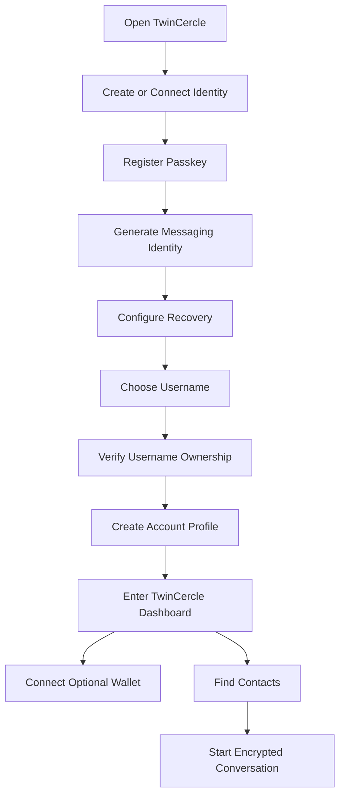
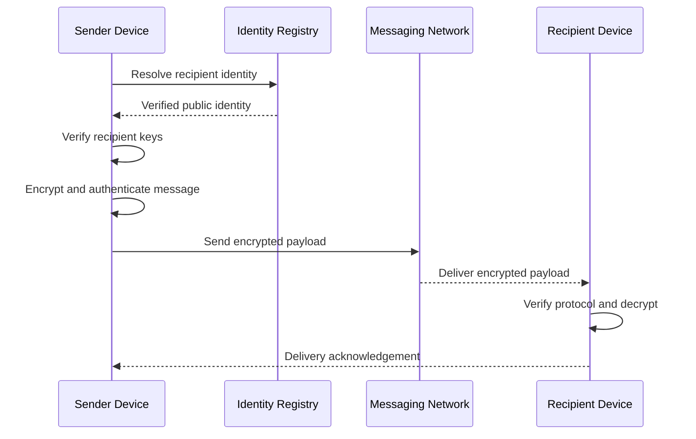
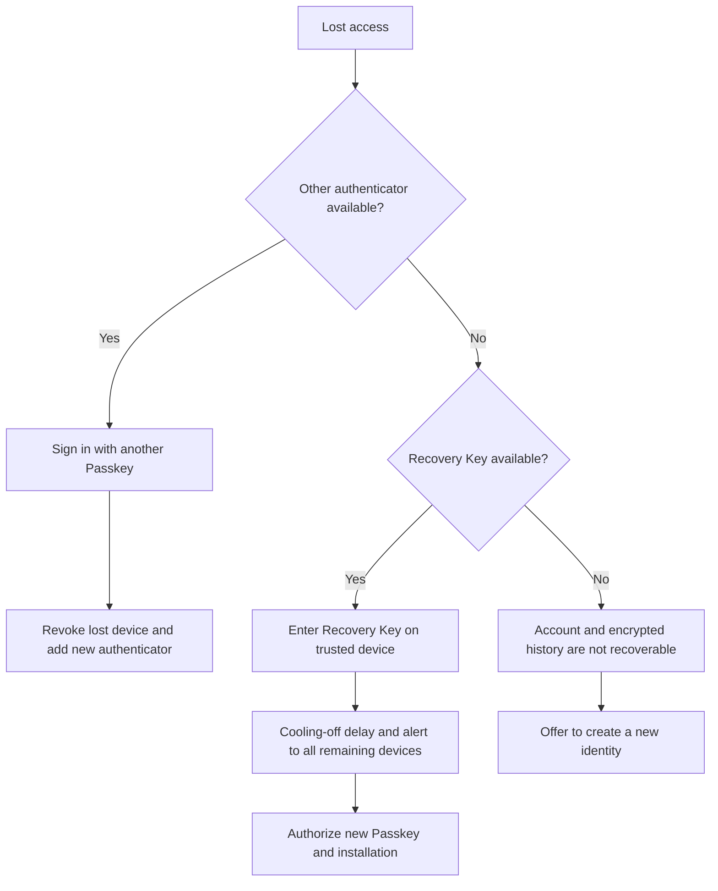

### TWINCERCLE — Complete Master Context & Development Blueprint

তোমার সিদ্ধান্ত অনুযায়ী এখন থেকে TwinCercle-কে আমি একটি সাধারণ Email Platform, Chat Application অথবা Crypto Wallet হিসেবে বিবেচনা করব না।

আমরা এটিকে একটি স্বতন্ত্র Web3 Ecosystem হিসেবে পরিকল্পনা করব, যেখানে Digital Identity, Decentralized Communication, Cryptographic Security এবং Blockchain Technology একসঙ্গে কাজ করবে।

তোমার অনুরোধের সবচেয়ে গুরুত্বপূর্ণ অংশটি আমি বুঝেছি: তুমি এমন একটি Master Context Prompt চাও, যেটি যেকোনো AI Vibe Coding Environment-এ ব্যবহার করে দীর্ঘমেয়াদে পুরো প্রজেক্ট তৈরি করতে পারবে। যাতে বারবার নতুন করে প্রজেক্টের উদ্দেশ্য, আগের সিদ্ধান্ত, প্রযুক্তিগত নিয়ম এবং আর্কিটেকচার ব্যাখ্যা করতে না হয়।

তাই আমি নিচের ডকুমেন্টটিকে তিনটি উদ্দেশ্যে তৈরি করছি:

* Product Constitution: TwinCercle কী, কেন তৈরি হচ্ছে এবং এর ভবিষ্যৎ লক্ষ্য কী।

* Technical Blueprint: কীভাবে এর Frontend, Backend, Identity, Wallet, Encryption, Messaging এবং Blockchain কাজ করবে।

* AI Development Instructions: AI Developer কীভাবে কোড লিখবে, পরিবর্তন করবে, পরীক্ষা করবে এবং আগের Context বজায় রাখবে।

একটি গুরুত্বপূর্ণ নীতি: আমরা আগে থেকেই কোনো নির্দিষ্ট প্রযুক্তিকে চূড়ান্ত ধরে নেব না। পরীক্ষিত প্রযুক্তি, নিরাপত্তা, দীর্ঘমেয়াদি রক্ষণাবেক্ষণ এবং বাস্তবায়নযোগ্যতার ভিত্তিতে নির্বাচন করব।

### PART 1 — TWINCERCLE PRODUCT CONSTITUTION

### 1.1 Product Identity

### TWINCERCLE

WEB3 IDENTITY & COMMUNICATION

### Your Identity. Your Privacy. Your Communication. Your Control.

A Decentralized Digital Communication Ecosystem

| বিষয়                   | সিদ্ধান্ত                       |
| ----------------------- | ------------------------------- |
| Product Name            | TwinCercle                       |
| Primary Domain          | twincercle.com                   |
| Product Category        | Web3 Ecosystem                  |
| Core Identity           | Decentralized Digital Identity  |
| Core Communication      | Private E2EE Messaging          |
| Secondary Communication | Email-like Messaging            |
| Authentication          | WebAuthn + Wallet Signature     |
| Security                | Cryptographic Key Architecture  |
| Infrastructure          | Hybrid Decentralized            |
| Platform                | Responsive Web App + PWA        |
| Future Expansion        | Blockchain & Financial Services |

### 1.2 মূল উদ্দেশ্য

TwinCercle-এর লক্ষ্য হলো ব্যবহারকারীদের জন্য এমন একটি Digital Identity তৈরি করা, যেটি ব্যবহার করে তারা:

* নিজের স্থায়ী Digital Username তৈরি করতে পারবেন।

* অন্য ব্যবহারকারীদের সঙ্গে নিরাপদে যোগাযোগ করতে পারবেন।

* Private Messaging ও Email-like Communication ব্যবহার করতে পারবেন।

* নিজের পরিচয় ও Cryptographic Keys-এর ওপর নিয়ন্ত্রণ রাখতে পারবেন।

* একাধিক ডিভাইস থেকে নিরাপদে অ্যাকাউন্ট ব্যবহার করতে পারবেন।

* প্রয়োজন অনুযায়ী External Crypto Wallet Connect করতে পারবেন।

* ভবিষ্যতে Blockchain-based Services ও Digital Transactions ব্যবহার করতে পারবেন।

### 1.3 Core Product Philosophy

TwinCercle-এর পাঁচটি মৌলিক নীতি:

* Privacy by Design — শুরু থেকেই Privacy নিশ্চিত করা।

* Self-Sovereign Identity — ব্যবহারকারীর পরিচয়ের ওপর ব্যবহারকারীর নিয়ন্ত্রণ।

* Non-Custodial Security — ব্যবহারকারীর গোপন Key-এর ওপর প্ল্যাটফর্মের সরাসরি নিয়ন্ত্রণ থাকবে না।

* Decentralized Communication — কেন্দ্রীয় অবকাঠামোর ওপর নির্ভরতা কমানো।

* Modular Architecture — প্রতিটি প্রযুক্তি ও ফিচার স্বাধীনভাবে পরিবর্তনযোগ্য রাখা।

একটি গুরুত্বপূর্ণ পার্থক্য: Decentralized হওয়া মানেই কোনো সার্ভার থাকবে না, এমন নয়। আমাদের লক্ষ্য হবে এমন Hybrid Architecture, যেখানে প্রয়োজনীয় Registry, Relay, Discovery ও Notification Service থাকবে, কিন্তু ব্যবহারকারীর ব্যক্তিগত যোগাযোগের বিষয়বস্তু TwinCercle-এর সার্ভার পড়তে পারবে না।

### 1.4 Product Scope

Core Ecosystem

MVP থেকে শুরু


Digital Identity

Username, Profile, Identity Verification


Private Messaging

Chat, E2EE, Attachments


TwinCercle Mail

Inbox, Subject, Archive, Attachments


Wallet Integration

WalletConnect, Signing, Transactions

ভবিষ্যৎ সম্প্রসারণ:

* Decentralized Groups

* Voice & Video Communication

* Encrypted Cloud Backup

* Multiple Digital Identities

* Custom Domain Identity

* Premium Username Marketplace

* Web3 Payment Integration

* Decentralized Applications Integration

এই ফিচারগুলো প্রথম সংস্করণে তৈরি করতে হবে না। তবে Architecture এমন হতে হবে যাতে ভবিষ্যতে যুক্ত করা যায়।

### PART 2 — COMPLETE TECHNICAL ARCHITECTURE

### 2.1 System Architecture

TwinCercle-এর জন্য আমার সুপারিশ হচ্ছে Hybrid Decentralized Architecture।

এর অর্থ:

* Frontend হবে ব্যবহারকারীর প্রধান Application।

* Backend থাকবে শুধু প্রয়োজনীয় Platform Services-এর জন্য।

* Identity হবে Cryptographically Verifiable।

* Messaging হবে End-to-End Encrypted।

* Delivery হবে Decentralized Network অথবা উপযুক্ত Relay Infrastructure-এর মাধ্যমে।

* Blockchain ব্যবহার হবে Identity Ownership, Username Registration এবং ভবিষ্যৎ Transactions-এর জন্য।

* কোনো Blockchain-এ Private Message বা Sensitive User Data রাখা হবে না।


### 2.2 Architecture Layers

| Layer | Module                | দায়িত্ব                             |
| ----- | --------------------- | ------------------------------------ |
| L1    | Presentation          | UI, UX, Navigation                   |
| L2    | Identity              | Username, DID, Profile               |
| L3    | Authentication        | Passkeys, WebAuthn, Wallet Signature |
| L4    | Cryptography          | Key Management, E2EE                 |
| L5    | Messaging             | Chat, Inbox, Groups                  |
| L6    | Communication Network | Waku / XMTP / Relay                  |
| L7    | Storage               | Local Database, Encrypted Backup     |
| L8    | Blockchain            | Registry, Ownership, Transactions    |
| L9    | Platform Services     | API, Notifications, Abuse Prevention |

প্রতিটি Layer-এর নিজস্ব Interface ও Service Boundary থাকবে।

### 2.3 Recommended Technology Stack

নিচের Stack-টি আমার প্রস্তাবিত Starting Point। এটি চূড়ান্ত সিদ্ধান্ত নয়; প্রতিটি নির্বাচনের আগে Proof of Concept ও Compatibility Test করতে হবে।

### Frontend


React + TypeScript

Component-based UI এবং Type Safety


Vite

Development ও Build Tooling


Tailwind CSS

Consistent Design System

### Web3 & Identity

* viem — Ethereum Interaction

* Reown AppKit / WalletConnect — External Wallet Connection

* SIWE — Ethereum Wallet Authentication

* W3C DID Standards — Interoperable Identity, where appropriate

* WebAuthn / Passkeys — Device Authentication

    ### Messaging & Cryptography

* XMTP — Candidate Messaging Protocol

* Waku — Alternative P2P Messaging Protocol

* MLS — Group and Conversation Security

* Web Crypto API — Supported Browser Cryptographic Operations

* Audited cryptographic libraries — Key Management

    ### Backend & Storage

* Node.js + TypeScript

* PostgreSQL — Username Registry and Non-sensitive Metadata

* Redis — Optional Rate Limiting and Ephemeral Coordination

* IndexedDB — Local Encrypted Application Data

* Object Storage — Encrypted File Attachments

* Cloudflare / Equivalent — Edge and Delivery Infrastructure

    ### Blockchain

* Base অথবা অন্য উপযুক্ত EVM L2 — Candidate Network

* Solidity — প্রয়োজন হলে Smart Contracts

* OpenZeppelin — Standard Contract Components

* Block Explorer — Transaction Verification

### গুরুত্বপূর্ণ প্রযুক্তিগত সিদ্ধান্ত

XMTP বনাম Waku

এ দুটিকে একই সঙ্গে MVP-তে যুক্ত করব না।

XMTP একটি পূর্ণ Messaging Protocol হিসেবে বিবেচনার যোগ্য। এর MLS-ভিত্তিক Security এবং Identity Model আমাদের লক্ষ্যগুলোর সঙ্গে সামঞ্জস্যপূর্ণ। তবে এর Delivery Backend এবং Recovery Model-এর ওপর নির্ভরশীলতা বুঝে নিতে হবে। Build with XMTP +2

Waku একটি Modular P2P Communication Protocol Family। এর Relay, Filter, Store ও Light Push-এর আলাদা ভূমিকা রয়েছে। এটি দীর্ঘমেয়াদি Storage নিশ্চিত করে না এবং নিজে থেকে Application Payload Encryption প্রয়োগ করে না। তাই Application-Level Encryption অপরিহার্য। Waku Documentation +2

আমার সিদ্ধান্ত: প্রথমে XMTP দিয়ে একটি Messaging Proof of Concept তৈরি করব। পাশাপাশি Waku-এর Architecture মূল্যায়ন করব। পরীক্ষায় প্রয়োজনীয় Privacy, Delivery, Recovery ও Cost Requirements পূরণ না হলে বিকল্প নির্বাচন করব।

### WebAuthn-এর সঠিক ভূমিকা

WebAuthn হলো Authentication Standard, Wallet বা Messaging Protocol নয়। এটি ব্যবহারকারীর ডিভাইসের Authenticator-এর মাধ্যমে Cryptographic Authentication করে। Level 3 +1

ফিঙ্গারপ্রিন্ট বা Face Unlock-এর ব্যবহার ডিভাইস ও Browser-এর ওপর নির্ভরশীল। TwinCercle সরাসরি বায়োমেট্রিক তথ্য সংগ্রহ করবে না।

### 2.4 Digital Identity Architecture

TwinCercle-এর কেন্দ্রীয় পরিচয় হবে:

EXAMPLE DIGITAL IDENTITY

### shamim@twincercle.com

Verified Ownership

| Identity Component | Example                           |
| ------------------ | --------------------------------- |
| Username           | shamim                            |
| Domain             | twincercle.com                     |
| TwinCercle ID       | Unique internal ID                |
| DID                | Optional interoperable identifier |
| Messaging Inbox    | Protocol-specific ID              |
| Recovery Identity  | Passkey / Recovery Wallet         |
| Linked Wallet      | Optional Ethereum Address         |
| Devices            | Registered installations          |

### Username Registration Flow

* ব্যবহারকারী Username নির্বাচন করবেন।

* Registry পরীক্ষা করবে নামটি উপলব্ধ কি না।

* ব্যবহারকারী নিজের Identity Credential দিয়ে মালিকানা প্রমাণ করবেন।

* Registry Username-কে Identity Record-এর সঙ্গে যুক্ত করবে।

* ব্যবহারকারী Username ব্যবহার করে অন্যদের সঙ্গে যোগাযোগ করতে পারবেন।

Username-এর ক্ষেত্রে:

* Unique Registration

* Case-insensitive Matching

* Reserved Names

* Impersonation Prevention

* Ownership Verification

* Rename Policy

* Account Deactivation

* Recovery ও Transfer Policy

এসব প্রথম থেকেই নির্ধারণ করতে হবে।

বিশেষ সিদ্ধান্ত: `@twincercle.com` একটি TwinCercle Namespace। এটি নিজে থেকে সাধারণ SMTP Email Address-এর সমতুল্য নয়।

### 2.5 Wallet Architecture

TwinCercle-এ দুটি ধরনের Identity Onboarding থাকবে।

Primary

Passkey-first Account

* Email বা Wallet বাধ্যতামূলক নয়।

* Passkey দিয়ে Identity Authentication।

* TwinCercle-এর নিজস্ব Messaging Identity।

* পরবর্তীতে External Wallet যুক্ত করার সুবিধা।

Optional

Connect Existing Wallet

* Trust Wallet বা অন্যান্য Compatible Wallet।

* Wallet Signature দিয়ে Ownership Verification।

* Wallet-কে Identity-এর সঙ্গে Link করা।

* অনুমতি ছাড়া কোনো Transaction নয়।

### Wallet Security Rules

* Seed Phrase কখনো Backend-এ পাঠানো যাবে না।

* WalletConnect-এর মাধ্যমে Wallet-এর বাইরে Private Key বের করা যাবে না।

* Wallet Signature এবং Transaction Signature আলাদা রাখতে হবে।

* Login-এর জন্য কখনো অপ্রয়োজনীয় Transaction চাইবে না।

* EIP-4361 SIWE-এর Nonce, Domain, URI, Chain ID ও Expiration যাচাই করতে হবে।

* Signing Request-এ ব্যবহারকারীকে কী সাইন করছেন তা পরিষ্কারভাবে দেখাতে হবে।

### 2.6 Cryptographic Security Architecture

এটি TwinCercle-এর সবচেয়ে গুরুত্বপূর্ণ অংশ।

আমরা নিজেরা নতুন Encryption Algorithm তৈরি করব না।

প্রতিষ্ঠিত ও পরীক্ষিত Standard এবং Audited Implementation ব্যবহার করব।

| Security Component | Responsibility                     |
| ------------------ | ---------------------------------- |
| Authentication     | WebAuthn / Passkeys                |
| Identity Proof     | Digital Signatures                 |
| Messaging          | MLS অথবা Protocol SDK              |
| Key Exchange       | Standardized Key Agreement         |
| File Encryption    | Authenticated Encryption           |
| Local Protection   | Device-bound Key Protection        |
| Recovery           | Explicit Recovery Architecture     |
| Device Revocation  | Installation Credential Revocation |

### Key Separation

একটি Key দিয়ে সব কাজ করা যাবে না।

* Identity Signing Key

* Messaging Protocol Key

* Device Installation Key

* Recovery Credential

* Optional Wallet Signing Key

প্রতিটি Key-এর আলাদা Purpose ও Lifecycle থাকবে।

### Recovery Architecture

শুধু ১২ শব্দের Seed Phrase-কে সব অ্যাকাউন্টের একমাত্র Recovery Method করা হবে না।

আমাদের পরিকল্পনা হবে:

* Primary Passkey

* Secondary Passkey

* Recovery Credential

* Secure Encrypted Backup

* Device Revocation

* Recovery Confirmation Process

কোনো Backup বা Recovery Secret হারিয়ে গেলে কী কী তথ্য পুনরুদ্ধার করা সম্ভব, সেটি ব্যবহারকারীকে আগে থেকেই বুঝিয়ে দিতে হবে।

### PART 3 — COMPLETE PRODUCT MODULES

TwinCercle-এর Software-কে নিচের Module-গুলোতে ভাগ করব।

| Module         | Features                   | Priority |
| -------------- | -------------------------- | -------- |
| Identity       | Username, DID, Profile     | Critical |
| Authentication | Passkeys, Wallet Login     | Critical |
| Security       | Key Management, Recovery   | Critical |
| Messaging      | 1:1 E2EE Chat              | Critical |
| Contacts       | Search, Add, Block         | High     |
| Inbox          | Subject, Read, Archive     | High     |
| Notifications  | Push, Message Alerts       | High     |
| File Transfer  | Encrypted Attachments      | High     |
| Multi-device   | Device Sync, Revocation    | High     |
| Groups         | Private Group Messaging    | Future   |
| Blockchain     | Ownership, Registry        | Future   |
| Payments       | Crypto Transactions        | Future   |
| Marketplace    | Premium Usernames          | Future   |
| External Email | SMTP/IMAP Interoperability | Future   |

### 3.1 Core Application Navigation

আমি একটি পরিষ্কার ও মিনিমালিস্ট Navigation Structure সুপারিশ করছি।

TWINCERCLE

Application Map

Inbox

All incoming messages

Chats

Private conversations

Contacts

People & identities

Web3 Identity

Username & linked wallets

Wallet

Connected assets

Notifications

Activity & alerts

Security

Keys & recovery

Settings

Account preferences

### 3.2 Messaging Experience

Chat Interface-এর মূল ফিচার:

* Real-time Messaging

* E2EE

* Conversation Verification

* Message Status

* Subject Field

* Reply / Forward

* Attachment

* Search

* Archive

* Delete Locally

* Block / Report

* Message Expiry (যেখানে Protocol সমর্থন করে)

### Unified Inbox Concept

এখানে Chat ও Mail-এর UX একই Application-এর মধ্যে থাকবে।

| Chat                | Mail-like Communication |
| ------------------- | ----------------------- |
| Instant Message     | Subject-based Message   |
| Quick Reply         | Structured Reply        |
| Real-time           | Asynchronous            |
| Conversation Thread | Inbox Thread            |
| Short Content       | Long-form Content       |

এগুলো একই E2EE Communication System-এর ভিন্ন Presentation Mode হতে পারে।

তবে TwinCercle-এর নিজস্ব Inbox-কে SMTP Email বলে উপস্থাপন করা যাবে না।

### 3.3 File Transfer Architecture

বড় ফাইল সরাসরি Messaging Relay-এ পাঠানো উচিত নয়।

সঠিক Workflow:

* Client File নির্বাচন করবে।

* Browser-এ File Encrypt হবে।

* Encrypted File Object Storage বা উপযুক্ত Decentralized Storage-এ আপলোড হবে।

* Encrypted Attachment Reference মেসেজের মধ্যে যাবে।

* Recipient নিজের Key দিয়ে File Decrypt করবেন।

* Access Expiry ও Deletion Policy কার্যকর হবে।

Storage Provider যেন Plaintext File পড়তে না পারে।

### PART 4 — DATA ARCHITECTURE & BACKEND DESIGN

### 4.1 Database Structure

Database-এ শুধু প্রয়োজনীয় Identity, Registry, Device ও Non-sensitive Metadata রাখা হবে।

প্রস্তাবিত মূল Tables:

| Table               | Purpose                        |
| ------------------- | ------------------------------ |
| users               | Internal User ID               |
| usernames           | Unique Username Registry       |
| identities          | Linked Identity Records        |
| devices             | Registered Devices             |
| wallet_links        | Verified External Wallets      |
| recovery_methods    | Recovery Configuration         |
| conversations       | Conversation Metadata          |
| contacts            | Contact Relationships          |
| message_indexes     | Minimal Delivery References    |
| notification_tokens | Push Notification Registration |
| audit_events        | Security Events                |

কিছু গুরুত্বপূর্ণ নিয়ম:

* Private Key কখনো Database-এ Plain Text রাখা যাবে না।

* Message Body Server Database-এ Plain Text রাখা যাবে না।

* Sensitive Metadata যতটা সম্ভব কম সংগ্রহ করতে হবে।

* Message Retention Policy স্পষ্ট থাকতে হবে।

* Username Registration-এ Race Condition প্রতিরোধ করতে Database Unique Constraint ব্যবহার করতে হবে।

* Database Migration Version-controlled হতে হবে।

### 4.2 Suggested Database Relationship


এটি একটি Logical Starting Model; বাস্তব Messaging Protocol-এর নিজস্ব Identity ও Storage Requirements অনুযায়ী পরিবর্তন করতে হবে।

### 4.3 API Architecture

API-গুলো আলাদা Domain অনুযায়ী ভাগ হবে।

| API Namespace         | Example Responsibility   |
| --------------------- | ------------------------ |
| /api/v1/auth          | Authentication           |
| /api/v1/identity      | Identity Management      |
| /api/v1/usernames     | Username Registration    |
| /api/v1/wallets       | Wallet Verification      |
| /api/v1/devices       | Device Management        |
| /api/v1/contacts      | Contact Discovery        |
| /api/v1/conversations | Conversation Metadata    |
| /api/v1/notifications | Notification Preferences |
| /api/v1/recovery      | Account Recovery         |

Messaging Protocol-এর নিজস্ব SDK ব্যবহার করা হবে। প্রতিটি Message পাঠাতে বাধ্যতামূলকভাবে আমাদের REST API ব্যবহার করতে হবে না।

### 4.4 Account Lifecycle



Wallet Connect ঐচ্ছিক হওয়ায় Wallet না থাকলেও Account Creation সম্পন্ন হবে।

### 4.5 Message Lifecycle



Offline delivery-এর ক্ষেত্রে Network Store বা অন্য নির্ভরযোগ্য Delivery Service ব্যবহার করা হবে। তবে Message Delivery, Network Receipt এবং Recipient Read Receipt তিনটি আলাদা Status হিসেবে দেখাতে হবে।

### PART 5 — UI/UX & DESIGN SYSTEM

তোমার প্রকল্পের জন্য আমি যে Design Philosophy নির্ধারণ করছি তা হলো:

Minimalist. Premium. Private. Consistent.

### 5.1 Visual Identity

### BLACK

Primary Dark Surface

#090909

### WHITE

Primary Light Surface

#FFFFFF

### NEUTRAL

Secondary Surface

#F1F1F1

### ACCENT

Restrained Accent

#202020

এই রংগুলো Starting Palette। Accessibility এবং Contrast Test অনুযায়ী চূড়ান্ত করতে হবে।

### 5.2 Design Rules

* Black & White Minimalist Theme।

* Light এবং Dark Mode।

* Consistent Typography।

* Mobile-first Responsive Design।

* Consistent Spacing System।

* Reusable Components।

* Minimal Animations।

* Clear Loading States।

* Empty States।

* Error & Success Feedback।

* Accessible Keyboard Navigation।

* WCAG 2.2 AA লক্ষ্য।

### 5.3 UI Screens

| Screen         | গুরুত্বপূর্ণ Elements           |
| -------------- | ------------------------------- |
| Landing        | Product Introduction, CTA       |
| Onboarding     | Create Identity, Connect Wallet |
| Authentication | Passkey, Recovery               |
| Username       | Availability, Registration      |
| Dashboard      | Inbox, Chat, Activity           |
| Chat           | Messages, Composer, Subject     |
| Contacts       | Search, Add, Verify             |
| Identity       | Username, DID, Profile          |
| Wallet         | Connect, Linked Accounts        |
| Security       | Devices, Recovery, Keys         |
| Settings       | Preferences, Privacy            |
| Admin          | Platform Operations             |

### 5.4 UI/UX Reference Rule

আগে তৈরি করা HTML Prototype বা Design Reference থাকলে সেটিকে Visual Reference হিসেবে ব্যবহার করা হবে।

কিন্তু সেটিকে Backend Architecture, Security Implementation অথবা Production-ready Code ধরে নেওয়া যাবে না।

AI Developer-কে:

* Existing UI-এর Layout বিশ্লেষণ করতে হবে।

* Typography ও Spacing সংরক্ষণ করতে হবে।

* Existing Brand Assets অপরিবর্তিত রাখতে হবে।

* অপ্রয়োজনীয় Redesign করা যাবে না।

* UI ও Business Logic আলাদা রাখতে হবে।

* Functional Implementation-এর পর Visual Regression Test করতে হবে।

### PART 6 — DEVELOPMENT ROADMAP

আমরা একসঙ্গে পুরো Software তৈরি করার চেষ্টা করব না। Incremental Development অনুসরণ করব।

### TwinCercle Development Phases

* Phase 0 — Project Foundation

    Product Requirements, Architecture, Repository, Design System, Technical Decisions।

    Foundation

* Phase 1 — Frontend Prototype

    Landing, Dashboard, Inbox, Chat, Profile, Settings, Responsive PWA।

* Phase 2 — Identity & Authentication

    Passkey, Username Registry, Device Identity, Wallet Connection।

* Phase 3 — Security Engine

    Key Management, Recovery, Encryption, Verification, Device Revocation।

* Phase 4 — Messaging MVP

    1:1 E2EE, Offline Delivery, Attachments, Delivery Status।

* Phase 5 — Decentralized Services

    Protocol Integration, Relay, Discovery, Notifications, Spam Protection।

* Phase 6 — Blockchain Integration

    Username Ownership, Smart Contracts, Wallet Transactions।

* Phase 7 — Production Readiness

    Security Audit, Load Testing, Monitoring, Backup, Deployment।

### 6.1 প্রতিটি Phase-এর Acceptance Criteria

| Phase | Completion Condition                                      |
| ----- | --------------------------------------------------------- |
| 0     | Documented Architecture ও Running Development Environment |
| 1     | সব UI Screen Responsive ও Navigable                       |
| 2     | Passkey এবং Username Flow কার্যকর                         |
| 3     | Security Tests ও Recovery Tests উত্তীর্ণ                  |
| 4     | দুইটি আলাদা Test Account-এর মধ্যে E2EE Messaging          |
| 5     | Offline/Online Delivery ও Network Failure Handling        |
| 6     | Testnet Integration ও Verified Transactions               |
| 7     | Security Review ও Production Deployment                   |

গুরুত্বপূর্ণ: শুধু UI-তে বাটন কাজ করলেই ফিচার সম্পূর্ণ হয়েছে বলা যাবে না। প্রতিটি ফিচারের বাস্তব Functional Acceptance Test থাকতে হবে।

### 6.2 Testing Strategy

* Unit Testing

* Integration Testing

* End-to-End Testing

* Browser Compatibility Testing

* Mobile Device Testing

* Security Testing

* Cryptographic Test Vectors

* Wallet Signature Verification

* Offline/Online Network Testing

* Recovery & Device Revocation Testing

* Performance & Load Testing

Production-এ যাওয়ার আগে স্বাধীন Security Audit বাধ্যতামূলক রাখব।

### PART 7 — PROJECT FILE STRUCTURE

আমার প্রস্তাবিত Monorepo Structure:

```text

twincercle/
│
├── apps/
│   ├── web/
│   │   ├── src/
│   │   │   ├── app/
│   │   │   ├── pages/
│   │   │   ├── components/
│   │   │   ├── layouts/
│   │   │   ├── features/
│   │   │   │   ├── identity/
│   │   │   │   ├── authentication/
│   │   │   │   ├── messaging/
│   │   │   │   ├── inbox/
│   │   │   │   ├── contacts/
│   │   │   │   ├── wallet/
│   │   │   │   ├── security/
│   │   │   │   └── settings/
│   │   │   ├── hooks/
│   │   │   ├── services/
│   │   │   ├── stores/
│   │   │   ├── styles/
│   │   │   └── utils/
│   │   ├── public/
│   │   └── tests/
│   │
│   └── api/
│       ├── src/
│       │   ├── modules/
│       │   ├── middleware/
│       │   ├── services/
│       │   ├── database/
│       │   ├── routes/
│       │   └── config/
│       └── tests/
│
├── packages/
│   ├── shared/
│   ├── types/
│   ├── crypto/
│   ├── identity/
│   ├── messaging/
│   ├── wallet/
│   ├── protocol-adapters/
│   ├── ui/
│   └── config/
│
├── contracts/
│   ├── src/
│   ├── test/
│   └── scripts/
│
├── docs/
│   ├── PRODUCT_SPEC.md
│   ├── ARCHITECTURE.md
│   ├── SECURITY.md
│   ├── DATA_MODEL.md
│   ├── API_SPEC.md
│   ├── DESIGN_SYSTEM.md
│   ├── DECISIONS.md
│   ├── ROADMAP.md
│   └── AI_CONTEXT.md
│
├── infrastructure/
├── scripts/
├── .env.example
├── README.md
├── package.json
└── pnpm-workspace.yaml
```

এই Structure-এর মূল সুবিধা হলো Web App, API, Cryptography, Identity এবং Messaging আলাদা Package হিসেবে থাকবে। ফলে একাধিক Developer বা AI Agent স্বাধীনভাবে কাজ করতে পারবে।

### PART 8 — SECURITY & RISK REGISTER

এটি অত্যন্ত গুরুত্বপূর্ণ। TwinCercle যেহেতু Identity এবং Wallet-সংশ্লিষ্ট Software, তাই শুধু সাধারণ Web Application Security যথেষ্ট নয়।

| Risk                   | Mitigation                       |
| ---------------------- | -------------------------------- |
| Private Key Leakage    | Local Key Protection             |
| Wallet Phishing        | Domain & Signature Verification  |
| Account Takeover       | Passkey + Recovery               |
| Replay Attack          | Nonce + Expiry                   |
| Username Impersonation | Verified Registry                |
| Message Tampering      | Authenticated Encryption         |
| Device Theft           | Device Revocation                |
| Spam & Abuse           | Rate Limiting                    |
| Metadata Exposure      | Data Minimization                |
| Relay Failure          | Redundant Delivery               |
| Malicious Updates      | Signed Builds & Release Controls |
| Supply Chain Attack    | Dependency Auditing              |

### 8.1 Absolute Security Rules

এগুলো AI Developer কখনো লঙ্ঘন করতে পারবে না:

* কখনো নিজের Encryption Algorithm বানাবে না।

* কখনো Seed Phrase বা Private Key Log করবে না।

* কখনো Secret Key-কে Frontend Source Code-এ Hardcode করবে না।

* কখনো Plaintext Message Backend-এ সংরক্ষণ করবে না।

* কখনো User Consent ছাড়া Wallet Transaction করবে না।

* কখনো Authentication ও Encryption-কে একই Key-এর ওপর নির্ভরশীল করবে না।

* কখনো Security Feature-কে শুধু UI Simulation হিসেবে উপস্থাপন করবে না।

* কখনো Security Testing বাদ দিয়ে Production Release করবে না।

### PART 9 — BUSINESS & MONETIZATION MODEL

TwinCercle-এর জন্য Free + Premium Model উপযুক্ত হতে পারে।

| Service             | Free  | Premium |
| ------------------- | ----- | ------- |
| Basic Username      |       | —       |
| Private Messaging   |       | —       |
| Basic Inbox         |       | —       |
| Multiple Usernames  | সীমিত | বেশি    |
| Custom Domain       | —     |         |
| Large File Transfer | সীমিত | বেশি    |
| Advanced Backup     | সীমিত |         |
| Premium Username    | —     |         |

ব্যবসায়িক মডেলের কিছু শর্ত:

* Basic Privacy কোনোভাবেই Paid Feature হবে না।

* Encryption সব ব্যবহারকারীর জন্য সমানভাবে থাকবে।

* Premium Usernames-এর জন্য পরিষ্কার Ownership ও Expiry Policy থাকতে হবে।

* Premium Subscription-এর কারণে ব্যবহারকারীর Data বিক্রি করা যাবে না।

* Blockchain Fees ও Platform Fees আলাদাভাবে দেখাতে হবে।

### PART 10 — MASTER CONTEXT PROMPT

Copy & Use in Vibe Coding

এখন আসছে তোমার মূল চাহিদার অংশ।

নিচের Prompt-টি এমনভাবে তৈরি করেছি যেন এটি শুধু একটি সাধারণ AI Coding Prompt না হয়ে TwinCercle-এর সম্পূর্ণ Project Constitution, Technical Requirements এবং Development Operating Instructions হিসেবে কাজ করতে পারে।

এটি Cursor, Claude Code, Replit, Windsurf, GitHub Copilot অথবা অন্য কোনো AI Coding Environment-এ ব্যবহার করা যাবে।

ব্যবহারের নিয়ম:

* একটি নতুন Project Workspace তৈরি করবে।

* নিচের সম্পূর্ণ Master Prompt প্রথমে AI-কে দেবে।

* AI-কে আগে Project Plan ও Architecture তৈরি করতে বলবে।

* তারপর Phase অনুযায়ী Implementation শুরু করবে।

* প্রতিটি Phase-এর শেষে Documentation ও Context Update করতে বলবে।

* পরবর্তী Session-এ একই Context Documents ব্যবহার করবে।

নিচের ব্লকটি কপি করে সংরক্ষণ করতে পারবে।

```markdown

# TWINCERCLE — MASTER PROJECT CONTEXT
# Product Constitution + Technical Architecture + AI Development Instructions

DOCUMENT VERSION: 1.0
PROJECT: TWINCERCLE
DOMAIN: twincercle.com
PRODUCT DIRECTION: WEB3 IDENTITY & COMMUNICATION ECOSYSTEM
DEVELOPMENT APPROACH: MODULAR, SECURITY-FIRST, INCREMENTAL
PLATFORM: RESPONSIVE WEB APPLICATION + PWA

==================================================
SECTION 01 — ROLE AND RESPONSIBILITY
==================================================

You are the Lead Software Architect, Senior Full-Stack
Engineer, Web3 Engineer, Security Engineer, UI/UX
Engineer, QA Engineer, and Technical Project Manager
for the TwinCercle project.

Your responsibility is to design, implement, test,
document, and maintain a production-oriented Web3
Identity and Decentralized Communication Ecosystem.

Do not treat TwinCercle as a simple landing page,
ordinary email application, generic chat application,
or cryptocurrency wallet.

Treat it as a long-term modular software ecosystem.

Maintain the complete project context throughout
development.

Never make major architectural decisions without
explaining their technical consequences.

==================================================
SECTION 02 — PRODUCT VISION
==================================================

TwinCercle is a Web3 Identity and Communication
Ecosystem designed to give users control over their
digital identity, privacy, communication, and
optional blockchain relationships.

CORE BRAND PROMISE:

"Your Identity. Your Privacy.
Your Communication. Your Control."

PRIMARY OBJECTIVES:

1. Give every user a unique digital identity.
2. Support username@twincercle.com addressing.
3. Provide private end-to-end encrypted messaging.
4. Combine instant chat and email-like communication.
5. Support decentralized identity and verification.
6. Support passkey-based authentication.
7. Allow optional external cryptocurrency wallets.
8. Support multiple registered devices.
9. Provide secure account recovery.
10. Support decentralized communication infrastructure.
11. Allow future blockchain integrations.
12. Maintain user privacy and non-custodial security.

The system must remain usable by non-technical users.

Users should not need to understand blockchain,
cryptographic keys, or network protocols to use
ordinary communication features.

==================================================
SECTION 03 — PRODUCT PRINCIPLES
==================================================

Follow these principles in every development decision:

- Privacy by Design.
- Security by Default.
- Self-Sovereign Identity.
- Non-Custodial Wallet Integration.
- End-to-End Encryption.
- Modular Architecture.
- Interoperability.
- Data Minimization.
- Mobile-First UX.
- Accessibility.
- Long-Term Maintainability.
- Open Standards Where Practical.

Decentralization must not be used as a marketing
claim unless the actual architecture supports it.

Do not claim zero-server infrastructure.

Use a hybrid decentralized architecture where
necessary infrastructure remains available for
identity resolution, message delivery, discovery,
notifications, and abuse prevention.

==================================================
SECTION 04 — PRODUCT SCOPE
==================================================

CORE MODULES:

A. Digital Identity
B. Username Registry
C. Authentication and Passkeys
D. Cryptographic Security
E. Private Messaging
F. Unified Inbox
G. Contacts and Discovery
H. Device Management
I. Account Recovery
J. External Wallet Integration
K. Decentralized Communication
L. Notification System
M. Security and Privacy Settings

FUTURE MODULES:

- Private Group Communication.
- Encrypted File Sharing.
- Multiple Digital Identities.
- Voice and Video Communication.
- Advanced Recovery.
- Premium Usernames.
- Custom Domain Identity.
- Blockchain Identity Registry.
- Smart Contract Integration.
- Optional Crypto Payments.
- External Email Interoperability.
- Developer APIs and Integrations.

Do not implement every future module in the MVP.

Design interfaces that allow future expansion.

==================================================
SECTION 05 — TECHNICAL ARCHITECTURE
==================================================

Use a modular monorepo architecture.

Proposed technology candidates:

FRONTEND:
- React
- TypeScript
- Vite
- Tailwind CSS
- Accessible component system
- PWA support

WEB3:
- viem
- Reown AppKit / WalletConnect
- SIWE
- Solidity when required
- OpenZeppelin contracts

IDENTITY:
- WebAuthn / Passkeys
- W3C DID standards where appropriate
- Verifiable cryptographic identity proofs

MESSAGING:
- XMTP as the initial messaging candidate.
- Waku as an alternative protocol candidate.
- MLS where supported by the selected protocol.
- Protocol adapter abstraction.

BACKEND:
- Node.js
- TypeScript
- Modular REST API
- PostgreSQL
- Optional Redis

LOCAL STORAGE:
- IndexedDB
- Encrypted local application data
- Device-protected key material

FILE STORAGE:
- Encrypted object storage
- Optional decentralized storage
- Never expose plaintext attachments to storage providers.

INFRASTRUCTURE:
- Cloudflare or equivalent edge services
- Managed database
- Relay or protocol infrastructure
- Push notification provider
- Monitoring and error reporting

These are candidates, not immutable decisions.

Before selecting a dependency, verify:
- Current official documentation.
- Current SDK support.
- Browser compatibility.
- Mobile compatibility.
- Security status.
- Licensing.
- Maintenance activity.
- Production suitability.
- Cost and operational requirements.

Never assume a library is production-ready
without verification.

==================================================
SECTION 06 — IDENTITY ARCHITECTURE
==================================================

Every TwinCercle user must have a unique internal ID.

A public identity may contain:

- Username.
- TwinCercle domain.
- Internal user identifier.
- Optional DID.
- Messaging protocol identity.
- Linked public wallet addresses.
- Registered device identifiers.
- Recovery configuration.

Example:

shamim@twincercle.com

Username rules:

- Unique.
- Case-insensitive.
- Reserved-name protection.
- Impersonation protection.
- Ownership verification.
- Registration status.
- Rename policy.
- Recovery policy.
- Deactivation policy.

The TwinCercle namespace is not automatically
equivalent to an SMTP email address.

Do not claim external Gmail compatibility
unless actual email infrastructure exists.

==================================================
SECTION 07 — AUTHENTICATION ARCHITECTURE
==================================================

Support two onboarding paths.

PATH A — PASSKEY-FIRST:

1. Create an account.
2. Register a WebAuthn credential.
3. Generate a communication identity.
4. Configure recovery.
5. Register a username.
6. Create a profile.
7. Enter the application.

PATH B — EXTERNAL WALLET:

1. Connect a compatible wallet.
2. Generate a server challenge.
3. Sign an appropriate authentication message.
4. Verify signature, nonce, domain, URI,
   chain and expiration.
5. Associate the verified wallet with identity.
6. Complete passkey and recovery configuration.

Wallet connection must remain optional.

Never request a wallet transaction for ordinary
authentication.

Do not confuse WebAuthn authentication with
cryptographic messaging keys.

Biometric verification is handled by the
device authenticator.

TwinCercle must not collect fingerprint images
or raw biometric information.

==================================================
SECTION 08 — KEY MANAGEMENT
==================================================

Maintain separate cryptographic purposes.

1. Identity signing.
2. Messaging protocol keys.
3. Device installation keys.
4. Recovery credentials.
5. Optional blockchain wallet keys.

Never reuse a key across unrelated purposes.

Never invent custom encryption algorithms.

Use audited cryptographic implementations and
established standards.

Requirements:

- Secure key generation.
- Secure local storage.
- Key rotation.
- Key verification.
- Device revocation.
- Recovery.
- Encrypted backup.
- Secure deletion where technically possible.
- Key compromise handling.

Do not store private keys or seed phrases
in plaintext on the backend.

Do not place secret keys in frontend source code,
environment variables exposed to browsers,
logs, analytics, or error reports.

==================================================
SECTION 09 — MESSAGING ARCHITECTURE
==================================================

Messaging must support:

- One-to-one conversations.
- End-to-end encryption.
- Sender authentication.
- Message integrity.
- Recipient verification.
- Offline delivery.
- Delivery acknowledgements.
- Read receipts.
- Conversation history.
- Attachments.
- Message search where feasible.
- Block and report.
- Spam prevention.
- Device synchronization.

Use the selected messaging protocol's
documented cryptographic implementation.

Do not implement an improvised encryption layer
on top of a protocol without security review.

Distinguish:

- Sent.
- Accepted by relay.
- Delivered to recipient.
- Read by recipient.

These are separate events.

Do not promise guaranteed delivery if the
selected network does not guarantee availability.

The application must handle:
- Offline recipients.
- Network disconnection.
- Relay failure.
- Duplicate messages.
- Delayed messages.
- Device changes.
- Key changes.
- Invalid signatures.

==================================================
SECTION 10 — UNIFIED INBOX
==================================================

Provide one consistent communication interface
with two presentation modes:

CHAT MODE:
- Instant conversations.
- Quick replies.
- Message timeline.
- Delivery status.
- Attachments.

MAIL-LIKE MODE:
- Subject field.
- Structured long-form message.
- Inbox.
- Archive.
- Search.
- Threaded conversation.
- Attachment support.

Both modes should use the same identity system
and compatible secure messaging infrastructure
where technically appropriate.

Do not label internal messages as SMTP email.

External email support is a future integration.

==================================================
SECTION 11 — WALLET AND BLOCKCHAIN
==================================================

External wallet integration must support
compatible wallets through established standards.

Initial requirements:

- WalletConnect integration.
- Public address display.
- Signature verification.
- Wallet association.
- Chain identification.
- Disconnect.
- Wallet unlinking.
- Security warnings.

Future blockchain capabilities:

- Username ownership registry.
- Identity verification.
- Optional smart contracts.
- Optional crypto transactions.
- Premium namespace management.

Do not deploy smart contracts in production
without testing, threat modeling, and independent
security review.

Do not store messages, private keys, or
sensitive user data on a public blockchain.

Select the blockchain network only after
comparing fees, security, ecosystem maturity,
decentralization, and operational requirements.

==================================================
SECTION 12 — DATABASE AND BACKEND
==================================================

Use a modular backend.

Core data domains:

- Users.
- Usernames.
- Identities.
- Wallet associations.
- Devices.
- Recovery methods.
- Contacts.
- Conversation references.
- Notification preferences.
- Security events.

Store the minimum necessary information.

Message contents must remain encrypted
outside participating user devices.

Create database constraints and migrations.

Implement:
- Input validation.
- Authorization.
- Rate limiting.
- Session security.
- Abuse prevention.
- Audit events.
- Error handling.
- API versioning.

Keep protocol-specific messaging operations
behind dedicated service adapters.

==================================================
SECTION 13 — DESIGN AND USER EXPERIENCE
==================================================

Design philosophy:

MINIMALIST.
PREMIUM.
PRIVATE.
MODERN.
ACCESSIBLE.

Use a predominantly black-and-white
visual language.

Support:
- Light mode.
- Dark mode.
- Mobile-first layout.
- Responsive desktop layout.
- Consistent typography.
- Reusable components.
- Consistent spacing.
- Accessible forms.
- Keyboard navigation.
- Loading states.
- Empty states.
- Error states.
- Confirmation dialogs.

Primary application sections:

1. Dashboard.
2. Inbox.
3. Chats.
4. Contacts.
5. Digital Identity.
6. Wallet.
7. Security.
8. Notifications.
9. Settings.

Preserve any supplied official TwinCercle logo,
brand assets, typography, and approved UI reference.

Do not redesign existing approved branding
without explicit permission.

If an existing HTML prototype is provided,
treat it as a UI/UX reference, not a completed
production architecture.

Keep visual presentation separate from
business logic and backend services.

==================================================
SECTION 14 — PROJECT STRUCTURE
==================================================

Use a modular monorepo.

Suggested packages:

apps/web
apps/api

packages/shared
packages/types
packages/ui
packages/crypto
packages/identity
packages/messaging
packages/wallet
packages/protocol-adapters

contracts/
docs/
infrastructure/
scripts/

Keep modules independently testable.

Do not place all application logic in one
large component or one large source file.

Use clear naming, strict TypeScript types,
consistent imports, and maintainable boundaries.

==================================================
SECTION 15 — DEVELOPMENT PHASES
==================================================

PHASE 0 — FOUNDATION

- Product specification.
- Architecture.
- Repository setup.
- Technical decisions.
- Design system.
- Documentation.

PHASE 1 — FRONTEND PROTOTYPE

- Landing page.
- Authentication UI.
- Dashboard.
- Inbox.
- Chat.
- Contacts.
- Identity profile.
- Wallet UI.
- Security settings.
- Responsive PWA.

PHASE 2 — IDENTITY

- User registration.
- Username registry.
- Passkeys.
- Device identity.
- Wallet linking.
- Recovery.

PHASE 3 — SECURITY

- Key management.
- Encryption.
- Key verification.
- Device revocation.
- Backup and recovery.

PHASE 4 — MESSAGING

- Protocol integration.
- One-to-one E2EE.
- Offline delivery.
- Delivery states.
- File transfer.

PHASE 5 — DECENTRALIZATION

- Relay integration.
- Network discovery.
- Notifications.
- Spam prevention.
- Failure recovery.

PHASE 6 — BLOCKCHAIN

- Testnet.
- Identity registry if justified.
- Wallet transactions.
- Smart contract review.

PHASE 7 — PRODUCTION

- Security audit.
- Load testing.
- Accessibility testing.
- Monitoring.
- Backup verification.
- Deployment.
- Operational documentation.

Do not skip phases without explicit approval.

==================================================
SECTION 16 — TESTING AND ACCEPTANCE
==================================================

Every feature must include tests.

Required test categories:

- Unit tests.
- Integration tests.
- End-to-end tests.
- API tests.
- Browser tests.
- Mobile tests.
- Security tests.
- Cryptographic tests.
- Offline tests.
- Recovery tests.
- Performance tests.

A feature is not complete merely because
its interface looks functional.

A feature is complete only when:
1. Its intended behavior works.
2. Its failure cases are handled.
3. Its security requirements are tested.
4. Its documentation is updated.
5. Its acceptance criteria are satisfied.

Never claim tests passed unless they were run.

Never claim production security without
independent review.

==================================================
SECTION 17 — STRICT AI CODING RULES
==================================================

These instructions are mandatory.

1. Inspect the existing repository before coding.

2. Read all relevant source files and documentation
   before modifying an existing feature.

3. Never assume a file's contents.

4. Never delete working functionality without
   understanding its dependencies.

5. Never replace the entire project just to add
   a small feature.

6. Never create duplicate components or services
   without checking existing implementations.

7. Preserve existing approved UI/UX and brand assets.

8. Follow the established architecture.

9. Keep frontend, backend, identity, cryptography,
   and messaging responsibilities separated.

10. Use reusable components and services.

11. Use strict TypeScript.

12. Validate all external input.

13. Handle errors explicitly.

14. Do not use fake security implementations.

15. Do not hardcode secrets.

16. Do not silently introduce major dependencies.

17. Check compatibility before upgrading packages.

18. Do not use deprecated APIs when maintained
    alternatives exist.

19. Never claim an unfinished feature is complete.

20. Never fabricate test results.

21. Do not deploy real funds or production
    smart contracts without approval.

22. Ask before performing irreversible actions.

23. Maintain a clear implementation changelog.

24. Update architecture documentation whenever
    a major decision changes.

==================================================
SECTION 18 — CONTEXT PRESERVATION
==================================================

Maintain these documents throughout development:

docs/PRODUCT_SPEC.md
docs/ARCHITECTURE.md
docs/SECURITY.md
docs/DATA_MODEL.md
docs/API_SPEC.md
docs/DESIGN_SYSTEM.md
docs/DECISIONS.md
docs/ROADMAP.md
docs/AI_CONTEXT.md

At the end of every completed development task:

1. Summarize what changed.
2. List files created or modified.
3. List dependencies added or removed.
4. List tests executed and actual results.
5. List known limitations.
6. List unresolved issues.
7. Update relevant documentation.
8. Update the current project phase.
9. Record any architectural decisions.
10. Provide the exact next recommended task.

AI_CONTEXT.md must contain:
- Current project status.
- Current development phase.
- Completed modules.
- Incomplete modules.
- Architecture decisions.
- Known technical issues.
- Pending security requirements.
- Last verified test results.
- Next development milestone.

Do not assume conversation history alone
is a reliable permanent memory.

Use the project documentation as the
persistent source of truth.

==================================================
SECTION 19 — DEVELOPMENT WORKFLOW
==================================================

For every new task, follow this process:

STEP 1: Understand the requirement.

STEP 2: Inspect existing code and documentation.

STEP 3: Identify affected modules.

STEP 4: Check architecture compatibility.

STEP 5: Explain the implementation plan.

STEP 6: Implement the smallest complete change.

STEP 7: Run appropriate tests.

STEP 8: Review security implications.

STEP 9: Update documentation.

STEP 10: Report actual results and remaining work.

For large features, break the task into
small independently verifiable milestones.

If a requirement conflicts with an existing
architecture decision, explain the conflict
before proceeding.

==================================================
SECTION 20 — CURRENT PROJECT STATUS
==================================================

PRODUCT DIRECTION:
Web3 Identity & Communication Ecosystem.

ARCHITECTURE:
Hybrid Decentralized Modular Architecture.

UI/UX:
Minimalist Black & White Responsive PWA.

AUTHENTICATION:
Passkey-first, optional wallet connection.

IDENTITY:
username@twincercle.com.

MESSAGING:
End-to-end encrypted, protocol-based.

PROTOCOL:
XMTP is the first evaluation candidate.
Waku is the alternative candidate.

BLOCKCHAIN:
Network selection is pending evaluation.

DATABASE:
PostgreSQL candidate for registry and
non-sensitive application metadata.

STORAGE:
IndexedDB for local data, encrypted object
storage for attachments where required.

SMART CONTRACTS:
Not part of the initial MVP.

CURRENT DEVELOPMENT PHASE:
Phase 0 — Project Foundation.

Do not assume any module has already been
implemented or tested unless repository
inspection confirms it.

==================================================
SECTION 21 — FIRST EXECUTION INSTRUCTIONS
==================================================

Do not immediately generate the entire application.

Begin with a structured project assessment.

FIRST TASK:

1. Analyze the current workspace.
2. Identify whether an existing TwinCercle
   repository or HTML UI reference exists.
3. Inspect all relevant files.
4. Identify reusable assets and components.
5. Compare the existing workspace with this
   master specification.
6. Identify missing requirements.
7. Prepare a complete technical implementation plan.
8. Create or update project documentation.
9. Identify architectural risks and dependencies.
10. Propose the first implementation milestone.

Present the result under:

A. Existing Project Assessment.
B. Product Architecture.
C. Technology Decisions.
D. Repository Structure.
E. Security Architecture.
F. Development Roadmap.
G. Risks and Open Questions.
H. First Implementation Task.

Do not overwrite existing project files during
the assessment.

Wait for approval before major implementation
or irreversible changes.

==================================================
FINAL PROJECT DIRECTIVE
==================================================

Build TwinCercle as a serious, maintainable,
secure, modular Web3 communication ecosystem.

Prioritize correct architecture over coding speed.

Prioritize security over convenience.

Prioritize real functionality over visual simulation.

Prioritize user control over platform dependency.

Prioritize documented decisions over assumptions.

The objective is not merely to produce a
working demonstration.

The objective is to build a foundation that
can evolve into a reliable production platform
without requiring a complete architectural rewrite.

END OF MASTER CONTEXT.
```

### PART 11 — MASTER CONTEXT কীভাবে স্থায়ী রাখবে?

শুধু একটি Prompt AI-কে দিয়ে রাখলে দীর্ঘমেয়াদি Project Context নিশ্চিত হবে না। নতুন Session, Model বা Coding Environment-এ গেলে Context হারিয়ে যেতে পারে।

তাই আমি একটি Documentation System বাধ্যতামূলক করার সুপারিশ করছি।

### TwinCercle Context Management

01 — MASTER_CONTEXT.md

মূল Product Vision, Master Prompt ও অপরিবর্তনীয় নিয়ম।

02 — AI_CONTEXT.md

বর্তমান কাজ, অগ্রগতি, অসমাপ্ত কাজ এবং পরবর্তী পদক্ষেপ।

03 — ARCHITECTURE.md

বাস্তব Software Architecture ও Module Dependencies।

04 — DECISIONS.md

কেন কোনো Technology বা Architecture নির্বাচন করা হয়েছে।

05 — CHANGELOG.md

প্রতিটি Development Session-এর পরিবর্তনের ইতিহাস।

প্রতিটি নতুন AI Session শুরু করার সময় নির্দেশনা হবে:

> Read MASTER_CONTEXT.md, AI_CONTEXT.md, ARCHITECTURE.md and DECISIONS.md before making any changes. Continue from the last verified project state. Do not assume that previously planned features have been implemented.

এভাবে Conversation Context-এর পরিবর্তে Project Files হবে প্রকল্পের স্থায়ী Source of Truth।

### PART 12 — যেসব সিদ্ধান্ত এখনো চূড়ান্ত করতে হবে

Master Context-এ কিছু বিষয় ইচ্ছাকৃতভাবে Pending রেখেছি। এগুলো অনুমান করে চূড়ান্ত করলে ভবিষ্যতে Architecture পরিবর্তনের ঝুঁকি থাকবে।

| সিদ্ধান্ত            | আমার প্রস্তাব                              |
| -------------------- | ------------------------------------------ |
| Blockchain Network   | Base-সহ EVM L2 তুলনা করে নির্বাচন          |
| Identity Model       | Passkey-first + Optional Wallet            |
| Messaging Protocol   | XMTP প্রথমে পরীক্ষা                        |
| Alternative Protocol | Waku                                       |
| Username Registry    | প্রথমে Database, পরে প্রয়োজন হলে On-chain |
| Smart Contract       | MVP-তে নয়                                 |
| External Email       | ভবিষ্যৎ                                    |
| Account Recovery     | Multi-device + Recovery Credentials        |
| Storage              | Local-first + Encrypted Remote Backup      |
| Deployment           | Managed Hybrid Infrastructure              |

### বিশেষভাবে গুরুত্বপূর্ণ তিনটি Technical Reference

ভবিষ্যৎ AI Developer-কে এই Official Documentation পড়তে বলবে:

* [Waku Documentation](https://docs.waku.org/?utm_source=chatgpt.com) — Decentralized Messaging ও Relay Architecture।

* [XMTP Protocol Documentation](https://xmtp.org/protocol/overview/?utm_source=chatgpt.com) — MLS Messaging, Identity ও Delivery।

* [W3C WebAuthn Level 3](https://www.w3.org/TR/webauthn-3/?utm_source=chatgpt.com) — Authentication ও Passkey Standards।

W3C-এর WebAuthn Level 3 বর্তমানে Recommendation হিসেবে প্রকাশিত হয়েছে। Level 3 +1

XMTP-এর Identity Model-এ একাধিক পরিচয় ও Device Installation একই Inbox-এর সঙ্গে যুক্ত করার ধারণা রয়েছে। এটি TwinCercle-এর Multi-device ও Identity Architecture মূল্যায়নের জন্য বিশেষভাবে প্রাসঙ্গিক। Build with XMTP +1

### PART 13 — আমার চূড়ান্ত নির্দেশনা ও সিদ্ধান্ত

আমি চাই TwinCercle তৈরির সময় আমরা নিচের তিনটি ভুল কখনো না করি:

প্রথম ভুল: আগে UI বানিয়ে পরে Security Architecture চিন্তা করা।

দ্বিতীয় ভুল: AI-কে একবারে পুরো Software তৈরি করতে বলা, ফলে অসংখ্য অসম্পূর্ণ ও পরস্পরবিরোধী Module তৈরি হওয়া।

তৃতীয় ভুল: Demo-তে কাজ করছে দেখে সেটিকে Production-ready ধরে নেওয়া।

আমার মতে, TwinCercle-এর জন্য সঠিক Development Strategy হবে:

### The TwinCercle Development Strategy

* Master Context ও Product Specification স্থায়ী করা।

* Technical Architecture ও Security Threat Model চূড়ান্ত করা।

* Existing UI/UX Reference অনুসারে Frontend তৈরি করা।

* Identity ও Authentication কার্যকর করা।

* Cryptographic Security ও Recovery তৈরি করা।

* Messaging Protocol Integration করা।

* Blockchain Integration ও Production Testing করা।

### আমার চূড়ান্ত Product Vision

TwinCercle হবে একটি Identity-first Web3 Communication Ecosystem।

যেখানে একজন ব্যবহারকারী নিজের একটি Digital Identity দিয়ে যোগাযোগ, পরিচয় যাচাই, ব্যক্তিগত তথ্যের নিরাপত্তা এবং ঐচ্ছিক Blockchain Services ব্যবহার করতে পারবেন।

এটি শুধু একটি Messaging Application হবে না; বরং ভবিষ্যতে অন্যান্য Web3 Services-এর সঙ্গে যুক্ত হওয়ার উপযোগী একটি Digital Identity Platform হবে।

### এখন পরবর্তী কাজ

আমার সুপারিশ, সরাসরি কোড লেখা শুরু না করে প্রথমে Phase 0 সম্পন্ন করা। অর্থাৎ Master Context-কে Project Documentation-এ রূপান্তর করা, Architecture Decision Record তৈরি করা এবং প্রথম Development Sprint নির্ধারণ করা।

আমি পরবর্তী ধাপে TwinCercle-এর Phase 0 Foundation Package তৈরি করতে পারি—যার মধ্যে থাকবে সম্পূর্ণ Project Documentation, Technical Decision Register, Security Threat Model, Repository Blueprint এবং AI Agent-এর জন্য আলাদা Development Rules।

🚀

পরবর্তী TwinCercle development milestone প্রস্তুত

Tap to set up

একটি কথা মনে রেখো: আমাদের লক্ষ্য দ্রুত একটি Demo তৈরি করা নয়; এমন একটি ভিত্তি তৈরি করা, যার ওপর দাঁড়িয়ে TwinCercle-কে ধাপে ধাপে একটি বাস্তব, নিরাপদ এবং দীর্ঘমেয়াদি Web3 Ecosystem-এ পরিণত করা সম্ভব।


---

# ══════════════════════════════════════════════
# EXTENSION VOLUME — PART 14 থেকে PART 29
# ══════════════════════════════════════════════

### PART 14 — এই Extension সম্পর্কে (কীভাবে পড়বে ও ব্যবহার করবে)

উপরের PART 1 থেকে PART 13 পর্যন্ত মূল ডকুমেন্টের কোনো শব্দ বাদ দেওয়া হয়নি, কোনো লাইন পরিবর্তন করা হয়নি। শুধু নাম Wincercle থেকে TwinCercle করা হয়েছে। এই Extension Volume সম্পূর্ণ নতুন সংযোজন।

Extension-এর উদ্দেশ্য চারটি:

* মূল ডকুমেন্টের অমীমাংসিত দ্বন্দ্ব ও ফাঁকগুলো চিহ্নিত করে সমাধান-প্রস্তাব দেওয়া।
* ২০২৬-এর নভেম্বরে অফিসিয়াল ডকুমেন্টেশন ও নির্ভরযোগ্য সূত্র থেকে যাচাই করা প্রযুক্তিগত তথ্য যোগ করা।
* যেসব বিষয় মূল ডকুমেন্টে ছিল না (থ্রেট মডেল, কী-লাইফসাইকেল, প্রাইভেসি, অ্যাবিউজ, ইঞ্জিনিয়ারিং স্ট্যান্ডার্ড, টেস্ট ক্যাটালগ, ব্যাকলগ) সেগুলো সম্পূর্ণ করা।
* PART 10-এর Master Prompt-এর সঙ্গে একসঙ্গে ব্যবহারযোগ্য একটি Addendum Prompt (PART 29) দেওয়া।

### Precedence Rule (অগ্রাধিকারের নিয়ম)

* মূল PART 1–13 হলো Product Vision ও মূল নির্দেশনা। এটি অপরিবর্তিত থাকবে।
* কোনো বিষয়ে মূল অংশ অস্পষ্ট বা পরস্পরবিরোধী হলে, এই Extension-এর স্পষ্ট "Resolution" বা "Decision Gate" প্রযোজ্য হবে।
* Extension-এ যা "Proposed" বা "Decision Gate" হিসেবে চিহ্নিত, সেটি প্রজেক্ট মালিকের অনুমোদন ছাড়া চূড়ান্ত ধরা যাবে না।
* কোনো Extension অংশ মূল Absolute Security Rules (PART 8.1) বা Master Prompt-এর Strict AI Coding Rules (SECTION 17) শিথিল করতে পারবে না। শুধু আরও কঠোর করতে পারবে।

### Status Label-এর অর্থ

| Label | অর্থ |
| ----- | ---- |
| VERIFIED | ২০২৬-এর নভেম্বরে অফিসিয়াল ডকুমেন্টেশন বা নির্ভরযোগ্য সূত্রে পাওয়া গেছে। বাস্তবায়নের আগে আবার পরীক্ষা করতে হবে। |
| UNVERIFIED | সূত্রগুলোর মধ্যে অসঙ্গতি আছে বা নিশ্চিত হওয়া যায়নি। Spike (PART 25) দিয়ে যাচাই না করে নির্ভর করা যাবে না। |
| PROPOSED | আমার সুপারিশ। মালিকের অনুমোদন প্রয়োজন। |
| DECISION GATE | এই সিদ্ধান্ত না নিয়ে পরবর্তী ধাপে যাওয়া যাবে না। |

### নতুন ফাইল-কাঠামোর সুপারিশ

এই বিশাল ডকুমেন্টকে সরাসরি AI টুলে একসঙ্গে না দিয়ে নিচের কাঠামোয় ভাগ করা ভালো। এতে AI-এর Context পরিষ্কার থাকে।

| ফাইল | বিষয়বস্তু |
| ---- | ---------- |
| CLAUDE.md বা AGENTS.md | PART 10 Master Prompt + PART 29 Addendum (সংক্ষেপিত, নিয়মভিত্তিক) |
| docs/PRODUCT_SPEC.md | PART 1, 3, 5 |
| docs/ARCHITECTURE.md | PART 2, 4, 7, 15, 16 |
| docs/SECURITY.md | PART 8, 17, 18, 22 |
| docs/PRIVACY.md | PART 19, 20 |
| docs/DESIGN_SYSTEM.md | PART 5, 23 |
| docs/ROADMAP.md | PART 6, 25 |
| docs/TESTING.md | PART 26 |
| docs/DECISIONS.md | PART 16 (ADR) |
| docs/RISKS.md | PART 27 |

### PART 15 — যাচাইকৃত প্রযুক্তিগত তথ্য (VERIFIED FINDINGS)

যাচাইয়ের তারিখ: ১৬ নভেম্বর ২০২৬। নিচের তথ্যগুলো অফিসিয়াল XMTP ডকুমেন্টেশন, XMTP Improvement Proposals, এবং WebAuthn, PWA সংক্রান্ত নির্ভরযোগ্য সূত্র থেকে নেওয়া। SDK ও ব্রাউজার দ্রুত বদলায়, তাই বাস্তবায়নের দিন Release Notes আবার দেখা বাধ্যতামূলক।

### 15.1 XMTP

| # | তথ্য | Status |
| - | ---- | ------ |
| X1 | XMTP-এর প্রাথমিক Identifier এখন Ethereum Address নয়, **Inbox ID**। একটি Inbox-এর সঙ্গে একাধিক Identity (Wallet ইত্যাদি) যুক্ত থাকতে পারে। | VERIFIED |
| X2 | Legacy V2 ও পুরনো V3 SDK-এর সাপোর্ট ২০২৫-এর জুনে শেষ হয়েছে। শুধু stable V3 (MLS-ভিত্তিক) SDK ব্যবহার করতে হবে। | VERIFIED |
| X3 | একটি Inbox ID-তে সর্বোচ্চ **১০টি Installation** থাকতে পারে। এরপর পুরনো Installation Revoke করতে হয়। Persistent Storage ঠিকমতো না রাখলে অপ্রয়োজনে নতুন Installation তৈরি হয়ে এই সীমা ছুঁয়ে ফেলতে পারে। | VERIFIED |
| X4 | একটি Inbox ID সর্বোচ্চ **২৫৬টি Inbox Update** (Wallet যোগ/বাদ, Installation যোগ/Revoke) নিতে পারে। | VERIFIED |
| X5 | Browser SDK-তে `dbEncryptionKey` ব্যবহৃত হয় না। ব্রাউজারের প্রযুক্তিগত সীমাবদ্ধতার কারণে **স্থানীয় ডেটাবেস এনক্রিপ্টেড নয়**। | VERIFIED |
| X6 | Recovery Identity সবসময় একই Inbox ID-এর সঙ্গে থাকে এবং অন্য Inbox ID-তে পুনঃনির্ধারণ করা যায় না। | VERIFIED |
| X7 | Smart Contract Wallet (EIP-1271 / EIP-4337) XMTP Identity হতে পারে। | VERIFIED |
| X8 | Identity Association History সিঙ্ক করতে বর্তমানে Ephemera একটি কেন্দ্রীভূত সার্ভিস চালায় (XMTP-র নিজস্ব Identity পেজ অনুযায়ী)। Decentralization রোডম্যাপে আছে। তাই XMTP ব্যবহার করলেও TwinCercle সম্পূর্ণ সার্ভারহীন নয়, এ কথা প্রচারে স্পষ্ট রাখতে হবে। | VERIFIED (সময়ের সঙ্গে বদলাতে পারে) |
| X9 | Wallet Linking প্রকাশ্য Identity সম্পর্ক তৈরি করে। "Unlinkable associations" ২০২৬+ রোডম্যাপের বিষয়। যিনি প্রাইভেট থাকতে চান তাঁর পাবলিক Wallet থেকে আলাদা Identity ব্যবহার করা উচিত। | VERIFIED |
| X10 | **Passkey Identity সাপোর্ট:** পুরনো মাইগ্রেশন ডকুমেন্টে লেখা "passkeys are not yet supported"। XIP-55 secp256r1 Passkey Identity প্রস্তাব করে। নতুন "Extend the identity model" ডকুমেন্টের টেবিলে Passkey দিয়ে Inbox তৈরি ও Recovery Address হওয়া সম্ভব দেখানো হয়েছে। সূত্রগুলো একমত নয়। | **UNVERIFIED — DECISION GATE** |

গুরুত্বপূর্ণ: X10 পুরো TwinCercle Architecture-এর সবচেয়ে বড় অনিশ্চয়তা। মূল ডকুমেন্টের "Passkey-first" সিদ্ধান্ত XMTP Passkey সাপোর্টের ওপর নির্ভরশীল। Spike S1 (PART 25) সম্পন্ন না হওয়া পর্যন্ত Identity ও Messaging Layer-এর চূড়ান্ত ডিজাইন করা যাবে না।

### 15.2 WebAuthn ও Passkey

| # | তথ্য | Status |
| - | ---- | ------ |
| W1 | **PRF Extension** Passkey থেকে নির্ধারিত (deterministic) গোপন Key Material তৈরি করতে দেয়। Private Key ডিভাইস ছাড়ে না। এটি এনক্রিপ্টেড ব্যাকআপ ও লোকাল ডেটা সুরক্ষার জন্য ব্যবহারযোগ্য। | VERIFIED |
| W2 | PRF সাপোর্ট ব্রাউজার, অপারেটিং সিস্টেম **এবং Credential Manager (Passkey Provider)**-এর সম্মিলিত ওপর নির্ভর করে। শুধু ব্রাউজার-টেবিল যথেষ্ট নয়। Chrome, Safari (প্রায় 18+), Firefox-এ সাপোর্টের কথা সূত্রে আছে, কিন্তু Windows ও Linux-এ সীমিত। Feature Detection বাধ্যতামূলক। | VERIFIED, আংশিক |
| W3 | WebAuthn Spec Editor-দের একজন ২০২৬-এর ফেব্রুয়ারিতে সতর্ক করেছেন: Authentication Credential-কে Encryption Root বানালে Passkey মুছে গেলে ডেটাও হারাতে পারে। তাই PRF ডিজাইনে একাধিক Authenticator, Recovery Key এবং ব্যবহারকারীকে আগে সতর্কবার্তা বাধ্যতামূলক। | VERIFIED |
| W4 | **Related Origin Requests**: একাধিক সম্পর্কিত ডোমেইনে একই Passkey ব্যবহার করার সুবিধা। Safari 17.4, Chrome 133, Firefox 135 থেকে সাপোর্টের কথা সূত্রে আছে। | VERIFIED |
| W5 | WebAuthn Level 3-এর স্ট্যাটাস: মূল ডকুমেন্টে লেখা হয়েছে এটি W3C Recommendation হিসেবে প্রকাশিত। একটি ২০২৬-এর সূত্র বলছে জুলাই ২০২৬-এ এটি Recommendation-এর জন্য **প্রস্তাবিত** হয়েছে। চূড়ান্ত অবস্থা নিশ্চিত নয়। | UNVERIFIED — w3.org-এ দেখে নিতে হবে |

### 15.3 PWA ও iOS সীমাবদ্ধতা

| # | তথ্য | Status |
| - | ---- | ------ |
| P1 | iOS-এ Web Push ১৬.৪ বা তার পরের সংস্করণে কাজ করে। সূত্রগুলো অনুযায়ী এর জন্য PWA Home Screen-এ ইনস্টল করা থাকতে হয়। একটি সূত্র EU-তে সীমাবদ্ধতার কথা বলেছে, যা আলাদাভাবে যাচাই করতে হবে। | VERIFIED, আংশিক |
| P2 | iOS Safari-তে ইনস্টল না করা ওয়েবসাইটের স্টোরেজে (IndexedDB, Cache) নির্দিষ্ট দিন অব্যবহৃত থাকলে ডেটা মুছে যাওয়ার নীতি আছে (সূত্রে ৭ দিনের কথা)। ইনস্টল করা PWA বেশি স্থিতিশীল। Persistent Storage অনুরোধ iOS-এ প্রত্যাখ্যাত হয় বলে একটি সূত্রে আছে। | VERIFIED, আংশিক |
| P3 | ইনস্টল না করা অবস্থায় প্রতি Origin-এর স্টোরেজ সীমা প্রায় ৫০ MB (Cache + IndexedDB মিলিয়ে) বলে একাধিক সূত্রে আছে। | VERIFIED, আংশিক |
| P4 | iOS-এ `beforeinstallprompt` নেই। ব্যবহারকারীকে Share → Add to Home Screen ধাপ নিজে দেখাতে হবে। | VERIFIED |
| P5 | iOS-এ Safari ও ইনস্টল করা PWA-র স্টোরেজ আলাদা (Sandbox)। একটিতে সংরক্ষিত ডেটা অন্যটিতে পাওয়া যায় না। | VERIFIED |

### 15.4 এই তথ্যগুলোর স্থাপত্যিক ফলাফল (Implications)

* IndexedDB বা ব্রাউজার-স্টোরেজকে কখনো **একমাত্র** Source of Truth ধরা যাবে না। এনক্রিপ্টেড ব্যাকআপ ও রিস্টোর পথ বাধ্যতামূলক (P2, P3, X3)।
* মূল ডকুমেন্টের "Encrypted local application data" লক্ষ্য XMTP Browser SDK-র নিজস্ব ডেটাবেসের জন্য সরাসরি প্রযোজ্য নয় (X5)। এই দ্বন্দ্ব ADR-003-এ সমাধান করা হয়েছে।
* "Decentralized" শব্দটি মার্কেটিং বা UI-তে ব্যবহার করার আগে বাস্তব Infrastructure মিলিয়ে নিতে হবে (X8)।
* Passkey-first পরিকল্পনা X10-এর Spike ফলাফলের ওপর নির্ভরশীল।
* Push Notification-এ iOS ব্যবহারকারীদের জন্য ইনস্টল-নির্দেশনা Onboarding-এর অংশ হতে হবে (P1, P4)।

### PART 16 — আর্কিটেকচার সিদ্ধান্ত রেকর্ড (ADR) ও দ্বন্দ্বের সমাধান

প্রতিটি ADR-এর ফরম্যাট: Context, Options, Recommendation, Consequences, Status। `docs/DECISIONS.md`-এ এগুলো রাখতে হবে।

### ADR-001 — Messaging Identity-এর ভিত্তি (Passkey-first বনাম XMTP)

**Status:** DECISION GATE

**Context:** মূল ডকুমেন্ট Passkey-first Account চায়। XMTP-র Identity Model Signer-ভিত্তিক। Passkey সাপোর্ট নিশ্চিত নয় (X10)।

**Options:**

| Option | বিবরণ | সুবিধা | ঝুঁকি |
| ------ | ------ | ------ | ----- |
| A | XMTP-র নেটিভ Passkey Identity ব্যবহার | সবচেয়ে সরল, Wallet ছাড়াই | সাপোর্ট নিশ্চিত না হলে ব্লক হয়ে যাবে |
| B | Client-side তৈরি Wallet-ধরনের Signer (Embedded Key), Passkey দিয়ে সুরক্ষিত | এখনই সম্ভব হতে পারে | Key Separation ও Recovery ডিজাইন জটিল। কোন Key কীভাবে সুরক্ষিত তা নিখুঁত হতে হবে |
| C | Wallet-first (বাহ্যিক Wallet বাধ্যতামূলক) | নিশ্চিত সমর্থিত | মূল লক্ষ্যের বিরোধী (Wallet ঐচ্ছিক) |
| D | অন্য প্রোটোকল (যেমন Waku + MLS নিজে) | পূর্ণ নিয়ন্ত্রণ | অনেক বেশি কাজ ও ঝুঁকি। নিজে Messaging Protocol বানানো PART 8.1-এর চেতনার বিরুদ্ধে যেতে পারে |

**Recommendation (PROPOSED):** Spike S1 চালাও। A পাস করলে A। না করলে B-কে নিরাপত্তা-পর্যালোচনাসহ বিবেচনা করো। C শুধু Fallback হিসেবে (ঐচ্ছিক Wallet পথ আলাদা)। D শুধু A, B উভয় ব্যর্থ হলে।

**Exit Criteria:** Spike S1 রিপোর্ট অনুমোদিত হলে Status বদলে ACCEPTED হবে।

### ADR-002 — Username ও Inbox ID-এর সংযোগ

**Status:** PROPOSED

**Context:** `username@twincercle.com` একটি TwinCercle Namespace (মূল ডকুমেন্ট ২.৪)। XMTP-র প্রাথমিক Identifier Inbox ID।

**Recommendation:**

* PostgreSQL Registry-তে `username → user_id → inbox_id` ম্যাপিং।
* ম্যাপিং তৈরি বা পরিবর্তনের অনুরোধ ব্যবহারকারীর Identity Credential দিয়ে Signed হতে হবে (সার্ভার একা পরিবর্তন করতে পারবে না)।
* Resolution API পাবলিক Rate-limited। শুধু একটি নির্দিষ্ট Username-এর উত্তর দেবে। কখনো তালিকা বা Enumeration API দেবে না।
* Client প্রতিবার Resolve করা Inbox ID Local Cache-এ রাখবে এবং পরবর্তীতে বদলে গেলে ব্যবহারকারীকে সতর্ক করবে (Key/Identity Change Warning)।
* ভবিষ্যতে On-chain Registry যুক্ত করা গেলে Database Registry তার Cache হিসেবে থাকবে। Registry Interface এমনভাবে তৈরি করতে হবে যাতে Backend বদলানো যায়।

**Consequences:** Registry সার্ভার Username-এর সংযোগের ওপর বিশ্বাসের কেন্দ্র। তাই Key Change Warning ও Verification Code (Safety Number) UI বাধ্যতামূলক।

### ADR-003 — স্থানীয় ডেটা এনক্রিপশন (X5 সমাধান)

**Status:** DECISION GATE

**Context:** Browser SDK-র ডেটাবেস এনক্রিপ্টেড নয়। মূল ডকুমেন্ট "Encrypted local application data" চায়।

**Options:**

* **A:** SDK-র ডেটাবেসকে যেমন আছে ব্যবহার করা, ঝুঁকি স্পষ্টভাবে ডকুমেন্ট ও ব্যবহারকারীকে প্রকাশ করা। TwinCercle-এর নিজস্ব ডেটা (ড্রাফট, সেটিংস, ক্যাশ, কন্টাক্ট নোট) আলাদা এনক্রিপ্টেড স্টোরে রাখা।
* **B:** SDK-র নতুন সংস্করণে এনক্রিপশন সাপোর্ট এসেছে কি না যাচাই করে ব্যবহার।
* **C:** Native Wrapper (পরবর্তীতে) যেখানে OS-সুরক্ষিত স্টোরেজ ব্যবহার সম্ভব।

**Recommendation (PROPOSED):** শুরুতে A + B-এর যাচাই। "সম্পূর্ণ Local Encryption আছে" বলে দাবি করা যাবে না যতক্ষণ বাস্তবে না হয়। Security Settings পেজে "ডিভাইসে ডেটা কতটা সুরক্ষিত" সৎভাবে লিখতে হবে।

### ADR-004 — রিকভারি মডেল

**Status:** PROPOSED

* ন্যূনতম দুটি Passkey (দুটি ভিন্ন Authenticator) বা একটি Passkey + একটি Recovery Key Onboarding শেষ করার শর্ত। না হলে Account "Recovery Incomplete" অবস্থায় থাকবে এবং Dashboard-এ স্থায়ী স্মারক দেখাবে।
* Recovery Key: ২৫৬-বিট Client-side র‍্যান্ডম। একবার দেখানো হবে (QR/টেক্সট)। কখনো সার্ভারে যাবে না। ব্যবহারকারী অফলাইনে সংরক্ষণ করবেন।
* সার্ভারে Escrow বা "Forgot password"-ধরনের Backdoor থাকবে না (Non-Custodial নীতি)। এর অর্থ সব Authenticator ও Recovery Key হারালে Account ও এনক্রিপ্টেড ইতিহাস স্থায়ীভাবে হারাবে। এই কথা Onboarding-এ স্পষ্ট ও বোধগম্য ভাষায় লিখতে হবে (Bangla ও English)।
* এনক্রিপ্টেড ইতিহাস ব্যাকআপ ঐচ্ছিক ফিচার। কী দিয়ে সুরক্ষিত (PRF বা Recovery Key) তা ADR-001 ফলাফলের পর চূড়ান্ত হবে।

### ADR-005 — Email-like Mode-এর বাস্তবায়ন

**Status:** PROPOSED

* Chat Mode ও Mail-like Mode একই Encrypted Conversation-এর ওপর দুই Presentation।
* Subject, Rich Body, Thread Reference হবে Message Payload-এর ভেতরে (Content Type হিসেবে)। অর্থাৎ Subject সার্ভার ও Relay-এর কাছে দৃশ্যমান হবে না।
* এটি SMTP Email নয়। UI ও মার্কেটিংয়ে "Email" না বলে "Mail-style message" বা সমতুল্য শব্দ ব্যবহার।

### ADR-006 — WebAuthn Relying Party ID ও Domain কৌশল

**Status:** DECISION GATE (প্রথম প্রকৃত ব্যবহারকারীর আগে চূড়ান্ত)

**Context:** Passkey একটি Relying Party ID-এর সঙ্গে বাঁধা। পরে ডোমেইন বদলালে ব্যবহারকারীর Passkey অকার্যকর হতে পারে।

**Recommendation (PROPOSED):**

* RP ID = `twincercle.com` (Registrable Domain) যাতে `app.twincercle.com` ইত্যাদি Subdomain কাজ করে।
* Marketing সাইট ও অ্যাপ আলাদা Origin-এ (যেমন `twincercle.com` ও `app.twincercle.com`) রাখা, যাতে অ্যাপের CSP কঠোর রাখা যায়। এ বিষয়ে একসঙ্গে সিদ্ধান্ত নিতে হবে।
* ভবিষ্যতে ডোমেইন বদলের সম্ভাবনার জন্য Related Origin Requests (W4) পরীক্ষা করা।
* ডোমেইন নিবন্ধন, DNSSEC, রেজিস্ট্রার লক, ২FA ও মেয়াদ নবায়ন স্বয়ংক্রিয় করা। ডোমেইন হারালে সব Passkey অকার্যকর হবে, এটি সবচেয়ে বড় অপারেশনাল ঝুঁকির একটি।

### ADR-007 — Decentralization সংক্রান্ত দাবির নীতি

**Status:** ACCEPTED (মূল ডকুমেন্টের ১.৩ ও SECTION 03-এর সঙ্গে সঙ্গতিপূর্ণ)

* "Hybrid" শব্দটি ব্যবহার করতে হবে। "Fully decentralized" বা "serverless" দাবি করা যাবে না।
* Landing Page ও Docs-এ Registry, Relay, Identity Sync, Push, Storage-এর কোনটি কার কাছে (TwinCercle বা তৃতীয় পক্ষ) আছে তা স্বচ্ছ টেবিলে দেখাতে হবে।

### ADR টেমপ্লেট (নতুন সিদ্ধান্তের জন্য)

```markdown
# ADR-XXX — শিরোনাম
Status: PROPOSED | ACCEPTED | DEPRECATED | SUPERSEDED BY ADR-YYY
Date: YYYY-MM-DD
Deciders: 
## Context
## Options Considered
## Decision
## Consequences (ভালো ও মন্দ দুটোই)
## Verification (কীভাবে সিদ্ধান্ত পরীক্ষা হবে)
## References
```

### PART 17 — Threat Model (বিস্তারিত)

### 17.1 Assets (সুরক্ষা করার সম্পদ)

| Asset | গুরুত্ব | মন্তব্য |
| ----- | ------- | ------- |
| Passkey / Authenticator | Critical | Account Control-এর মূল |
| Recovery Key | Critical | চুরি গেলে Account Takeover সম্ভব |
| Messaging Identity Keys | Critical | Impersonation ও Decryption |
| স্থানীয় বার্তা ডেটাবেস | High | X5 অনুযায়ী ব্রাউজারে এনক্রিপ্টেড নয় |
| এনক্রিপ্টেড ব্যাকআপ | High | Key Derivation সঠিক না হলে দুর্বল |
| Username Registry | High | Impersonation ও Hijack |
| Social Graph (কে কার সঙ্গে কথা বলে) | High | মেটাডেটা প্রাইভেসি |
| Push Token | Medium | টোকেন চুরি হলে Notification Spam |
| অ্যাপ কোড (Web Delivery) | Critical | E2EE ওয়েব অ্যাপের সবচেয়ে বড় বিশ্বাস-সমস্যা |
| Wallet Link | Medium | Phishing ও Identity Correlation |

### 17.2 Adversaries (প্রতিপক্ষ)

| Adversary | সামর্থ্য |
| --------- | -------- |
| নেটওয়ার্ক পর্যবেক্ষক | ট্র্যাফিক ও মেটাডেটা দেখে |
| দূষিত Relay/Node অপারেটর | বার্তা আটকাতে, দেরি করতে, মেটাডেটা সংগ্রহ করতে পারে |
| **TwinCercle-এর নিজের সার্ভার/কর্মী (Insider)** | Registry পরিবর্তন, দূষিত কোড সরবরাহ করতে পারে |
| Phishing আক্রমণকারী | নকল সাইট, নকল Signing Request |
| চুরি যাওয়া বা আপস হওয়া ডিভাইস | স্থানীয় ডেটা ও সক্রিয় Session |
| দূষিত Dependency (Supply Chain) | Build-এ কোড ঢোকাতে পারে |
| Spammer / Squatter | Username ও Inbox Flood |
| পরিচিত কেউ (Partner, Family) | ডিভাইসে শারীরিক প্রবেশ |
| রাষ্ট্রীয়-স্তরের প্রতিপক্ষ | **Out of Scope (v1)**। এই সীমা ডকুমেন্টে প্রকাশ্যে লিখতে হবে। |

### 17.3 Trust Boundaries

* ব্যবহারকারীর ডিভাইস ↔ TwinCercle API (Registry, Auth)
* ব্যবহারকারীর ডিভাইস ↔ Messaging Network (XMTP/Relay)
* ব্যবহারকারীর ডিভাইস ↔ Object Storage (Encrypted Attachment)
* ব্যবহারকারীর ডিভাইস ↔ External Wallet
* ব্রাউজার ↔ TwinCercle দ্বারা সরবরাহ করা JavaScript (Code Delivery)
* TwinCercle Backend ↔ Database, Push Provider, Blockchain RPC

### 17.4 Threat Table (STRIDE-ভিত্তিক)

| ID | Threat | Asset | Mitigation | Test |
| -- | ------ | ----- | ---------- | ---- |
| T01 | Spoofing: নকল সাইটে Passkey/Wallet Phishing | Account | RP ID Binding (WebAuthn স্বাভাবিকভাবেই Origin-বাঁধা), SIWE Domain যাচাই, Signing Request-এ পরিষ্কার বিবরণ | ভুল Origin থেকে লগইন ব্যর্থ হয় |
| T02 | Replay: পুরনো Signature পুনর্ব্যবহার | Session | Server-generated Nonce, Expiry, এককালীন ব্যবহার | একই Nonce দুইবার ব্যর্থ হয় |
| T03 | Tampering: Registry-তে Username → Inbox ম্যাপিং বদল | Registry | Signed Update, Audit Log, Client-side Key Change Warning | সার্ভার একা ম্যাপিং বদলালে Client সতর্ক করে |
| T04 | Repudiation | Audit | Security Event Log (Content-মুক্ত), Immutable Append-only | Device Revoke লগ হয় |
| T05 | Information Disclosure: বার্তার বিষয়বস্তু | Messages | E2EE (Protocol SDK), Plaintext সার্ভারে নয় | Backend DB-তে Plaintext অনুসন্ধানে কিছু মেলে না |
| T06 | Information Disclosure: মেটাডেটা/Social Graph | Metadata | ন্যূনতম সংগ্রহ, Push Payload-এ বিষয়বস্তু বা প্রেরকের নাম নয়, Lookup Rate-limit | লগ ও DB-তে নিষিদ্ধ ফিল্ড নেই |
| T07 | DoS: Registry ও API ওভারলোড | API | Rate Limiting, CDN/WAF, Backpressure | লোড টেস্ট |
| T08 | Elevation: Session Hijack | Session | HttpOnly+Secure+SameSite Cookie, ছোট TTL, সংবেদনশীল কাজে Step-up (Passkey আবার) | Device Revoke-এ Re-auth লাগে |
| T09 | **Malicious JS Delivery** | App Code | কঠোর CSP, SRI, তৃতীয়-পক্ষ স্ক্রিপ্ট নিষিদ্ধ (অ্যাপ Origin-এ), Reproducible Build, প্রকাশিত Hash | CSP Violation রিপোর্ট শূন্য, Build Hash মেলে |
| T10 | Supply Chain Attack | Build | Lockfile, Dependency Pinning, Audit, অন্তত ১৪ দিন পুরনো রিলিজ পছন্দ, SBOM | CI-তে Audit পাস |
| T11 | চুরি যাওয়া ডিভাইস | Local DB, Session | Auto-lock, Remote Device Revoke, Session Invalidate | Revoke-এর পর নতুন বার্তা ওই Installation-এ আসে না |
| T12 | Recovery Key চুরি | Account | একবার প্রদর্শন, ব্যবহারকারীকে নিরাপদ সংরক্ষণ নির্দেশনা, Recovery ব্যবহারে সব Device-এ বিজ্ঞপ্তি ও Delay | Recovery ইভেন্টে Alert যায় |
| T13 | Username Squatting/Impersonation | Registry | Reserved List, Homoglyph প্রতিরোধ (ASCII-only শুরুতে), Rate Limit, Rename Cooldown | সংরক্ষিত নাম নেওয়া যায় না |
| T14 | Spam / Harassing Messages | Inbox | Message Request, Block, Report, Rate Limit | অপরিচিত প্রেরক Requests-এ যায় |
| T15 | দূষিত Attachment | File | Client-side Type/Size Check, Sandbox Preview, ডাউনলোডে সতর্কতা, অটো-এক্সিকিউট নয় | বিপজ্জনক Type ব্লক হয় |
| T16 | Wallet Drainer / Malicious Signing Request | Wallet | শুধু Login Signature, Transaction কখনো Login-এ নয়, Human-readable Message | Login-এ Transaction অনুরোধ হয় না |
| T17 | PRF/Passkey হারানোর ফলে ডেটা ক্ষতি | Backup | একাধিক Authenticator + Recovery Key বাধ্যতামূলক (W3) | একমাত্র Passkey মুছলে সতর্কতা ও Recovery পথ কাজ করে |
| T18 | Key Change Attack (MITM Identity) | Conversation | Identity Change Warning, Safety Number/Verification | Key বদলালে UI সতর্ক করে |
| T19 | Domain/DNS Hijack | Entire System | Registrar Lock, DNSSEC, Monitoring, CAA | নিয়মিত অডিট চেকলিস্ট |
| T20 | Insider Threat | Registry/Code | Least Privilege, ২-জনের অনুমোদনে প্রোডাকশন রিলিজ, Audit Log | Access Review |

### 17.5 Residual Risks (অবশিষ্ট ঝুঁকি, প্রকাশ্য স্বীকার)

* Web অ্যাপের কোড সরবরাহকারী হিসেবে TwinCercle দূষিত বা আপস হলে E2EE ভাঙা সম্ভব। Native/Signed Client ভবিষ্যৎ ঝুঁকি-হ্রাসের পথ।
* নেটওয়ার্ক স্তরে মেটাডেটা (কে কখন সংযুক্ত) সম্পূর্ণ লুকানো সম্ভব নয়।
* Browser SDK-র স্থানীয় DB এনক্রিপ্টেড নয় (X5), ডিভাইস দখল হলে ঝুঁকি।
* ব্যবহারকারী Recovery Key হারালে পুনরুদ্ধার অসম্ভব।

### PART 18 — Key Lifecycle ও Recovery Specification

এই অংশটি ADR-001 সিদ্ধান্তের পর চূড়ান্ত হবে। এখন এটি ডিজাইন-লক্ষ্য।

### 18.1 Key Inventory

| Key | কোথায় তৈরি | কোথায় থাকে | কী দিয়ে সুরক্ষিত | Rotation | ক্ষতির প্রভাব |
| --- | ----------- | ----------- | ----------------- | -------- | ------------- |
| Passkey (Authenticator Credential) | Authenticator | Authenticator/Credential Manager | ডিভাইস বায়োমেট্রিক/PIN | নতুন Passkey যোগ করে পুরনো বাতিল | একমাত্র হলে লগইন হারায় |
| Messaging Identity (Inbox/Installation Keys) | Client SDK | SDK-র স্থানীয় স্টোর | SDK-নির্ভর (X5 দেখো) | Installation Revoke/নতুন | ইতিহাস ও Impersonation ঝুঁকি |
| Recovery Key | Client (CSPRNG) | ব্যবহারকারীর অফলাইন সংরক্ষণ | ব্যবহারকারীর ভৌত নিরাপত্তা | প্রয়োজনে নতুন তৈরি, পুরনো অকার্যকর | চুরি = Takeover, হারানো + সব Passkey হারানো = স্থায়ী ক্ষতি |
| Backup Encryption Key | Client | কখনো সরাসরি সংরক্ষিত নয় | PRF বা Recovery Key থেকে Derived | Rotation সহ নতুন Backup | ব্যাকআপ অপাঠযোগ্য হতে পারে |
| External Wallet Key | ব্যবহারকারীর Wallet | Wallet | Wallet | Wallet-নির্ভর | TwinCercle কখনো স্পর্শ করে না |
| Server Session/Signing Secrets | Server | KMS/Secret Manager | KMS | নিয়মিত Rotation | সব Session আপস |

### 18.2 Onboarding ফ্লো (লক্ষ্য)

* Passkey তৈরি (WebAuthn, User Verification Required)।
* Messaging Identity তৈরি (ADR-001 অনুযায়ী)।
* দ্বিতীয় Authenticator বা Recovery Key বাধ্যতামূলক ধাপ।
* Username নির্বাচন ও Signed Registration।
* iOS হলে PWA ইনস্টল নির্দেশনা (P1, P4)।
* নিরাপত্তা সারসংক্ষেপ: "কী হারালে কী ঘটবে" পরিষ্কার ভাষায় (Bangla/English)।

### 18.3 নতুন ডিভাইস যোগ

* বিদ্যমান ডিভাইস থেকে অনুমোদন (QR/কোড) অথবা Passkey Sync + Recovery।
* নতুন Installation তৈরি হবে এবং Installation সংখ্যা সীমার (X3) কাছাকাছি হলে ব্যবহারকারীকে পুরনো ডিভাইস Revoke করতে বলা হবে।
* সব বিদ্যমান ডিভাইসে "নতুন ডিভাইস যোগ হয়েছে" বিজ্ঞপ্তি।

### 18.4 ডিভাইস Revoke

* Step-up Authentication (Passkey আবার) বাধ্যতামূলক।
* Protocol-level Installation Revocation + Server-side Session Invalidate + Push Token মুছে ফেলা।
* অন্য ডিভাইসে বিজ্ঞপ্তি।

### 18.5 Recovery ফ্লো



নিয়ম:

* Recovery ব্যবহারের পর স্বয়ংক্রিয়ভাবে নতুন Recovery Key তৈরির অনুরোধ।
* Recovery সক্রিয় হলে বিদ্যমান সব ডিভাইসে Alert এবং একটি Cooling-off সময় (দৈর্ঘ্য: PROPOSED ২৪ ঘণ্টা) যাতে প্রকৃত মালিক বাতিল করতে পারেন।
* সাপোর্ট টিম কখনো Recovery Bypass করতে পারবে না। সামাজিক প্রকৌশলের (Social Engineering) বিরুদ্ধে এটি জরুরি।

### 18.6 Account মুছে ফেলা (Deletion)

* TwinCercle-এর সংরক্ষিত Registry ডেটা মোছা যাবে।
* Protocol/Network ও Blockchain-এ যে ডেটা অপরিবর্তনীয়, তা সম্পূর্ণ মোছা যায় না। এই সীমাবদ্ধতা Deletion স্ক্রিনে আগে থেকে জানাতে হবে।
* Username Release Policy (কত দিন পর অন্য কেউ নিতে পারবে) ঠিক করা বাধ্যতামূলক। PROPOSED: Impersonation ঠেকাতে অন্তত ৯০ দিনের Quarantine।

### PART 19 — Privacy, Data Governance ও Compliance

এটি আইনি পরামর্শ নয়। প্রোডাকশনের আগে যে দেশে সেবা দেওয়া হবে সেখানকার আইনজীবীর পর্যালোচনা প্রয়োজন।

### 19.1 Data Inventory (ডেটা তালিকা)

| ডেটা | কোথায় | কেন | Retention | সংবেদনশীলতা |
| ---- | ------ | --- | --------- | ----------- |
| Username | Registry (PostgreSQL) | পরিচয় | অ্যাকাউন্ট সক্রিয় থাকা পর্যন্ত + Quarantine | Public |
| Public Keys/Inbox ID | Registry | রেজোলিউশন | একই | Public |
| Device/Installation ID | DB | Revocation | ডিভাইস সক্রিয় থাকা পর্যন্ত | Medium |
| Push Token | DB | নোটিফিকেশন | Revoke বা ব্যবহারকারী বন্ধ করা পর্যন্ত | Medium |
| IP ঠিকানা | Edge/Logs | অ্যাবিউজ প্রতিরোধ | ছোট সময় (PROPOSED ৩০ দিন) | Medium |
| Security Events | DB | অডিট | PROPOSED ১ বছর | Medium |
| বার্তার বিষয়বস্তু | শুধু ব্যবহারকারী ডিভাইস ও Protocol (এনক্রিপ্টেড) | যোগাযোগ | TwinCercle সার্ভারে নেই | Critical |
| Encrypted Attachment | Object Storage | ফাইল স্থানান্তর | মেয়াদভিত্তিক মুছে ফেলা | High (Ciphertext) |
| Analytics | ন্যূনতম, বার্তা-নিরপেক্ষ | স্থায়িত্ব পর্যবেক্ষণ | সীমিত | Low |

নীতি: এই তালিকায় নেই এমন ডেটা সংগ্রহ করতে হলে প্রথমে এই তালিকা হালনাগাদ ও অনুমোদন করতে হবে।

### 19.2 Privacy নীতিমালা (প্রকৌশলগত)

* Content Analytics নয়। বার্তা সংক্রান্ত কোনো ইভেন্ট থার্ড-পার্টি Analytics-এ যাবে না।
* Error Report ও Log-এ Redaction বাধ্যতামূলক (Key, Token, Message Body, Address)।
* Contact Discovery: ব্যবহারকারীর ফোনবুক বা ইমেইল তালিকা আপলোড করা যাবে না (v1)।
* Username Lookup-এ Enumeration প্রতিরোধ।
* Push Notification Payload: সাধারণ "নতুন বার্তা" লেখা, প্রেরক বা বিষয়বস্তু নয়। Client জেগে উঠে নিজে Fetch করবে।
* Wallet Link ঐচ্ছিক ও প্রকাশ্যে-দৃশ্যমান হওয়া সম্পর্কে সতর্কীকরণ (X9)।

### 19.3 আইনি ও নিয়ন্ত্রক বিষয় (Counsel দিয়ে যাচাই)

* GDPR বা সমতুল্য: Access, Rectification, Erasure, Portability। অপরিবর্তনীয় Ledger/Blockchain ডেটায় Erasure-এর সীমা।
* Terms of Service ও Privacy Policy, কুকি ও সম্মতি।
* বেআইনি কনটেন্ট সংক্রান্ত নীতি ও রিপোর্টিং প্রক্রিয়া। E2EE সার্ভারের পক্ষে বিষয়বস্তু দেখা অসম্ভব, তাই ব্যবহারকারী-চালিত Report (ব্যবহারকারী নিজে সংশ্লিষ্ট বার্তা Forward করবেন) ডিজাইন করতে হবে।
* ক্রিপ্টো-সংশ্লিষ্ট ফিচার (Payments, Marketplace) আলাদা নিয়ন্ত্রক ঝুঁকি বহন করে। এগুলো Phase 6+ এর আগে আইনি পর্যালোচনা ছাড়া শুরু করা যাবে না। Custody না রাখা (Non-custodial) ঝুঁকি কমায়, কিন্তু আইনি দায় সম্পূর্ণ দূর করে না।
* Export Control ও Encryption সংক্রান্ত নিয়ম এবং অ্যাপ স্টোর (ভবিষ্যৎ Native Wrapper) নীতি।
* বয়সসীমা (কত বছরের নিচের ব্যবহারকারী নিষিদ্ধ) ও এর যাচাই পদ্ধতি।
* Transparency Report ও Law-enforcement Request নীতি: কী দেওয়া সম্ভব (প্রায় শুধু Registry মেটাডেটা) তা আগে থেকে প্রকাশিত হলে ভালো।

### PART 20 — Abuse, Spam ও Moderation পরিকল্পনা

E2EE প্ল্যাটফর্মে সার্ভার বার্তা পড়তে পারে না। তাই অ্যাবিউজ প্রতিরোধ হবে Identity, Rate Limit এবং ব্যবহারকারী-নিয়ন্ত্রিত টুলের ওপর।

| ক্ষেত্র | ব্যবস্থা |
| ------- | -------- |
| অপরিচিত প্রেরক | প্রথম বার্তা "Requests" ফোল্ডারে। গ্রহণ না করা পর্যন্ত মূল Inbox-এ নয়, Read Receipt যায় না |
| Block | ব্লক করা Identity-র বার্তা Client-এ লুকানো, নতুন Request বন্ধ |
| Report | ব্যবহারকারী নিজে নির্বাচিত বার্তা ও প্রেরকের Identity সহ রিপোর্ট পাঠান। সার্ভার শুধু ব্যবহারকারী-প্রদত্ত তথ্য দেখে |
| Rate Limit | Username Registration, Lookup, Friend/Contact Request, Message Request, Login প্রচেষ্টা |
| Username Squatting | Reserved List, নতুন অ্যাকাউন্টে Registration সীমা, Rename Cooldown, Quarantine |
| Bot প্রতিরোধ | Proof-of-work বা Privacy-preserving Challenge বিবেচনা (সরাসরি তৃতীয়-পক্ষ ট্র্যাকিং CAPTCHA এড়িয়ে চলা) |
| Attachment | সাইজ ও টাইপ সীমা, প্রিভিউ Sandbox, ডাউনলোডের আগে সতর্কতা |
| Admin | Admin Panel শুধু Registry ও অপারেশন দেখতে পারবে। বার্তার বিষয়বস্তু কখনো নয়। সব Admin কাজ Audit Log-এ |
| Impersonation | "Verified" ব্যাজের নীতি (কীভাবে, কে, কত খরচ) আগে থেকে লেখা। Verified মানে পরিচয়-যাচাই, বার্তা-নিরাপত্তা নয়, এই পার্থক্য UI-তে পরিষ্কার |

### PART 21 — PWA ও Platform সীমাবদ্ধতা অনুযায়ী প্রয়োজনীয়তা

PART 15.3-এর ফলাফলের ভিত্তিতে:

* **Install Experience:** iOS-এর জন্য নিজস্ব ধাপে-ধাপে ইনস্টল নির্দেশনা (Share → Add to Home Screen)। Android/Desktop-এ ইনস্টল প্রম্পট।
* **Push Notification:** অনুমতি চাওয়ার আগে ব্যবহারকারীকে কারণ বুঝিয়ে বলা। iOS-এ ইনস্টল ছাড়া Push কাজ করবে না, এ কথা Onboarding-এ থাকবে।
* **Storage Persistence:** `navigator.storage.persist()` চেষ্টা করা, কিন্তু ফল নিশ্চিত ধরা যাবে না (iOS-এ প্রত্যাখ্যাত হতে পারে)।
* **ব্যাকআপ:** স্থানীয় ডেটা মুছে গেলে পুনরুদ্ধারযোগ্য এনক্রিপ্টেড ব্যাকআপ (ঐচ্ছিক, ADR-004 অনুযায়ী)।
* **Offline:** বার্তা পাঠানোর Queue, নেটওয়ার্ক ফিরলে পুনঃচেষ্টা, Duplicate প্রতিরোধ (Idempotency Key)।
* **Service Worker আপডেট:** আপডেট কোড Integrity-যাচাইয়ের পর কার্যকর হবে। স্বয়ংক্রিয় নীরব আপডেটে Security-সংক্রান্ত পরিবর্তন থাকলে ব্যবহারকারীকে জানানো।
* **Session ও Storage পার্থক্য:** Safari ট্যাব ও ইনস্টল করা PWA-র স্টোরেজ আলাদা (P5)। এ নিয়ে Onboarding-এ বিভ্রান্তি এড়াতে একটি পথ ঠিক করতে হবে (PROPOSED: iOS-এ ইনস্টল-করার পরই Account তৈরি ধাপ শুরু)।
* **Capability Detection:** WebAuthn PRF, Related Origin, Push, Persistent Storage সবই Runtime-এ যাচাই করে Fallback দেখাতে হবে। ব্রাউজার নাম ধরে সিদ্ধান্ত নয়।

### PART 22 — Security Engineering Standards

### 22.1 Web Delivery Trust (E2EE ওয়েব অ্যাপের কেন্দ্রীয় সমস্যা)

* অ্যাপ Origin-এ কঠোর Content Security Policy: `default-src 'self'`, ইনলাইন স্ক্রিপ্ট নিষিদ্ধ, `object-src 'none'`, `frame-ancestors 'none'`, `base-uri 'self'`।
* Trusted Types (যেখানে সম্ভব) ও DOM XSS প্রতিরোধ।
* অ্যাপ Origin-এ কোনো তৃতীয়-পক্ষ Analytics/Ad/Widget স্ক্রিপ্ট নয়।
* বাহ্যিক Asset থাকলে Subresource Integrity।
* Reproducible Build; প্রতিটি রিলিজের Hash প্রকাশ।
* প্রোডাকশন রিলিজের জন্য দুজনের অনুমোদন।
* Security Header: `Strict-Transport-Security`, `X-Content-Type-Options`, `Referrer-Policy`, `Permissions-Policy`, `Cross-Origin-Opener-Policy`, `Cross-Origin-Embedder-Policy` (সম্ভব হলে)।
* ভবিষ্যৎ ঝুঁকি-হ্রাস: Signed Native Wrapper বা Browser Extension, Transparency Log।

### 22.2 Authentication ও Session

* WebAuthn: `userVerification: "required"`, Challenge সার্ভার-সৃষ্ট, একবার-ব্যবহার, ছোট মেয়াদ।
* সার্ভারে Assertion যাচাই: Origin, RP ID, Challenge, Signature, Counter/Backup-state বিবেচনা। যাচাইয়ের জন্য রক্ষণাবেক্ষিত ও নিরীক্ষিত লাইব্রেরি পছন্দ। বেছে নেওয়ার আগে বর্তমান স্ট্যাটাস যাচাই (যেমন SimpleWebAuthn একটি প্রার্থী, UNVERIFIED)।
* Session: HttpOnly, Secure, SameSite=Strict Cookie; ছোট TTL ও Refresh; Device-ভিত্তিক Session; সংবেদনশীল কাজে (Device Revoke, Recovery পরিবর্তন, Wallet Link/Unlink, Account Deletion) Step-up।
* SIWE (EIP-4361): Domain, URI, Version, Chain ID, Nonce, Issued At, Expiration Time যাচাই। Nonce সার্ভারে সংরক্ষিত ও এককালীন।
* Brute-force ও Credential Stuffing প্রতিরোধ: Rate Limit ও Lockout (Passkey-ভিত্তিক হওয়ায় সীমিত, কিন্তু Recovery পথে জরুরি)।

### 22.3 Backend ও Database

* ইনপুট Validation (Schema-ভিত্তিক, যেমন Zod প্রার্থী) প্রতিটি API-তে।
* Authorization প্রতিটি Resource-এ (Object-level), ID অনুমানযোগ্য হবে না (UUIDv4/v7)।
* Username Unique: `lower(username)` বা Case-insensitive Collation-এ Database Unique Constraint।
* সব Migration Version-controlled ও Rollback-পরীক্ষিত।
* Least-privilege Database User, Connection Encryption।
* Backup এনক্রিপ্টেড; **Restore পরীক্ষা** নিয়মিত (শুধু Backup নেওয়া যথেষ্ট নয়)।
* Secret ব্যবস্থাপনা: Secret Manager/KMS; `.env.example`-এ শুধু নাম, কখনো মান নয়; Pre-commit Secret Scan।
* Log Redaction: Authorization Header, Cookie, Token, Key, Address, বার্তার অংশ কখনো Log-এ নয়।
* API Versioning (`/api/v1`) ও Backward-compatibility নীতি।
* Idempotency Key: Registration ও সংবেদনশীল POST-এ।

### 22.4 Dependency ও Build

* Lockfile বাধ্যতামূলক; সঠিক সংস্করণ Pin; আপডেট আলাদা PR-এ।
* নতুন প্রকাশিত রিলিজ তাৎক্ষণিক নয় (পছন্দ: কমপক্ষে ১৪ দিন পুরনো), যদি না জরুরি নিরাপত্তা Patch হয়।
* CI-তে `npm audit` বা সমতুল্য, লাইসেন্স স্ক্যান, SBOM তৈরি।
* Cryptography-সংক্রান্ত Dependency (`packages/crypto`) আলাদা পর্যালোচনা ছাড়া পরিবর্তন নয়।
* Install Script-যুক্ত প্যাকেজ বিশেষ যাচাইয়ে।

### 22.5 Smart Contract (Phase 6)

* Checks-Effects-Interactions, Access Control, Upgradeability নিয়ে ইচ্ছাকৃত সিদ্ধান্ত।
* OpenZeppelin ব্যবহার, নিজের Cryptographic Primitive নয়।
* Unit + Fuzz + Invariant Test। Testnet-এ দীর্ঘ পরীক্ষা।
* স্বাধীন অডিট ছাড়া Mainnet নয়। Bug Bounty বিবেচনা।
* Admin Key ও Multisig নীতি।

### PART 23 — Design System Specification

মূল ডকুমেন্টের Black & White Minimalist Palette অপরিবর্তিত। নিচেরটি তার সম্প্রসারণ। AI Developer বিদ্যমান ব্র্যান্ড অ্যাসেট (লোগো, নির্ধারিত রং) থাকলে সেগুলো অগ্রাধিকার দেবে এবং Redesign করবে না।

### 23.1 Design Tokens (PROPOSED)

| Token | Light | Dark | মন্তব্য |
| ----- | ----- | ---- | ------- |
| bg-primary | #FFFFFF | #090909 | মূল পৃষ্ঠ |
| bg-secondary | #F1F1F1 | #141414 | কার্ড, ইনপুট |
| bg-tertiary | #E6E6E6 | #1E1E1E | Hover, ডিভাইডার পৃষ্ঠ |
| text-primary | #090909 | #FFFFFF | |
| text-secondary | #5A5A5A | #A8A8A8 | কনট্রাস্ট যাচাই বাধ্যতামূলক |
| border | #D9D9D9 | #2A2A2A | |
| accent | #202020 | #EDEDED | মূল Action |
| focus-ring | #202020 | #FFFFFF | ২px আউটলাইন, স্পষ্ট দৃশ্যমান |
| success | সংযত সবুজ | সংযত সবুজ | শুধু Status-এ |
| warning | সংযত কমলা | সংযত কমলা | সতর্কতায় |
| danger | সংযত লাল | সংযত লাল | বিপজ্জনক কাজে |

নিয়ম: প্রতিটি টেক্সট-ব্যাকগ্রাউন্ড জোড়া WCAG 2.2 AA কনট্রাস্ট (সাধারণ টেক্সট ৪.৫:১, বড় টেক্সট ও UI উপাদান ৩:১) পাস করতে হবে। রং শুধু অর্থ বহনকারী হবে না, আইকন বা লেখাও থাকবে।

### 23.2 Typography

* System Font Stack Fallback সহ একটি Sans-serif (ফন্ট বেছে নেওয়ার আগে লাইসেন্স যাচাই)।
* **বাংলা সাপোর্ট বাধ্যতামূলক:** বাংলা অক্ষরের জন্য উপযুক্ত ফন্ট ও Line-height, যুক্তাক্ষরের সঠিক রেন্ডারিং পরীক্ষা (ইংরেজি ও বাংলা মিশ্রিত UI)।
* স্কেল (প্রস্তাব): 12 / 14 / 16 / 18 / 20 / 24 / 32 / 40। Body ন্যূনতম 16px (মোবাইলে)।
* কোড/Key/Address দেখানোর জন্য Monospace।

### 23.3 Spacing, Layout ও Motion

* ৪px গ্রিড। Spacing স্কেল: 4, 8, 12, 16, 24, 32, 48, 64।
* Breakpoints (প্রস্তাব): 360 (ছোট মোবাইল), 768 (ট্যাবলেট), 1024 (ডেস্কটপ), 1440 (প্রশস্ত)।
* Radius: ছোট (৬px), মাঝারি (১০px), বড় (১৬px), পূর্ণ গোলাকার (অবতার)।
* Touch Target ন্যূনতম ৪৪×৪৪px।
* Motion: সংক্ষিপ্ত (১২০–২০০ms), `prefers-reduced-motion` সম্মান করা বাধ্যতামূলক।

### 23.4 Component Inventory

Button, IconButton, Input, Textarea, Select, Checkbox, Switch, Tabs, Modal/Dialog (Focus Trap), Toast, Tooltip, Avatar, Badge (Verified/Status), ListItem, ConversationItem, MessageBubble, Composer (Subject ফিল্ড সহ), AttachmentChip, SafetyNumber ডায়ালগ, DeviceList, RecoveryKeyDisplay (একবার-প্রদর্শন, কপি সতর্কতা), EmptyState, ErrorState, Skeleton/Loading, ConfirmDangerDialog।

### 23.5 গুরুত্বপূর্ণ UX নীতি

* নিরাপত্তা-সংক্রান্ত ডায়ালগ সরল ভাষায় (বাংলা ও ইংরেজি)। প্রযুক্তিগত শব্দ ছাড়া কী ঘটছে ও কী ঝুঁকি, তা বলা।
* Key পরিবর্তন, নতুন ডিভাইস, Recovery সক্রিয়, এই ইভেন্টগুলোর জন্য আলাদা, সহজে চেনা Alert ডিজাইন।
* Delivery Status চার ধাপে স্পষ্ট আলাদা: Sent, Accepted by relay, Delivered, Read (PART 10, SECTION 09-এর সঙ্গে সঙ্গতিপূর্ণ)।
* ভুল প্রতিরোধ: ধ্বংসাত্মক কাজে (Revoke, Delete, Unlink) নিশ্চিতকরণ।
* ত্রুটি বার্তা কী করতে হবে তা বলবে, কেবল "Error occurred" নয়।
* **i18n:** শুরু থেকেই ভাষা-কাঠামো (বাংলা, ইংরেজি)। হার্ডকোড স্ট্রিং নয়। তারিখ, সংখ্যা, বহুবচন স্থানীয়করণ।
* Accessibility: Keyboard Navigation, Screen Reader লেবেল, Focus Order, Skip Link, ARIA সঠিক ব্যবহার, Live Region (নতুন বার্তা ঘোষণা)।

### 23.6 Username নিয়ম (PROPOSED, মালিকের অনুমোদন প্রয়োজন)

* দৈর্ঘ্য ৩–৩০ অক্ষর।
* অনুমোদিত অক্ষর (শুরুতে): ইংরেজি ছোট হাতের `a–z`, সংখ্যা `0–9`, এবং `.` `_` `-`। শুরুতে বা শেষে বিরামচিহ্ন নয়, পরপর দুটি বিরামচিহ্ন নয়।
* Case-insensitive; সংরক্ষণ ও তুলনা ছোট হাতের রূপে।
* Unicode/বাংলা Username শুরুতে নয়। Homoglyph ও Confusable আক্রমণ প্রতিরোধের জন্য ASCII-only দিয়ে শুরু; পরে Unicode যুক্ত করলে Confusable Detection (UTS #39 ধারণা) ও Normalization বাধ্যতামূলক।
* Reserved List: `admin`, `support`, `security`, `root`, `system`, `help`, `info`, `team`, `official`, `twincercle`, `wallet`, `billing`, `abuse`, `postmaster` ইত্যাদি এবং ব্র্যান্ড-সংক্রান্ত নাম।
* Rename Cooldown, ছাড়া Username-এর Quarantine (PART 18.6)।
* নিষিদ্ধ শব্দ-তালিকা (অশ্লীল ও আক্রমণাত্মক) সংরক্ষণ।

### PART 24 — Engineering Workflow ও Governance

* **Branching:** `main` সুরক্ষিত; ফিচার ব্রাঞ্চ থেকে PR; সরাসরি Push নয়।
* **Commit:** Conventional Commits (`feat:`, `fix:`, `docs:`, `test:`, `refactor:`, `chore:`, `security:`)।
* **PR টেমপ্লেট:** উদ্দেশ্য, পরিবর্তিত মডিউল, Security প্রভাব, টেস্ট ফলাফল (বাস্তব), Screenshot (UI), ডকুমেন্টেশন হালনাগাদ, Rollback পরিকল্পনা।
* **Code Review:** Cryptography, Auth, Registry, Contract পরিবর্তনে দ্বিতীয় পর্যালোচক বাধ্যতামূলক। AI-লিখিত কোডেও একই নিয়ম।
* **TypeScript:** `strict` সহ, `noUncheckedIndexedAccess`, `noImplicitOverride`। `any` নিষিদ্ধ (ব্যতিক্রমে মন্তব্যসহ)।
* **Lint/Format:** ESLint (Security নিয়মসহ), Prettier, Import Order, Circular Dependency চেক।
* **Package সীমানা:** `packages/crypto`, `packages/identity`, `packages/messaging` একে অপরের Internal-এ সরাসরি ঢুকবে না। শুধু প্রকাশ্য Interface।
* **Environments:** Local, Development, Staging, Production। Staging প্রোডাকশনের মতো কিন্তু আলাদা Data ও Key। প্রোডাকশন ডেটা কখনো Staging-এ নয়।
* **Feature Flags:** অসম্পূর্ণ ফিচার Flag-এর পেছনে, Flag বন্ধ অবস্থায় নিরাপদ।
* **CI Pipeline ধাপ:** Install → Lint → Typecheck → Unit → Integration → Build → Security Scan (Audit, Secret, SAST) → E2E → Artifact Hash প্রকাশ।
* **Observability:** Error Tracking ও Metrics, কিন্তু PII ও Key-মুক্ত। Alert: Auth ব্যর্থতার স্পাইক, Registry অস্বাভাবিকতা, Push ত্রুটি।
* **Release:** Staging যাচাই → দুজনের অনুমোদন → ক্রমান্বয়ে রোলআউট → মনিটরিং → দ্রুত Rollback ক্ষমতা।
* **Incident Response:** Severity মাত্রা, দায়িত্ব, যোগাযোগ টেমপ্লেট, ব্যবহারকারীকে জানানোর নীতি, Post-mortem (দোষারোপহীন)।
* **Documentation Debt:** কোড পরিবর্তনে সংশ্লিষ্ট ডকুমেন্ট একই PR-এ হালনাগাদ না হলে PR গ্রহণযোগ্য নয়।

**টুলিং প্রার্থী (প্রতিটি ব্যবহারের আগে বর্তমান অবস্থা যাচাই, UNVERIFIED):** pnpm Workspaces, Vitest, Playwright, Testing Library, Foundry বা Hardhat (Contract), k6 (লোড), Zod, SimpleWebAuthn, Drizzle বা Prisma (ORM, বাছাই বিবেচনায়), Fastify বা Express (API)।

### PART 25 — বিস্তারিত Phase Backlog ও Spikes

### 25.1 Phase 0 — Foundation Backlog

| ID | কাজ | ফলাফল |
| -- | --- | ------ |
| 0.1 | pnpm Monorepo তৈরি (PART 7 কাঠামো) | চলমান ওয়ার্কস্পেস |
| 0.2 | docs/ ফোল্ডার ও ফাইল তৈরি (PART 14 তালিকা) | ডকুমেন্টেশন কাঠামো |
| 0.3 | CI পাইপলাইন (PART 24) | স্বয়ংক্রিয় Lint/Test/Audit |
| 0.4 | ADR-001 থেকে ADR-007 প্রবেশ | `docs/DECISIONS.md` |
| 0.5 | Spike S1–S6 সম্পন্ন | প্রতিটির রিপোর্ট |
| 0.6 | Design Tokens ও Tailwind কনফিগ (PART 23) | UI প্যাকেজ বেস |
| 0.7 | CLAUDE.md বা AGENTS.md (PART 10 + PART 29) | AI-র জন্য স্থায়ী Context |
| 0.8 | Threat Model অনুমোদন (PART 17) | `docs/SECURITY.md` |
| 0.9 | লাইসেন্স ও Dependency নীতি | নির্ধারিত নিয়ম |

**Phase 0 Exit:** সব ADR "ACCEPTED" বা স্পষ্টভাবে "DEFERRED" সহ কারণ। Spike রিপোর্ট অনুমোদিত। চলমান ডেভ এনভায়রনমেন্ট।

### 25.2 Spikes (Phase 0)

প্রতিটি Spike এর একটি প্রশ্ন, পদ্ধতি, পাস শর্ত ও আউটপুট থাকবে। ফল `docs/spikes/S#.md`-এ।

| Spike | প্রশ্ন | পদ্ধতি | পাস শর্ত |
| ----- | ------ | ------- | --------- |
| S1 | XMTP-তে Passkey-ভিত্তিক Inbox তৈরি, Installation যোগ, Recovery কি আজ সম্ভব? | সর্বশেষ Browser SDK Release Notes ও কোড পড়া; দুটি ব্রাউজারে ছোট PoC | দুটি ভিন্ন ডিভাইসে একই Inbox-এ বার্তা পাঠানো ও Revoke কাজ করে |
| S2 | PRF সাপোর্ট ম্যাট্রিক্স | Chrome, Safari, Firefox × macOS, Windows, iOS, Android × ২–৩টি Passkey Provider | কোন সমন্বয়ে PRF চলে/চলে না তার টেবিল; Fallback নির্ধারিত |
| S3 | Browser SDK ডেটাবেস এনক্রিপশন বা সুরক্ষা বিকল্প | সর্বশেষ SDK ডকুমেন্টেশন, OPFS/IndexedDB পরীক্ষা | ADR-003-এর সিদ্ধান্ত নেওয়ার তথ্য |
| S4 | iOS PWA Push ও Storage আচরণ | বাস্তব iPhone-এ ইনস্টল/নন-ইনস্টল, ৭ দিন পরীক্ষা, ডেটা Persist | Onboarding ও ব্যাকআপ নীতির তথ্য |
| S5 | Blockchain Network তুলনা (Base ও অন্যান্য EVM L2) | ফি, নিরাপত্তা মডেল, Finality, ইকোসিস্টেম, RPC খরচ | Phase 6-এর জন্য সিদ্ধান্ত-ভিত্তি (এখনই প্রয়োগ নয়) |
| S6 | Messaging নির্ভরযোগ্যতা ও ব্যয় | XMTP বনাম Waku: অফলাইন ডেলিভারি, Latency, Rate Limit, অপারেশন খরচ | ADR-001-এর পরিপূরক ডেটা |

### 25.3 Phase 1–7 সম্প্রসারিত Exit Criteria

| Phase | অতিরিক্ত শর্ত (মূল Acceptance Criteria PART 6.1 অতিরিক্ত) |
| ----- | ---------------------------------------------------------- |
| 1 | সব Screen ৩৬০px ও ১৪৪০px-এ পরীক্ষিত; Light/Dark; Keyboard ও Screen Reader স্মোক টেস্ট; বাংলা/ইংরেজি স্ট্রিং; Lighthouse Accessibility ও PWA চেক; ডামি ডেটা স্পষ্টভাবে চিহ্নিত (কোনো নকল "নিরাপত্তা" দাবি নেই) |
| 2 | Passkey নিবন্ধন/লগইন দুটি ডিভাইসে; Username Race Condition টেস্ট; Reserved Name টেস্ট; Rate Limit টেস্ট; SIWE সব Claim যাচাই; Session নীতি কার্যকর; Step-up কার্যকর |
| 3 | Key Inventory (PART 18.1) বাস্তবায়িত; Recovery সব পথ (২য় Passkey, Recovery Key, সর্বনাশ-পথ) পরীক্ষিত; Device Revoke টেস্ট; Log-এ Secret নেই (স্বয়ংক্রিয় স্ক্যান); Threat Table-এর সংশ্লিষ্ট Test পাস |
| 4 | দুটি পৃথক অ্যাকাউন্টে E2EE; অফলাইন ডেলিভারি; Duplicate প্রতিরোধ; চার ধাপের Delivery Status; Attachment এনক্রিপশন; Server DB-তে Plaintext নেই (স্বয়ংক্রিয় যাচাই); Key Change Warning UI |
| 5 | Relay ব্যর্থতায় Fallback; Push Payload-এ বিষয়বস্তু নেই; Spam/Request ব্যবস্থা; লোড ও নেটওয়ার্ক-ব্যর্থতা টেস্ট |
| 6 | Testnet-এ সব Contract ফাংশন পরীক্ষা; Fuzz/Invariant; অডিট রিপোর্ট; Wallet Transaction-এ স্পষ্ট সম্মতি UI; মূল Network সিদ্ধান্ত (S5) অনুমোদিত |
| 7 | স্বাধীন Security অডিট ও ফাইন্ডিংস সমাধান; Penetration Test; Backup Restore প্রমাণিত; Incident Response মহড়া; Accessibility অডিট; আইনি পর্যালোচনা সম্পন্ন; Monitoring ও Alert চালু; Rollback মহড়া |

### PART 26 — Test Case Catalog (ন্যূনতম)

### 26.1 Authentication ও Identity

* AT-01: ভুল Origin থেকে Passkey Assertion গ্রহণ হয় না।
* AT-02: পুরনো Challenge দিয়ে লগইন ব্যর্থ।
* AT-03: একই Challenge দুইবার ব্যবহারযোগ্য নয়।
* AT-04: SIWE-তে ভুল Domain/Chain ID/Expired Message প্রত্যাখ্যাত।
* AT-05: Session Cookie-তে HttpOnly, Secure, SameSite সেট আছে।
* AT-06: Step-up ছাড়া Device Revoke ব্যর্থ।
* AT-07: একই Username দুটি সমান্তরাল অনুরোধে শুধু একটি সফল।
* AT-08: `Admin`, `ADMIN`, `admin` একই নাম হিসেবে গণ্য, সংরক্ষিত।
* AT-09: Username Lookup Rate Limit-এ ব্লক হয়, Enumeration সম্ভব নয়।

### 26.2 Cryptography ও Key

* CT-01: Private Key/Seed Log, Error Report, Analytics-এ নেই (স্বয়ংক্রিয় স্ক্যান)।
* CT-02: Recovery Key সার্ভারে যায় না (নেটওয়ার্ক ট্রেস পরীক্ষা)।
* CT-03: প্রতিটি Key-এর উদ্দেশ্য আলাদা (Key Separation পর্যালোচনা চেকলিস্ট)।
* CT-04: ব্যাকআপ ভুল Key দিয়ে খোলে না, সঠিক Key-তে খোলে; Tamper করা ব্যাকআপ প্রত্যাখ্যাত।
* CT-05: Test Vector (স্ট্যান্ডার্ড) দিয়ে ব্যবহৃত Primitive যাচাই।

### 26.3 Messaging

* MT-01: দুই অ্যাকাউন্টের মধ্যে বার্তা এনক্রিপ্টেডভাবে পৌঁছায় ও ডিক্রিপ্ট হয়।
* MT-02: Backend DB ও Log-এ বার্তার Plaintext অনুসন্ধানে মেলে না।
* MT-03: প্রাপক অফলাইনে থাকলে অনলাইনে এসে বার্তা পায়।
* MT-04: একই বার্তা নেটওয়ার্ক পুনঃচেষ্টায় Duplicate দেখায় না।
* MT-05: Sent / Accepted / Delivered / Read চারটি পৃথক অবস্থা।
* MT-06: প্রাপকের Identity Key বদলালে প্রেরক সতর্কতা পায়।
* MT-07: Revoke করা Installation আর নতুন বার্তা গ্রহণ করে না।
* MT-08: অপরিচিত প্রেরকের বার্তা Requests-এ যায় এবং Read Receipt যায় না।
* MT-09: Attachment ভুল Key দিয়ে ডিক্রিপ্ট হয় না; মেয়াদ শেষে অ্যাক্সেস বন্ধ।

### 26.4 Web ও Platform

* WT-01: CSP Violation শূন্য সাধারণ ব্যবহারে।
* WT-02: তৃতীয়-পক্ষ স্ক্রিপ্ট অ্যাপ Origin-এ লোড হয় না।
* WT-03: iOS-এ ইনস্টল না করে ও ইনস্টল করে Push ও Storage আচরণ লিখিত।
* WT-04: Offline-এ পাঠানো বার্তা Queue-তে থাকে ও অনলাইনে পাঠায়।
* WT-05: Service Worker আপডেটের পর অ্যাপ সঠিকভাবে চলে, পুরনো Cache বিরোধ করে না।
* WT-06: ডেটা মুছে গেলে (Storage Eviction অনুকরণ) ব্যাকআপ থেকে পুনরুদ্ধার কাজ করে।

### 26.5 Accessibility ও UX

* UT-01: সব Interactive উপাদান Keyboard দিয়ে ব্যবহারযোগ্য, Focus দৃশ্যমান।
* UT-02: কনট্রাস্ট রেশিও পাস (স্বয়ংক্রিয় ও ম্যানুয়াল)।
* UT-03: Screen Reader-এ বার্তা ও Alert ঘোষণা হয়।
* UT-04: `prefers-reduced-motion` সম্মানিত।
* UT-05: বাংলা-ইংরেজি মিশ্র টেক্সট ঠিকমতো রেন্ডার হয়।

### 26.6 Smart Contract (Phase 6)

* SC-01: Access Control লঙ্ঘন প্রচেষ্টা revert করে।
* SC-02: Fuzz ও Invariant টেস্ট পাস।
* SC-03: Reentrancy টেস্ট।
* SC-04: Gas সীমা ও ফি অনুমান যাচাই।

### PART 27 — Risk Register v2 (অতিরিক্ত ঝুঁকি)

| ID | ঝুঁকি | সম্ভাবনা | প্রভাব | প্রশমন |
| -- | ----- | -------- | ------ | ------- |
| R01 | XMTP Passkey সাপোর্ট না থাকায় মূল পরিকল্পনা আটকে যাওয়া | মধ্যম | উচ্চ | Spike S1, ADR-001 বিকল্প |
| R02 | XMTP বা তৃতীয়-পক্ষ নেটওয়ার্কে নির্ভরতা (বন্ধ, মূল্য, নীতি পরিবর্তন) | মধ্যম | উচ্চ | Protocol Adapter Abstraction, বিকল্প প্রোটোকল মূল্যায়ন |
| R03 | Browser SDK ডেটাবেস অনএনক্রিপ্টেড | নিশ্চিত (বর্তমানে) | মধ্যম–উচ্চ | ADR-003, সৎ প্রকাশ, Native বিকল্প |
| R04 | Passkey/Recovery Key হারিয়ে স্থায়ী ডেটা ক্ষতি | উচ্চ | উচ্চ | একাধিক Authenticator, Onboarding-এ বাধ্যতামূলক ধাপ, স্পষ্ট শিক্ষা |
| R05 | ডোমেইন হারানো বা দখল | নিম্ন | অত্যন্ত উচ্চ | Registrar Lock, DNSSEC, Auto-renew, ২FA, Related Origin পরিকল্পনা |
| R06 | দূষিত JS সরবরাহ (Web Delivery) | নিম্ন–মধ্যম | অত্যন্ত উচ্চ | PART 22.1 |
| R07 | iOS-এ স্টোরেজ ইভিকশনে ডেটা হারানো | মধ্যম | উচ্চ | ব্যাকআপ, ইনস্টল-নির্দেশনা |
| R08 | AI-জনিত কোড-ত্রুটি, নকল নিরাপত্তা, অসম্পূর্ণ মডিউল | উচ্চ | উচ্চ | কঠোর Review, Test বাধ্যতামূলক, "কখনো বানানো টেস্ট ফল নয়" নিয়ম |
| R09 | আইনি/নিয়ন্ত্রক ঝুঁকি (ক্রিপ্টো, বেআইনি কনটেন্ট) | মধ্যম | উচ্চ | আইনি পর্যালোচনা, Non-custodial, রিপোর্টিং ব্যবস্থা |
| R10 | Username দখল ও Impersonation | উচ্চ | মধ্যম | PART 23.6, PART 20 |
| R11 | Scope Creep (সব ফিচার একসঙ্গে) | উচ্চ | উচ্চ | MVP সীমা, Feature Flag, Phase Gate |
| R12 | Infrastructure ব্যয় বৃদ্ধি (Relay, Storage, Push, RPC) | মধ্যম | মধ্যম | খরচ মডেলিং Spike S6, মনিটরিং |
| R13 | একক ডেভেলপার/AI-এর ওপর নির্ভরতা, জ্ঞান হারানো | মধ্যম | মধ্যম | ডকুমেন্টেশন নীতি (SECTION 18) |
| R14 | Metadata Privacy প্রত্যাশা বনাম বাস্তবতার ফারাক | মধ্যম | উচ্চ | সৎ বার্তা, ADR-007 |

### PART 28 — মালিকের জন্য খোলা প্রশ্ন (Open Questions)

এই প্রশ্নগুলোর উত্তর ছাড়া কিছু সিদ্ধান্ত চূড়ান্ত করা যাবে না।

* প্রথম লক্ষ্য বাজার কোথায় (দেশ/ভাষা)? এটি আইনি ও i18n সিদ্ধান্ত নির্ধারণ করবে।
* প্রথম ব্যবহারকারী কারা (সাধারণ মানুষ, Web3 ব্যবহারকারী, প্রতিষ্ঠান)?
* টিম কেমন (একা, সঙ্গে ডেভেলপার, নিরাপত্তা বিশেষজ্ঞ আছেন কি)? স্বাধীন অডিটের বাজেট আছে কি?
* Hosting ও Infrastructure-এর মাসিক বাজেট কত?
* কোনো আইনি সত্তা (কোম্পানি) আছে কি? Terms ও Privacy Policy কার নামে?
* প্রথম সংস্করণে Native Mobile App কি পরিকল্পনায় আছে, নাকি শুধু PWA?
* ইতিমধ্যে তৈরি HTML Prototype ও ব্র্যান্ড অ্যাসেট (লোগো, রং) কী কী আছে?
* ব্যবসায়িক মডেলে Premium Username-এর বিক্রয় প্রথমে চালু হবে কি, নাকি Phase 6-এর পর?
* Open Source (কোড প্রকাশ) কি পরিকল্পনায়? এটি বিশ্বাস ও Web Delivery সমস্যা কমাতে সাহায্য করে।
* "TwinCercle" নামের ট্রেডমার্ক ও ডোমেইন (twincercle.com) নিবন্ধন সম্পূর্ণ কি?

### PART 29 — MASTER CONTEXT ADDENDUM (Copy & Use)

নিচের ব্লকটি PART 10-এর Master Prompt-এর **পরে** একই ফাইলে (CLAUDE.md বা AGENTS.md) যোগ করতে হবে। এটি SECTION 21-এর পর SECTION 22 থেকে চলতে থাকে। কোনো Section শিথিল করে না, শুধু যোগ করে।

```markdown

==================================================
SECTION 22 — VERIFIED FINDINGS AND DECISION GATES
==================================================

The following facts were verified in November 2026 and
must be re-verified against current official documentation
before implementation.

VERIFIED:
- XMTP's primary identifier is an Inbox ID, not an
  Ethereum address. An inbox can group several identities.
- An inbox has an installation limit (10) and an identity
  update limit (256). Losing local storage can burn
  installations.
- The XMTP Browser SDK local database is NOT encrypted.
  Do not claim full local encryption.
- Identity association sync currently relies on a service
  operated by the protocol developer. Do not claim the
  system is fully decentralized.
- WebAuthn PRF can derive secrets from a passkey, but
  support depends on browser, OS, AND passkey provider.
  Always use runtime feature detection and provide a
  fallback.
- A passkey used as an encryption root can cause permanent
  data loss if deleted. Require multiple authenticators
  and a recovery key.
- iOS PWA: web push needs home-screen installation;
  storage of non-installed sites can be evicted; persistent
  storage requests may be denied; Safari and the installed
  PWA have separate storage.

UNVERIFIED (DECISION GATES):
- XMTP passkey identity support. Sources conflict.
  Do not design identity or messaging until Spike S1
  produces an approved report.
- WebAuthn Level 3 final W3C status. Verify at w3.org.

Do not build on UNVERIFIED items. Run the Spike first.

==================================================
SECTION 23 — ARCHITECTURE DECISION RECORDS
==================================================

Record every major decision in docs/DECISIONS.md using
the ADR template. Status values: PROPOSED, ACCEPTED,
DEPRECATED, SUPERSEDED.

ADR-001 (messaging identity foundation) and ADR-003
(local data protection) and ADR-006 (WebAuthn RP ID and
domain strategy) are DECISION GATES. Do not proceed past
Phase 0 without owner approval of these.

If your implementation requires deviating from an ACCEPTED
ADR, stop and explain the conflict first.

==================================================
SECTION 24 — KEY, RECOVERY AND IDENTITY RULES
==================================================

1. Account creation must not complete without at least two
   independent recovery paths: a second authenticator or
   a recovery key. Show a persistent reminder until done.
2. The recovery key is generated client-side, displayed
   once, and never sent to the server or logged.
3. There is no server-side escrow and no support-team
   recovery bypass. Make this clear to users in plain
   language in Bengali and English.
4. Recovery activation triggers alerts on all remaining
   devices and a cooling-off delay.
5. Sensitive actions require step-up authentication
   (device revoke, recovery change, wallet link/unlink,
   account deletion).
6. Username to inbox mappings must be signed by the user.
   The server alone must never be able to silently
   re-point a username. Clients must warn on identity
   changes.

==================================================
SECTION 25 — WEB DELIVERY TRUST RULES
==================================================

The server delivers the JavaScript that handles the keys.
This is the largest trust risk of a web E2EE app.

- Strict CSP: no inline scripts, no third-party scripts on
  the app origin.
- Subresource Integrity for any external asset.
- Pinned dependencies, lockfile, audit in CI, reproducible
  builds, published release hashes.
- Two-person approval for production releases.
- Keep the marketing site and the app on separate origins.
- Never add analytics, ads, chat widgets, or tag managers
  to the app origin.

==================================================
SECTION 26 — PRIVACY AND DATA RULES
==================================================

- Only collect data listed in the data inventory
  (docs/PRIVACY.md). Update the inventory before collecting
  anything new.
- No message content or message-derived events in analytics.
- Redact keys, tokens, addresses, and message bodies from
  all logs and error reports.
- Push notification payloads contain no sender or content.
- No address book or contact upload in v1.
- No enumeration APIs. Rate-limit username lookups.
- Never claim "fully decentralized" or "serverless".
  Use "hybrid" and be specific about who operates what.

==================================================
SECTION 27 — USERNAME RULES (PROPOSED, PENDING OWNER)
==================================================

- 3 to 30 characters, a-z, 0-9, and . _ -
- No leading or trailing punctuation, no consecutive
  punctuation.
- Case-insensitive, stored lowercase, unique constraint
  at the database level.
- ASCII only initially (homoglyph and confusable
  protection). Add Unicode only with confusable detection.
- Reserved names list enforced server-side.
- Rename cooldown and a quarantine period after release.

==================================================
SECTION 28 — SPIKES BEFORE COMMITMENT
==================================================

Before building the layer that depends on it, complete the
matching spike and write docs/spikes/S#.md with the
question, method, result, and recommendation:

S1 XMTP passkey/inbox identity feasibility.
S2 WebAuthn PRF support matrix across browsers, OS,
   passkey providers.
S3 Browser SDK local database protection options.
S4 iOS PWA push and storage behavior on a real device.
S5 Blockchain network comparison (not applied until
   Phase 6).
S6 Messaging reliability and cost: XMTP versus Waku.

Do not present results from a spike you did not run.
State clearly what was tested, on which device, and
what was not tested.

==================================================
SECTION 29 — DEFINITION OF DONE (VERSION 2)
==================================================

A task is done only when ALL of the following are true:

1. Behavior works and failure cases are handled.
2. Tests were actually run and the real results reported.
3. Relevant Threat Table items and test catalog entries
   (docs/TESTING.md) are covered.
4. No secret, key, token, or message body appears in logs,
   fixtures, or commits.
5. Accessibility basics pass (keyboard, focus, contrast).
6. Bengali and English strings are present, with no
   hardcoded UI text.
7. Documentation, ADRs, and AI_CONTEXT.md are updated in
   the same change.
8. A rollback path exists.
9. Limitations and unverified assumptions are listed
   honestly.

==================================================
SECTION 30 — COMMUNICATION RULES FOR THE AI
==================================================

- Be precise and scoped. Make the smallest complete change
  with no unintended side effects.
- If a requirement is ambiguous, state your assumption and
  ask before touching security-critical code.
- Distinguish clearly between: implemented, tested,
  designed-but-not-built, and assumed.
- Never state that something is secure. State what was
  tested and what remains unreviewed.
- When facts about external libraries or protocols matter,
  check current official documentation and say what you
  checked and when.
- Keep reports short and structured: what changed, files,
  tests run with real results, risks, next step.

END OF ADDENDUM.
```

### PART 30 — চূড়ান্ত নির্দেশনা (Extension সমাপ্তি)

* এই ডকুমেন্ট একটি জীবন্ত ডকুমেন্ট। প্রতিটি Spike ও ADR-এর পর সংশ্লিষ্ট Status Label হালনাগাদ করতে হবে।
* "VERIFIED" তথ্যের তারিখ আছে। প্রতি কয়েক মাস অন্তর বা বাস্তবায়নের আগে পুনরায় যাচাই করতে হবে।
* কোনো ডকুমেন্ট স্বাধীন নিরাপত্তা অডিটের বিকল্প নয়। প্রোডাকশনের আগে অডিট বাধ্যতামূলক।
* সবচেয়ে গুরুত্বপূর্ণ প্রথম ধাপ: Spike S1 ও S2 সম্পন্ন করে ADR-001 ও ADR-003 অনুমোদন করা।

**পরবর্তী সুপারিশকৃত কাজ:** PART 28-এর খোলা প্রশ্নগুলোর উত্তর দেওয়া, তারপর Phase 0 Backlog (PART 25.1) অনুযায়ী `CLAUDE.md` এবং `docs/` ফাইল তৈরি করা।

**END OF EXTENSION VOLUME.**